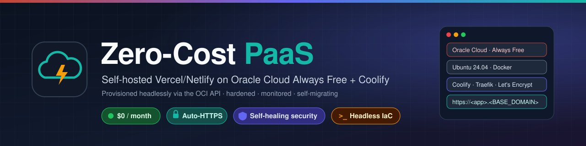
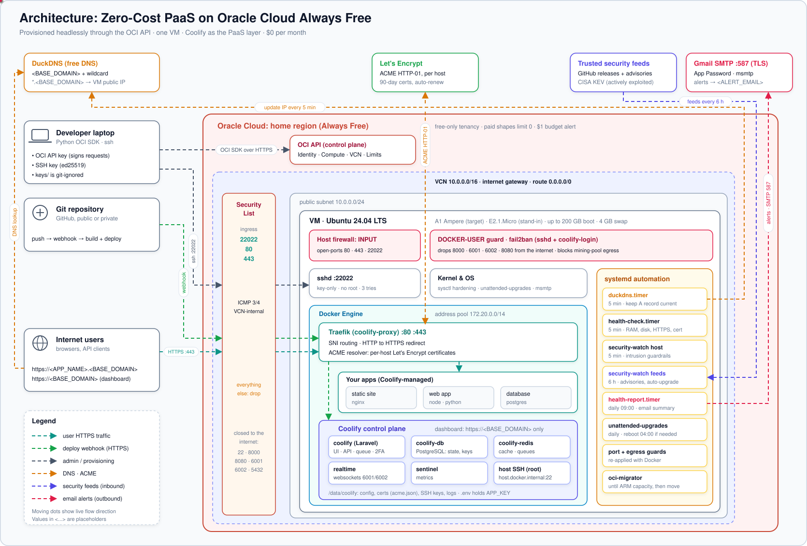
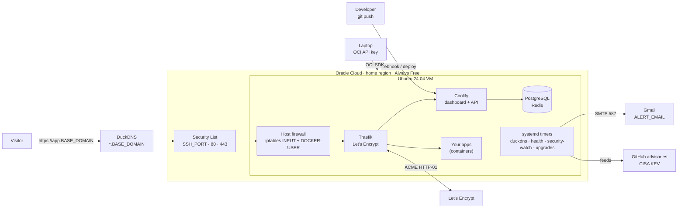
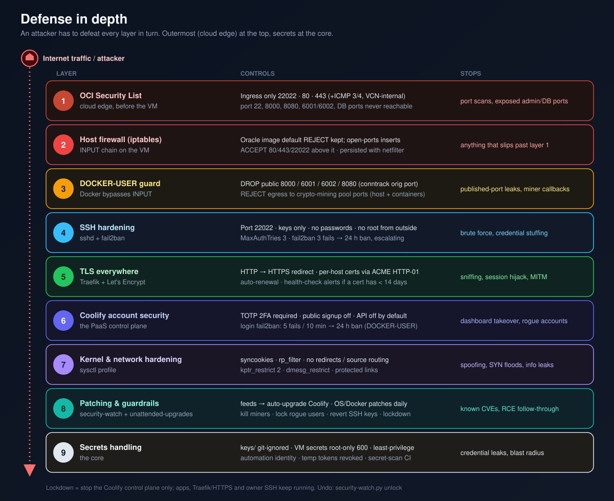
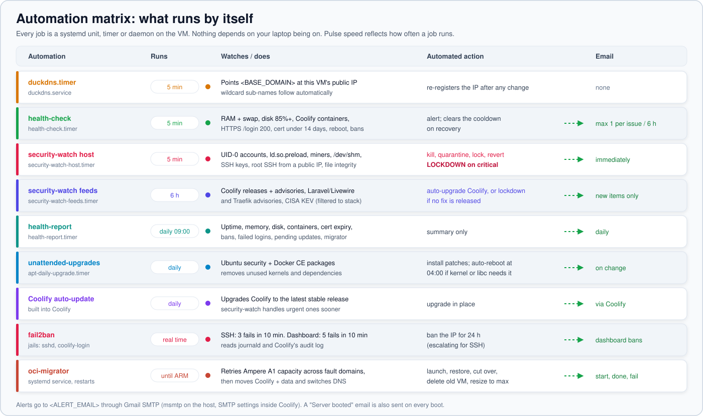
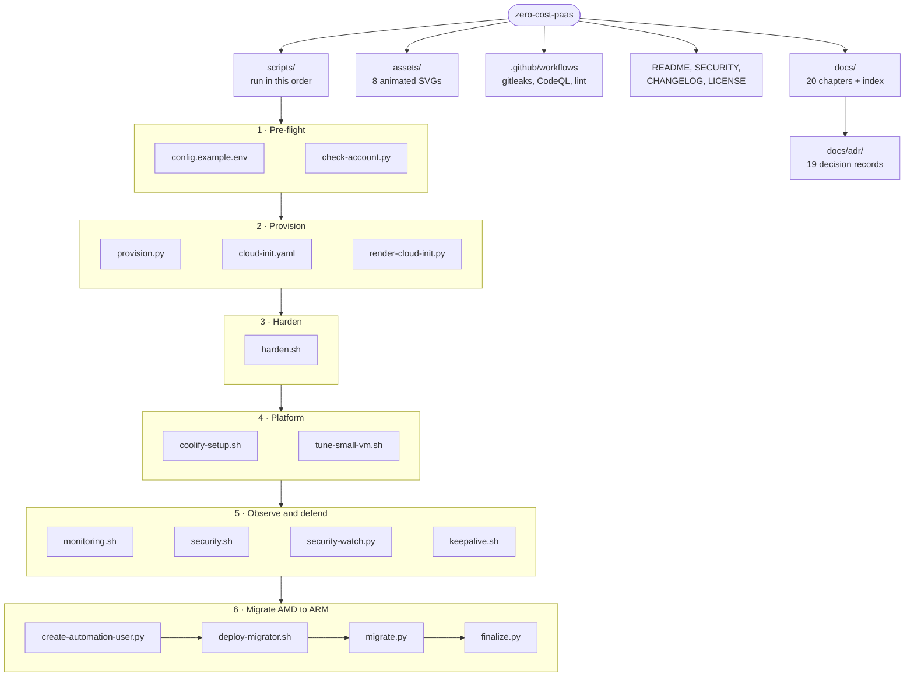

<div align="center">



# Zero-Cost PaaS

**A production-grade, self-hosted Vercel/Netlify alternative on Oracle Cloud's Always Free tier.**
It costs $0 a month and was provisioned entirely through the OCI API, with no console clicks.
It deploys from Git with automatic HTTPS, emails you alerts, patches itself, and contains threats automatically.


</div>

---

## Contents

| | Section | What you'll find |
|---|---|---|
| 1 | [At a glance](#at-a-glance) | Results in one table |
| 2 | [Performance: challenge and fix](#performance-challenge-faced-and-how-it-was-optimized) | Real measurements: why Coolify was slow on the free AMD, what was tuned, what failed |
| 3 | [What it really costs](#what-it-really-costs-hosting-options-compared) | Real-money comparison: Oracle, GCP, AWS, Azure, Hetzner, Contabo, DigitalOcean, Bluehost, home bare metal |
| 4 | [The free building blocks](#the-free-building-blocks) | Every free service used, and a stable address without paying for a static IP |
| 5 | [Architecture](#architecture) | End-to-end diagram and request flow |
| 6 | [What's inside](#whats-inside) | Every capability, grouped |
| 7 | [Quick start](#quick-start) | From an empty Oracle account to deploying apps |
| 8 | [Documentation index](#documentation-index) | 20 chapters, case study to runbook |
| 9 | [Architecture Decision Records](#architecture-decision-records) | Why each choice was made |
| 10 | [Repository layout](#repository-layout) | Scripts and docs map |
| 11 | [Security & privacy](#security--privacy) | How this repo stays secret-free |

---

## At a glance

| Metric | Result |
|---|---|
| Monthly cost | **$0.00**. The tenancy is free-only and cannot be billed: paid shapes are limited to 0, plus a $1 budget alert. |
| Provisioning | **100% API-driven**: OCI Python SDK plus cloud-init. The console was only used to create the API key. |
| Public attack surface | **3 TCP ports**: `<SSH_PORT>`, 80, 443. Verified by an external port scan. |
| Time to HTTPS for a new app | about **2 minutes**, with a per-app Let's Encrypt certificate issued and renewed automatically |
| Patch latency for Coolify security releases | **≤ 6 hours**, applied automatically. The first run upgraded 4.5.0 → 4.5.2 because of an RCE advisory. |
| Host health and intrusion checks | **every 5 minutes**, with email alerts and automated containment |
| Hardware upgrade path | Self-migrating **AMD Micro → Ampere A1**, with a health-gated DNS cutover and no laptop needed |
| Coolify dashboard speed | AMD Micro test box, idle: **0.4 to 0.6 s** median, about 1 s p90 after tuning (was up to 3.6 s). The A1 VM is production. See [docs/20](docs/20-amd-micro-limits.md). |
| Decisions documented | **19 ADRs** |

<p align="center"></p>

---

## Performance: challenge faced and how it was optimized

**The challenge.** Oracle had no free ARM capacity, so the platform went live on the Always Free
**AMD E2.1.Micro**: 1 GB RAM and only **1/8 of a CPU core guaranteed** (it bursts above that on
credit). Coolify asks for 2 GB and 2 cores. The dashboard worked, but every click felt slow,
**with not a single app deployed**.

**Diagnosis, measured on the VM** (not guessed):

| Finding | Evidence |
|---|---|
| The control plane does not fit in RAM | About **700 MB of 1 GB in swap** at all times; the first click after a pause waits for the network disk |
| CPU burst credit runs out | **61 %** of CPU time withheld by the hypervisor (steal) during a 60 s sample |
| Background work eats the guaranteed core | Docker health checks every 4 to 5 s on 5 containers (`dockerd` + `containerd`: 5.7 h CPU in 5 days); Oracle agent plugins: 13.5 h CPU in 5 days |
| Not the network, not the keepalive | Timed from the VM itself; keepalive on versus off was within noise |

**Results** (20 dashboard loads 3 s apart plus 60 s of CPU accounting, two runs each):

| | Before | After tuning | Change |
|---|---|---|---|
| Median page load | 0.59 to 1.01 s | **0.41 to 0.59 s** | about 1.7x faster |
| p90 page load (the slow clicks you notice) | 2.79 to 3.61 s | **0.98 to 1.08 s** | about **3x faster** |
| Worst page load | 3.80 to 4.81 s | 1.98 to 2.21 s | about 2x faster |
| CPU steal | 61 % | **24 to 33 %** | about half |

**What changed** (all reversible, no feature removed, one command: [`scripts/tune-small-vm.sh`](scripts/tune-small-vm.sh)):

1. Coolify, Postgres and Redis health checks every **30 s** instead of 5 s (still 2 s while starting, so upgrades are not slowed).
2. Fewer idle PHP web workers (spare 10 to 2) and queue workers (4 to 2): about 30 MB and 75 MB each.
3. Unused host services off: modem manager, firmware updater, disk manager, multipath, NFS portmapper.
4. Oracle agent **Run Command** plugin off: the biggest agent CPU user, and one less way to run commands as root. Monitoring stays on.

**What was tried and rejected:** zram (compressed swap in RAM) made it **worse**: median 1.7 s,
worst 6.5 s, steal up to 77 %. Compression needs CPU this VM does not have, and it takes RAM from
the disk cache. It was reverted, and the numbers are kept here because a negative result is still a
result.

**Outcome.** The AMD Micro is now a usable **test environment**, and its limits are measured
rather than guessed. The **Ampere A1** VM (2 OCPU / 12 GB, 12x the RAM, no CPU credit) is
**production**. The migrator moves Coolify there automatically and resets this tuning, so
production runs Coolify's defaults ([ADR 0019](docs/adr/0019-amd-micro-is-test-only.md)).
Full method, commands and reasoning: [docs/20](docs/20-amd-micro-limits.md).

---

## What it really costs: hosting options compared

The same production setup (this stack on one always-on box with about 2 to 4 vCPU and **8 GB RAM**),
priced in real money across the major platforms. Prices checked 2026-10-28, excluding VAT;
**(V)** verified on the provider's page, **(A)** from independent aggregators, **(≈)** approximate,
varies by region.

| Platform | Example at this size | Per month | Year 1 | 3 years | Free period | Public IPv4 | Traffic | Hardware ownership |
|---|---|---|---|---|---|---|---|---|
| **Oracle Cloud Always Free** (this repo) | Ampere A1, 2 to 4 OCPU / 12 to 24 GB, 200 GB | **$0** (V) | **$0** | **$0** | No end date | Included | 10 TB | No |
| **Contabo** | Cloud VPS 10: 4 vCPU / 8 GB / 75 GB | ≈ €4.50 to €5.50 (A) | ≈ $60 to $75 | ≈ $190 to $230 | None | Included | Unlimited at 200 Mbit/s | No |
| **Hetzner Cloud** | CX33: 4 vCPU / 8 GB / 80 GB | €8.99 ≈ $10.30 (V) | ≈ $124 | ≈ $372 | None | Included | 20 TB (EU) | No |
| **Home bare metal** | Intel N100 mini PC, 16 GB / 512 GB | ≈ $2 to $3 to run, plus ≈ $230 hardware (≈) | ≈ $230 to $285 | ≈ $280 to $355 | n/a | Not needed with Cloudflare Tunnel | Your home line | **Yes** |
| **DigitalOcean** | Droplet 4 vCPU / 8 GB / 160 GB | $48 (V) | $576 | $1,728 | Trial credit | Included | 5 TB | No |
| **AWS** | m7i-flex.large (2 vCPU / 8 GB) | $0 for 6 months on credits (V), then ≈ $55 to $70 | ≈ $330 to $420 | ≈ $1,650 to $2,100 | 6 months | ≈ $3.65/mo (V) | Billed | No |
| **Google Cloud** | e2-standard-2 (2 vCPU / 8 GB); free e2-micro is only 1 GB | ≈ $50 to $60 (≈) | ≈ $600 to $720 | ≈ $1,800 to $2,160 | No end date for e2-micro only | ≈ $3.65/mo (V) | 1 GB/mo free, then billed | No |
| **Azure** | B2as v2 (2 vCPU / 8 GB); free B2pts/B2ats v2 are 1 GB | ≈ $55 to $70 (≈) | ≈ $660 to $840 | ≈ $1,980 to $2,520 | 12 months (1 GB VM) | Billed | Billed | No |
| **Bluehost managed VPS** | NVMe 8: 4 cores / 8 GB, cPanel | ≈ $69 intro to $99+ renewal (A) | ≈ $830 to $1,190 | ≈ $2,500 to $3,600 | None | Included | Generous | No |

Domain: **$0** with DuckDNS (used here) or about **$10.46/year** for a `.com` at cost (A); an own
domain is required for Cloudflare's proxy, WAF and Tunnel.

| If you want... | Choose |
|---|---|
| Strictly **$0, permanently** | **Oracle Always Free** (this repository) |
| Best **paid value** with good reliability | **Hetzner** (~€9/month) |
| **Lowest paid price**, variable performance is fine | **Contabo** (~€5/month) |
| **Full ownership** of hardware and data | **Home mini PC + Cloudflare Tunnel** |
| **Least effort** | **DigitalOcean** |
| Learn a **hyperscaler** | **AWS / GCP / Azure** on credits, then move |

Full analysis with 3-year chart, IPv4 and DNS comparison, weighted scoring, SWOT per platform,
home bare-metal itemization and sources: **[docs/18 · Hosting options compared](docs/18-hosting-options-compared.md)**.

---

## The free building blocks

Why the Oracle setup costs **$0** end to end: every layer uses a free service. Items marked
**Used** run in this deployment today; **Option** items are free upgrades you can add.

| Layer | Free resource | What you get for $0 | Status |
|---|---|---|---|
| Compute | **Oracle Always Free: Ampere A1** | ARM VM up to 4 OCPU / 24 GB (account limits vary; this tenancy: 2 / 12) | Used (target) |
| Compute | **Oracle Always Free: 2 × E2.1.Micro** | x86 VMs, 1/8 OCPU / 1 GB each | Used (stand-in) |
| Storage | **Oracle block volumes** | 200 GB total across boot and block volumes | Used |
| Network | **Oracle egress** | 10 TB outbound per month | Used |
| Network | **Oracle public IPv4** | Included with the VM; stays the same for the VM's whole life | Used |
| Network | **Oracle VCN, security lists, internet gateway** | Private network and cloud firewall | Used |
| Extras | **Oracle Object Storage, Autonomous DB, Load Balancer** | Offsite backup target, managed databases, a small flexible load balancer | Option |
| DNS | **DuckDNS** | `<name>.duckdns.org` plus **wildcard** `*.<name>.duckdns.org`, API updates | Used |
| TLS | **Let's Encrypt** (via Traefik) | Certificate per app, auto-issued and auto-renewed | Used |
| PaaS | **Coolify** (open source) | Git-push deploys, previews, databases, one-click services | Used |
| OS & tools | **Ubuntu, Docker, Traefik, fail2ban, msmtp** | The whole runtime, open source | Used |
| Email | **Gmail SMTP** with an App Password | Alert and report email on port 587 | Used |
| Code | **GitHub Free** (public repo) | Actions CI, Dependabot alerts and updates, branch rulesets | Used |
| Security | **GitHub secret scanning + push protection, CodeQL, gitleaks** | Secret and code scanning on every push, results in the Security tab | Used |
| Threat intel | **GitHub Security Advisories, CISA KEV** | Vulnerability feeds read by `security-watch.py` | Used |
| Edge | **Cloudflare Free** (needs your own domain) | DNS, proxy, DDoS protection, WAF rules, Universal SSL | Option |
| Edge | **Cloudflare Tunnel** (needs your own domain) | Publish a server with **no public IP and no open ports**; works behind CGNAT | Option (ideal for home servers) |
| Access | **Tailscale** (Personal plan) | Private WireGuard VPN: close the public SSH port entirely, reach the Coolify UI privately | Option, guide: [docs/19](docs/19-private-access-with-tailscale.md) |

### A stable address without paying for a static IP

A static IPv4 normally costs money (≈ $3.65/month on GCP and AWS, extra on many home ISP plans).
This setup gets the same result for $0:

| Situation | Free combination | How it works |
|---|---|---|
| **Oracle VM** (this repo) | Oracle public IP + **DuckDNS** | The IP is included and stable for the VM's life; a 5-minute DuckDNS timer keeps `<BASE_DOMAIN>` pointed at it even after a rebuild or the ARM migration |
| **Home server, public IP from ISP** | Dynamic IP + **DuckDNS** | DuckDNS follows the IP every time your ISP changes it |
| **Home server behind CGNAT or without a public IP** | **Cloudflare Tunnel** + own domain (≈ $10.46/yr) | The server dials out to Cloudflare; visitors reach Cloudflare, never your IP |
| **Any server, best protection** | Own domain + **Cloudflare Free** proxy | Hides the origin IP, adds DDoS protection and a WAF |

Details: [06 · DNS & TLS](docs/06-dns-and-tls.md), [12 · Cost guardrails](docs/12-cost-guardrails.md),
[18 · Hosting options compared](docs/18-hosting-options-compared.md).

---

## Architecture

<p align="center"></p>



Details are in [docs/02-architecture.md](docs/02-architecture.md), which covers components, network topology, trust boundaries and sequence diagrams.

---

## What's inside

<table>
<tr><td width="50%" valign="top">

**Infrastructure as code (headless)**
- OCI Python SDK provisioning of the VCN, gateway, routes, security list and subnet
- cloud-init first boot: updates, Docker, swap, fail2ban, firewall helper
- Retries for "Out of host capacity" across fault domains, with a smaller-shape fallback
- Read-only pre-flight check of account type, limits and usage

**Platform (your own Vercel/Netlify)**
- Coolify v4 installed headlessly: admin seeded, sign-up and API off
- Git push to deploy (GitHub App, public repos, Docker images, Compose)
- Wildcard app domains `https://<APP_NAME>.<BASE_DOMAIN>`
- Automatic Let's Encrypt certificates via Traefik, renewed automatically

**DNS & TLS at $0**
- DuckDNS with wildcard resolution, kept current by a systemd timer
- HTTP → HTTPS redirect and a certificate per host

</td><td width="50%" valign="top">

**Security (defense in depth)**
- Only `<SSH_PORT>`/80/443 public, enforced in three firewall layers
- SSH key-only, no root from outside, fail2ban with escalating bans
- Coolify login: 2FA, brute-force bans in `DOCKER-USER`
- sysctl hardening, unattended upgrades with auto-reboot
- Blocking of outbound connections to mining-pool ports

**Self-defending automation**
- Feeds: Coolify releases and advisories, Laravel/Livewire/Traefik GitHub advisories, CISA KEV
- Auto-upgrade on security fixes, **lockdown** of the control plane when no fix exists
- Intrusion checks: UID-0 accounts, rootkit preload, miners, rogue SSH keys, file integrity

**Observability**
- Gmail SMTP alerts with per-issue cooldowns, a daily health report and a boot notice
- Coolify notifications: deploys, server reachability, disk > 80%, backups

**Self-migration AMD → ARM**
- Waits for Ampere capacity, then moves Coolify with no data loss
- Health-gated DNS cutover, then the old VM deletes itself and the new one grows to the free maximum

</td></tr>
</table>

<p align="center"></p>

---

## Quick start

> Read [docs/03-placeholders.md](docs/03-placeholders.md) first. Every `<PLACEHOLDER>` is explained there.
> For the complete ordered checklist with a verification for every step, follow
> [docs/16-new-machine-setup.md](docs/16-new-machine-setup.md) (Path C).

> [!IMPORTANT]
> **After cloning, on every computer, run once:** `git config core.hooksPath .githooks`
> This enables the local branch protection that blocks deleting or rewriting `main`. Git does not
> carry this setting over when you clone. Details: [docs/16-new-machine-setup.md](docs/16-new-machine-setup.md).

```bash
# 0. Oracle Cloud account (free) -> create an API signing key -> ~/.oci/config   (docs/04)
python -m venv ~/.oci-venv && ~/.oci-venv/bin/pip install oci
cp scripts/config.example.env keys/config.env && $EDITOR keys/config.env && set -a && . keys/config.env && set +a

# 1. What does my tenancy allow? (read-only)
python scripts/check-account.py

# 2. Network (only <SSH_PORT>/80/443 public) + VM. harden.sh is embedded in cloud-init,
#    so the VM is hardened and reachable on <SSH_PORT> from its first boot             (docs/05, docs/08)
python scripts/provision.py network
python scripts/provision.py micro                       # prints <VM_PUBLIC_IP>

# 3. DNS: create <DUCKDNS_SUBDOMAIN> at duckdns.org, then install the updater with your token (docs/06)
VM="ssh -i keys/oci_vm -p $SSH_PORT ubuntu@<VM_PUBLIC_IP>"
scp -i keys/oci_vm -P $SSH_PORT scripts/*.sh scripts/security-watch.py ubuntu@<VM_PUBLIC_IP>:/tmp/
$VM "sudo DUCKDNS_TOKEN=$DUCKDNS_TOKEN DUCKDNS_DOMAIN=$DUCKDNS_DOMAIN bash /tmp/harden.sh"

# 4. Coolify, headless                                                              (docs/07)
$VM "sudo ADMIN_USERNAME=$ADMIN_USERNAME ADMIN_EMAIL=$ALERT_EMAIL ADMIN_PASSWORD='$ADMIN_PASSWORD' VPS_DOMAIN=$VPS_DOMAIN bash /tmp/coolify-setup.sh"

# 5. Alerts + security automation                                                   (docs/09, docs/10)
$VM "cd /tmp && sudo ALERT_EMAIL=$ALERT_EMAIL VPS_DOMAIN=$VPS_DOMAIN GMAIL_APP_PASSWORD=$GMAIL_APP_PASSWORD bash monitoring.sh \
     && sudo ALERT_EMAIL=$ALERT_EMAIL bash security.sh && rm -f /tmp/*.sh /tmp/security-watch.py"

# 6. (optional) self-migration to Ampere A1                                         (docs/11)
python scripts/create-automation-user.py && bash scripts/deploy-migrator.sh
```

Then open `https://<BASE_DOMAIN>`, change the password, **enable 2FA**, pick **"This machine"**, and deploy.

---

## Documentation index

| # | Chapter | Highlights |
|---|---|---|
| 01 | [Case study](docs/01-case-study.md) | Constraints, discoveries, outcome, lessons |
| 02 | [Architecture](docs/02-architecture.md) | C4-style views, network, trust boundaries, sequences |
| 03 | [Placeholders & config](docs/03-placeholders.md) | Every placeholder explained, plus where secrets live |
| 04 | [OCI API setup](docs/04-oci-api-setup.md) | API key, SDK, account type and limits, without the console |
| 05 | [Provisioning](docs/05-provisioning.md) | VCN, security list, cloud-init, capacity retries |
| 06 | [DNS & TLS](docs/06-dns-and-tls.md) | DuckDNS wildcard, Let's Encrypt, why not Cloudflare |
| 07 | [Coolify](docs/07-coolify.md) | Headless install, configuration, deploying apps |
| 08 | [Security hardening](docs/08-security-hardening.md) | Layers, configs, threat model, scan results |
| 09 | [Monitoring & alerts](docs/09-monitoring-and-alerts.md) | Email pipeline, health checks, daily report |
| 10 | [Security automation](docs/10-security-automation.md) | Vulnerability feeds, guardrails, lockdown |
| 11 | [AMD → ARM migration](docs/11-amd-to-arm-migration.md) | Self-migrating pipeline, dry run, bugs caught |
| 12 | [Cost guardrails](docs/12-cost-guardrails.md) | Why it stays $0, limits, idle reclaim |
| 13 | [Operations runbook](docs/13-operations-runbook.md) | Day-2 tasks, secret rotation, incident response |
| 14 | [Troubleshooting](docs/14-troubleshooting.md) | Every real issue hit, with symptom → cause → fix |
| 15 | [Production readiness](docs/15-production-readiness.md) | Scorecard, gaps, roadmap |
| 16 | [New machine & from-scratch setup](docs/16-new-machine-setup.md) | New device, restoring access, full rebuild, handover |
| 17 | [Same stack on Google Cloud or AWS](docs/17-other-clouds-gcp-aws.md) | Free-tier comparison, gcloud / aws CLI setup, cost caveats |
| 18 | [Hosting options compared](docs/18-hosting-options-compared.md) | Clouds vs VPS vs home bare metal: TCO, SWOT, scoring, verdict |
| 19 | [Private access with Tailscale](docs/19-private-access-with-tailscale.md) | Optional: close the public SSH port, private admin access |
| 20 | [AMD Micro limits](docs/20-amd-micro-limits.md) | Why Coolify is slow on 1 GB, benchmark, tuning, test box vs production |

The full index with reading paths is in [docs/README.md](docs/README.md).

---

## Architecture Decision Records

Each significant choice is recorded with its context, the alternatives considered and the consequences: see [docs/adr/](docs/adr/README.md).
Examples: [free-only, no Pay-As-You-Go](docs/adr/0003-stay-free-only-no-payg.md),
[why no Cloudflare with DuckDNS](docs/adr/0008-no-cloudflare-with-duckdns.md),
[defense-in-depth network layers](docs/adr/0011-defense-in-depth-network-layers.md),
[automated lockdown](docs/adr/0014-automated-security-guardrails-and-lockdown.md),
[self-migrating AMD → ARM](docs/adr/0015-self-migrating-amd-to-arm.md).

<p align="center"></p>

---

## Repository layout



| Phase | Script | What it does |
|---|---|---|
| 1 | [`config.example.env`](scripts/config.example.env) | Every variable as a placeholder; copy to `keys/config.env` |
| 1 | [`check-account.py`](scripts/check-account.py) | Read-only pre-flight: auth, account type, Always Free limits |
| 2 | [`provision.py`](scripts/provision.py) | VCN, gateway, routes, security list, subnet and VM through the OCI SDK |
| 2 | [`render-cloud-init.py`](scripts/render-cloud-init.py) | cloud-init with `harden.sh` embedded, for any cloud (GCP, AWS) |
| 2 | [`cloud-init.yaml`](scripts/cloud-init.yaml) | First boot: updates, Docker, swap, fail2ban, firewall helper, hardening |
| 3 | [`harden.sh`](scripts/harden.sh) | SSH, host firewall, DOCKER-USER guard, fail2ban, sysctl, DuckDNS timer |
| 4 | [`coolify-setup.sh`](scripts/coolify-setup.sh) | Headless Coolify install and configuration |
| 4 | [`tune-small-vm.sh`](scripts/tune-small-vm.sh) | Test box only: makes Coolify usable on 1 GB / burstable CPU ([docs/20](docs/20-amd-micro-limits.md)) |
| 5 | [`monitoring.sh`](scripts/monitoring.sh) | Gmail alerts, 5-minute health checks, daily report |
| 5 | [`security.sh`](scripts/security.sh) | Auto-patching, egress guard, security-watch timers |
| 5 | [`security-watch.py`](scripts/security-watch.py) | Vulnerability feeds and intrusion guardrails with lockdown |
| 5 | [`keepalive.sh`](scripts/keepalive.sh), [`keepalive.py`](scripts/keepalive.py) | Idle-reclaim guard using only spare CPU, with an on/off toggle |
| 6 | [`create-automation-user.py`](scripts/create-automation-user.py) | Least-privilege OCI identity for the migrator |
| 6 | [`deploy-migrator.sh`](scripts/deploy-migrator.sh) | Runs the migration as a service on the VM |
| 6 | [`migrate.py`](scripts/migrate.py), [`finalize.py`](scripts/finalize.py) | Health-gated AMD to ARM move, then cleanup and resize on the ARM VM |

---

## Security & privacy

- **No secrets or personal data are in this repository.** Everything deployment-specific is a `<PLACEHOLDER>`, documented in [docs/03-placeholders.md](docs/03-placeholders.md).
- `.gitignore` blocks `keys/`, `*.pem`, `*.env` and similar files, and CI runs **gitleaks** on every push.
- See [SECURITY.md](SECURITY.md) for how to report problems and what to rotate.

<div align="center">

*Built for the cost of a domain name you don't have to buy.* · MIT License

</div>
