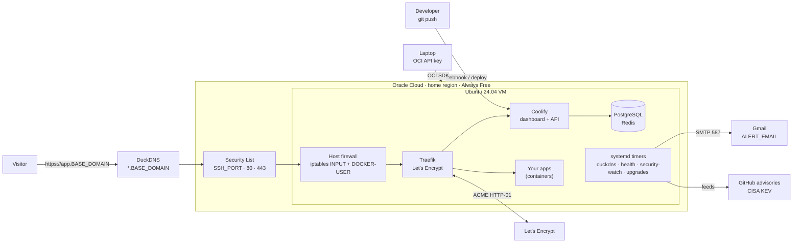
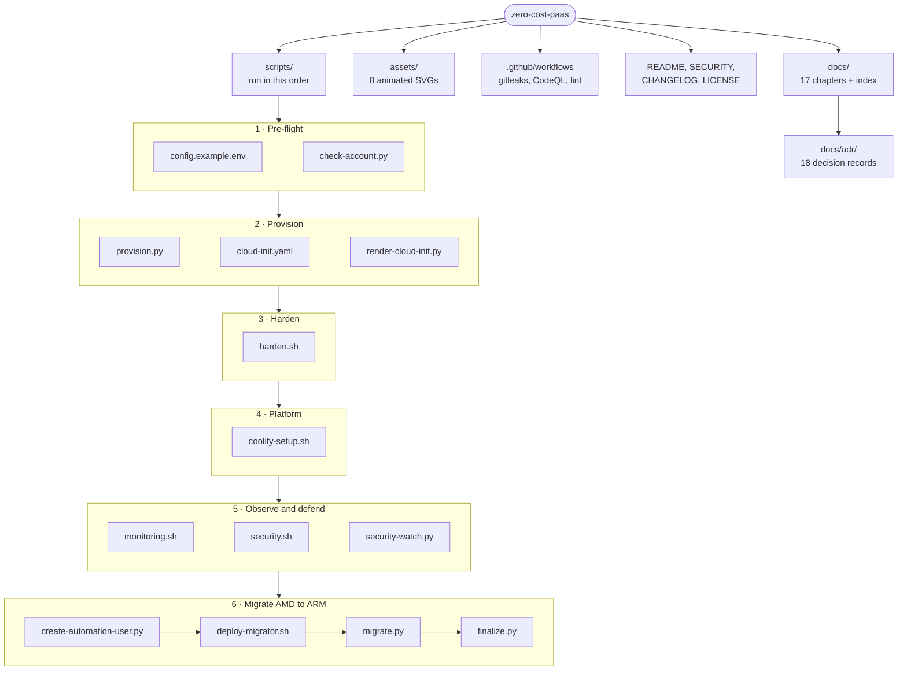

<div align="center">


# Zero-Cost PaaS

**A production-grade, self-hosted Vercel/Netlify alternative on Oracle Cloud's Always Free tier.**
It costs $0 a month and was provisioned entirely through the OCI API, with no console clicks.
It deploys from Git with automatic HTTPS, emails you alerts, patches itself, and contains threats automatically.


</div>

---

## Contents

| | Section | What you'll find |
|---|---|---|
| 1 | [At a glance](#at-a-glance) | Results in one table |
| 2 | [Architecture](#architecture) | End-to-end diagram and request flow |
| 3 | [What's inside](#whats-inside) | Every capability, grouped |
| 4 | [Quick start](#quick-start) | From an empty Oracle account to deploying apps |
| 5 | [Documentation index](#documentation-index) | 17 chapters, case study to runbook |
| 6 | [Architecture Decision Records](#architecture-decision-records) | Why each choice was made |
| 7 | [Repository layout](#repository-layout) | Scripts and docs map |
| 8 | [Security & privacy](#security--privacy) | How this repo stays secret-free |

---

## At a glance

| Metric | Result |
|---|---|
| Monthly cost | **$0.00**. The tenancy is free-only and cannot be billed: paid shapes are limited to 0, plus a $1 budget alert. |
| Provisioning | **100% API-driven**: OCI Python SDK plus cloud-init. The console was only used to create the API key. |
| Public attack surface | **3 TCP ports**: `<SSH_PORT>`, 80, 443. Verified by an external port scan. |
| Time to HTTPS for a new app | about **2 minutes**, with a per-app Let's Encrypt certificate issued and renewed automatically |
| Patch latency for Coolify security releases | **≤ 6 hours**, applied automatically. The first run upgraded 4.5.0 → 4.5.2 because of an RCE advisory. |
| Host health and intrusion checks | **every 5 minutes**, with email alerts and automated containment |
| Hardware upgrade path | Self-migrating **AMD Micro → Ampere A1**, with a health-gated DNS cutover and no laptop needed |
| Decisions documented | **18 ADRs** |

<p align="center"></p>

---

## Architecture

<p align="center"></p>



Details are in [docs/02-architecture.md](docs/02-architecture.md), which covers components, network topology, trust boundaries and sequence diagrams.

---

## What's inside

<table>
<tr><td width="50%" valign="top">

**Infrastructure as code (headless)**
- OCI Python SDK provisioning of the VCN, gateway, routes, security list and subnet
- cloud-init first boot: updates, Docker, swap, fail2ban, firewall helper
- Retries for "Out of host capacity" across fault domains, with a smaller-shape fallback
- Read-only pre-flight check of account type, limits and usage

**Platform (your own Vercel/Netlify)**
- Coolify v4 installed headlessly: admin seeded, sign-up and API off
- Git push to deploy (GitHub App, public repos, Docker images, Compose)
- Wildcard app domains `https://<APP_NAME>.<BASE_DOMAIN>`
- Automatic Let's Encrypt certificates via Traefik, renewed automatically

**DNS & TLS at $0**
- DuckDNS with wildcard resolution, kept current by a systemd timer
- HTTP → HTTPS redirect and a certificate per host

</td><td width="50%" valign="top">

**Security (defense in depth)**
- Only `<SSH_PORT>`/80/443 public, enforced in three firewall layers
- SSH key-only, no root from outside, fail2ban with escalating bans
- Coolify login: 2FA, brute-force bans in `DOCKER-USER`
- sysctl hardening, unattended upgrades with auto-reboot
- Blocking of outbound connections to mining-pool ports

**Self-defending automation**
- Feeds: Coolify releases and advisories, Laravel/Livewire/Traefik GitHub advisories, CISA KEV
- Auto-upgrade on security fixes, **lockdown** of the control plane when no fix exists
- Intrusion checks: UID-0 accounts, rootkit preload, miners, rogue SSH keys, file integrity

**Observability**
- Gmail SMTP alerts with per-issue cooldowns, a daily health report and a boot notice
- Coolify notifications: deploys, server reachability, disk > 80%, backups

**Self-migration AMD → ARM**
- Waits for Ampere capacity, then moves Coolify with no data loss
- Health-gated DNS cutover, then the old VM deletes itself and the new one grows to the free maximum

</td></tr>
</table>

<p align="center"></p>

---

## Quick start

> Read [docs/03-placeholders.md](docs/03-placeholders.md) first. Every `<PLACEHOLDER>` is explained there.
> For the complete ordered checklist with a verification for every step, follow
> [docs/16-new-machine-setup.md](docs/16-new-machine-setup.md) (Path C).

> [!IMPORTANT]
> **After cloning, on every computer, run once:** `git config core.hooksPath .githooks`
> This enables the local branch protection that blocks deleting or rewriting `main`. Git does not
> carry this setting over when you clone. Details: [docs/16-new-machine-setup.md](docs/16-new-machine-setup.md).

```bash
# 0. Oracle Cloud account (free) -> create an API signing key -> ~/.oci/config   (docs/04)
python -m venv ~/.oci-venv && ~/.oci-venv/bin/pip install oci
cp scripts/config.example.env keys/config.env && $EDITOR keys/config.env && set -a && . keys/config.env && set +a

# 1. What does my tenancy allow? (read-only)
python scripts/check-account.py

# 2. Network (only <SSH_PORT>/80/443 public) + VM. harden.sh is embedded in cloud-init,
#    so the VM is hardened and reachable on <SSH_PORT> from its first boot             (docs/05, docs/08)
python scripts/provision.py network
python scripts/provision.py micro                       # prints <VM_PUBLIC_IP>

# 3. DNS: create <DUCKDNS_SUBDOMAIN> at duckdns.org, then install the updater with your token (docs/06)
VM="ssh -i keys/oci_vm -p $SSH_PORT ubuntu@<VM_PUBLIC_IP>"
scp -i keys/oci_vm -P $SSH_PORT scripts/*.sh scripts/security-watch.py ubuntu@<VM_PUBLIC_IP>:/tmp/
$VM "sudo DUCKDNS_TOKEN=$DUCKDNS_TOKEN DUCKDNS_DOMAIN=$DUCKDNS_DOMAIN bash /tmp/harden.sh"

# 4. Coolify, headless                                                              (docs/07)
$VM "sudo ADMIN_USERNAME=$ADMIN_USERNAME ADMIN_EMAIL=$ALERT_EMAIL ADMIN_PASSWORD='$ADMIN_PASSWORD' VPS_DOMAIN=$VPS_DOMAIN bash /tmp/coolify-setup.sh"

# 5. Alerts + security automation                                                   (docs/09, docs/10)
$VM "cd /tmp && sudo ALERT_EMAIL=$ALERT_EMAIL VPS_DOMAIN=$VPS_DOMAIN GMAIL_APP_PASSWORD=$GMAIL_APP_PASSWORD bash monitoring.sh \
     && sudo ALERT_EMAIL=$ALERT_EMAIL bash security.sh && rm -f /tmp/*.sh /tmp/security-watch.py"

# 6. (optional) self-migration to Ampere A1                                         (docs/11)
python scripts/create-automation-user.py && bash scripts/deploy-migrator.sh
```

Then open `https://<BASE_DOMAIN>`, change the password, **enable 2FA**, pick **"This machine"**, and deploy.

---

## Documentation index

| # | Chapter | Highlights |
|---|---|---|
| 01 | [Case study](docs/01-case-study.md) | Constraints, discoveries, outcome, lessons |
| 02 | [Architecture](docs/02-architecture.md) | C4-style views, network, trust boundaries, sequences |
| 03 | [Placeholders & config](docs/03-placeholders.md) | Every placeholder explained, plus where secrets live |
| 04 | [OCI API setup](docs/04-oci-api-setup.md) | API key, SDK, account type and limits, without the console |
| 05 | [Provisioning](docs/05-provisioning.md) | VCN, security list, cloud-init, capacity retries |
| 06 | [DNS & TLS](docs/06-dns-and-tls.md) | DuckDNS wildcard, Let's Encrypt, why not Cloudflare |
| 07 | [Coolify](docs/07-coolify.md) | Headless install, configuration, deploying apps |
| 08 | [Security hardening](docs/08-security-hardening.md) | Layers, configs, threat model, scan results |
| 09 | [Monitoring & alerts](docs/09-monitoring-and-alerts.md) | Email pipeline, health checks, daily report |
| 10 | [Security automation](docs/10-security-automation.md) | Vulnerability feeds, guardrails, lockdown |
| 11 | [AMD → ARM migration](docs/11-amd-to-arm-migration.md) | Self-migrating pipeline, dry run, bugs caught |
| 12 | [Cost guardrails](docs/12-cost-guardrails.md) | Why it stays $0, limits, idle reclaim |
| 13 | [Operations runbook](docs/13-operations-runbook.md) | Day-2 tasks, secret rotation, incident response |
| 14 | [Troubleshooting](docs/14-troubleshooting.md) | Every real issue hit, with symptom → cause → fix |
| 15 | [Production readiness](docs/15-production-readiness.md) | Scorecard, gaps, roadmap |
| 16 | [New machine & from-scratch setup](docs/16-new-machine-setup.md) | New device, restoring access, full rebuild, handover |
| 17 | [Same stack on Google Cloud or AWS](docs/17-other-clouds-gcp-aws.md) | Free-tier comparison, gcloud / aws CLI setup, cost caveats |

The full index with reading paths is in [docs/README.md](docs/README.md).

---

## Architecture Decision Records

Each significant choice is recorded with its context, the alternatives considered and the consequences: see [docs/adr/](docs/adr/README.md).
Examples: [free-only, no Pay-As-You-Go](docs/adr/0003-stay-free-only-no-payg.md),
[why no Cloudflare with DuckDNS](docs/adr/0008-no-cloudflare-with-duckdns.md),
[defense-in-depth network layers](docs/adr/0011-defense-in-depth-network-layers.md),
[automated lockdown](docs/adr/0014-automated-security-guardrails-and-lockdown.md),
[self-migrating AMD → ARM](docs/adr/0015-self-migrating-amd-to-arm.md).

<p align="center"></p>

---

## Repository layout



| Phase | Script | What it does |
|---|---|---|
| 1 | [`config.example.env`](scripts/config.example.env) | Every variable as a placeholder; copy to `keys/config.env` |
| 1 | [`check-account.py`](scripts/check-account.py) | Read-only pre-flight: auth, account type, Always Free limits |
| 2 | [`provision.py`](scripts/provision.py) | VCN, gateway, routes, security list, subnet and VM through the OCI SDK |
| 2 | [`render-cloud-init.py`](scripts/render-cloud-init.py) | cloud-init with `harden.sh` embedded, for any cloud (GCP, AWS) |
| 2 | [`cloud-init.yaml`](scripts/cloud-init.yaml) | First boot: updates, Docker, swap, fail2ban, firewall helper, hardening |
| 3 | [`harden.sh`](scripts/harden.sh) | SSH, host firewall, DOCKER-USER guard, fail2ban, sysctl, DuckDNS timer |
| 4 | [`coolify-setup.sh`](scripts/coolify-setup.sh) | Headless Coolify install and configuration |
| 5 | [`monitoring.sh`](scripts/monitoring.sh) | Gmail alerts, 5-minute health checks, daily report |
| 5 | [`security.sh`](scripts/security.sh) | Auto-patching, egress guard, security-watch timers |
| 5 | [`security-watch.py`](scripts/security-watch.py) | Vulnerability feeds and intrusion guardrails with lockdown |
| 6 | [`create-automation-user.py`](scripts/create-automation-user.py) | Least-privilege OCI identity for the migrator |
| 6 | [`deploy-migrator.sh`](scripts/deploy-migrator.sh) | Runs the migration as a service on the VM |
| 6 | [`migrate.py`](scripts/migrate.py), [`finalize.py`](scripts/finalize.py) | Health-gated AMD to ARM move, then cleanup and resize on the ARM VM |

---

## Security & privacy

- **No secrets or personal data are in this repository.** Everything deployment-specific is a `<PLACEHOLDER>`, documented in [docs/03-placeholders.md](docs/03-placeholders.md).
- `.gitignore` blocks `keys/`, `*.pem`, `*.env` and similar files, and CI runs **gitleaks** on every push.
- See [SECURITY.md](SECURITY.md) for how to report problems and what to rotate.

<div align="center">

*Built for the cost of a domain name you don't have to buy.* · MIT License

</div>
