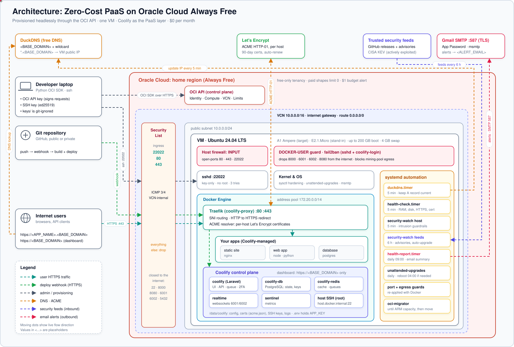

# 01 · Case Study: A Production-Grade PaaS for $0

[← Index](README.md) · [Next: Architecture →](02-architecture.md)

> **TL;DR**: Goal: a permanent, free cloud host to deploy and test real projects with
> Vercel/Netlify-style git deploys and automatic HTTPS. Result: Coolify on Oracle Cloud *Always
> Free*, provisioned entirely through the OCI API, exposing only three ports, with email alerting,
> automated vulnerability response, and a self-migration path to bigger free hardware.
> **Monthly cost: $0.00**, and the account is structurally unable to incur charges.

---

## 1. The problem

Hosted PaaS products (Vercel, Netlify, Render, Railway) are excellent but their free tiers sleep,
cap build minutes, restrict backends/databases, or need a card that can be charged. The brief was:

* a **live Linux + Docker environment** for testing and validating real projects,
* **git-push deploys with HTTPS** on per-app subdomains, like Vercel/Netlify,
* **production-grade security** (it is on the public internet),
* and **never spending a single cent**: no charge may ever happen without explicit confirmation.

## 2. Hard constraints

| # | Constraint | Consequence for the design |
|---|---|---|
| C1 | **$0, forever** | Only Oracle *Always Free* resources; free DNS; free certificates; free SMTP |
| C2 | **No charge possible without confirmation** | Stay on a **free-only** account (no Pay-As-You-Go), see [ADR 0003](adr/0003-stay-free-only-no-payg.md) |
| C3 | **No console GUI**: only an API signing key | Everything scripted via the OCI Python SDK ([ADR 0002](adr/0002-headless-api-only-provisioning.md)) |
| C4 | **Public internet exposure** | Defense in depth, minimal ports, 2FA, automated containment |
| C5 | **Operator may be offline** (laptop off) | Long-running automation must run *on the VM*, not the workstation |

## 3. Discoveries that changed the plan

| Expectation | Reality (measured via API) | Decision |
|---|---|---|
| Always Free A1 = **4 OCPU / 24 GB** | This free-only tenancy's A1 limit was **2 OCPU / 12 GB** (`standard-a1-core-count = 2`) | Target 2/12, design for in-place resize if limits rise |
| A1 VMs launch on request | Every launch in the home region returned **`Out of host capacity`** (and `429` when retried fast) | Temporary **AMD E2.1.Micro** stand-in + automatic migration ([ADR 0004](adr/0004-ampere-a1-target-amd-micro-standin.md)) |
| Upgrade to PAYG to get capacity priority | PAYG has **no hard spending cap**: budgets only alert *after* spend | Rejected; free-only guarantees $0 |
| `oci-cli` is the standard tool | It pins an old PyYAML that **fails to build on Python 3.14** | Use the **OCI Python SDK** in a venv |
| Cloudflare in front for WAF/DDoS | Not possible with a **DuckDNS** subdomain (no NS control) | Harden the origin; Cloudflare is a roadmap item with an own domain ([ADR 0008](adr/0008-no-cloudflare-with-duckdns.md)) |
| Coolify defaults are fine | Default Docker pool `10.0.0.0/8` **overlaps the VCN** `10.0.0.0/16` | Pool `172.20.0.0/14` ([ADR 0009](adr/0009-docker-address-pool-172-20.md)) |

## 4. The solution at a glance

* **Compute:** Oracle Always Free VM, Ubuntu 24.04 LTS, Docker Engine + Compose.
* **PaaS:** Coolify (self-hosted Vercel/Netlify/Heroku alternative) with Traefik as the edge proxy.
* **DNS:** DuckDNS free subdomain; every `*.<BASE_DOMAIN>` resolves to the VM → zero-config app domains.
* **TLS:** Let's Encrypt via Traefik HTTP-01, one certificate per host, renewed automatically.
* **Security:** 3 public ports, key-only SSH on a non-standard port, fail2ban for SSH *and* the
  dashboard, Docker-aware firewall rules, kernel hardening, 2FA, auto-patching.
* **Observability:** Gmail SMTP alerts (Coolify events + host health + daily report).
* **Automated defense:** vulnerability feeds → auto-upgrade or lockdown; intrusion indicators →
  kill/quarantine/lock + control-plane lockdown.
* **Self-migration:** a service that waits for A1 capacity, moves Coolify, switches DNS only after
  health checks, deletes the old VM and grows the new one to the free-tier maximum.

## 5. Outcome & metrics

| Metric | Result | How it was verified |
|---|---|---|
| Recurring cost | **$0.00** | Free-only subscription; paid shape limits are `0`; $1 budget alert |
| Public attack surface | **3 TCP ports**: `<SSH_PORT>`, 80, 443 | External TCP scan: 22, 8000, 8080, 6001, 6002, 5432 **closed** |
| Time from deploy to valid HTTPS for a new app | **~2 minutes** | Test app on `https://<APP_NAME>.<BASE_DOMAIN>` → Let's Encrypt cert issued, HTTP 200 |
| Dashboard TLS | Let's Encrypt, 90-day cert, auto-renew | `openssl s_client` issuer/expiry check |
| Coolify → host management | Root via internal SSH only | `instant_remote_process(['whoami'])` → `root` |
| Brute-force protection | SSH: 3 tries → 24 h ban; dashboard: 5 fails/10 min → 24 h ban | fail2ban jails active, filter regex test matched |
| Patch latency for a Coolify security fix | **Same day, unattended** | First feed run detected an authenticated-RCE advisory affecting 4.5.0 → auto-upgraded to **4.5.2** |
| Migration dry run (AMD → test VM) | All stages green | launch ≈1 min · first boot ≈10 min · backup+transfer ≈15 s · install+restore ≈4-5 min · health gate ≈2 min |
| Bugs caught by the dry run before production | **4** | See [11 · Migration](11-amd-to-arm-migration.md#8-dry-run-methodology) |
| Email delivery | Gmail SMTP `250 OK` | `/var/log/msmtp.log` |

## 6. Timeline

```mermaid
gantt
    title Build timeline (single working session)
    dateFormat HH:mm
    axisFormat %H:%M
    section Foundation
    API key, SDK, account & limits audit      :a1, 15:15, 25m
    Network + first A1 attempts (no capacity) :a2, after a1, 15m
    AMD stand-in VM + Docker via cloud-init   :a3, after a2, 15m
    section Platform
    DuckDNS + Coolify headless install        :b1, 16:15, 25m
    Domain, wildcard, HTTPS verified          :b2, after b1, 10m
    section Security
    SSH/firewall/fail2ban/sysctl hardening    :c1, 16:50, 15m
    External port scan + E2E app deploy test  :c2, after c1, 10m
    section Resilience
    Migrator + 3 dry runs (4 bugs fixed)      :d1, 17:15, 75m
    section Operations
    Gmail alerts + health checks              :e1, 19:15, 20m
    Security watch + guardrails + auto-patch  :e2, after e1, 25m
```

## 7. Lessons learned

1. **Measure the account, don't trust the marketing page.** The API showed a 2/12 A1 limit and
   `FREE_TRIAL` payment model, both changed the design before anything was built.
2. **Default network ranges collide.** Coolify's Docker pool and the OCI VCN both defaulted to `10.x`.
3. **Docker bypasses your host firewall.** Published ports are DNAT'd and never hit `INPUT`; guard
   them in `DOCKER-USER` and at the cloud security list.
4. **Dry-run destructive automation on throwaway infrastructure.** The migration dry run on a second
   free VM caught four bugs that would each have broken the real cut-over.
5. **Long remote operations must not depend on an SSH session.** On a 1/8-OCPU VM, image pulls froze
   the session; running the step as a detached `systemd-run` unit made it robust.
6. **Automate the response, not just the alert.** The very first security-feed run found a
   critical Coolify advisory and patched it unattended.
7. **Be explicit about residual risk.** No Cloudflare, single node, no offsite backups yet, all
   documented in [15 · Production readiness](15-production-readiness.md).

[Next: Architecture →](02-architecture.md)
