# 02 · Architecture

[← Case study](01-case-study.md) · [Index](README.md) · [Next: Placeholders →](03-placeholders.md)

> **TL;DR**: One Always Free VM in a dedicated VCN. Traefik (inside Coolify) is the only HTTP(S)
> entry point; it terminates TLS with Let's Encrypt certificates and routes `*.<BASE_DOMAIN>` to app
> containers. Coolify (Laravel/PHP) is the control plane and manages the host as root over an
> **internal** SSH connection. Systemd timers on the host handle DNS updates, health checks,
> security feeds and intrusion checks; Gmail SMTP carries every alert.

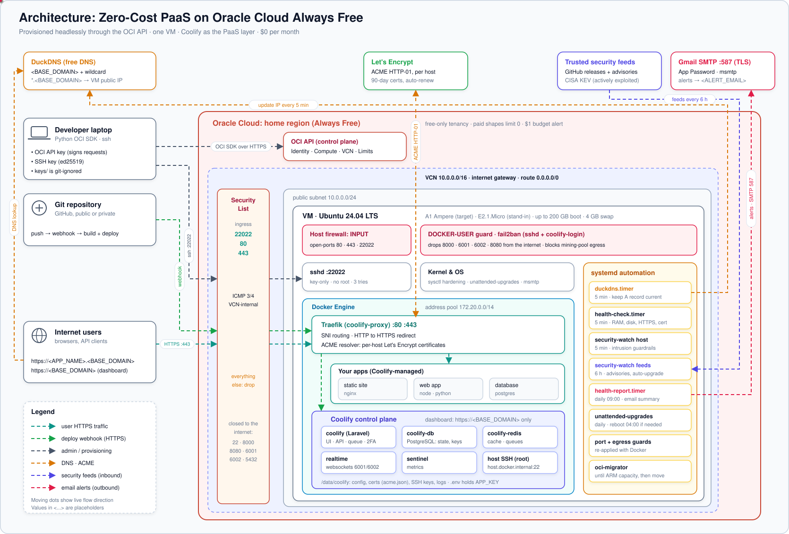

## 1. System context

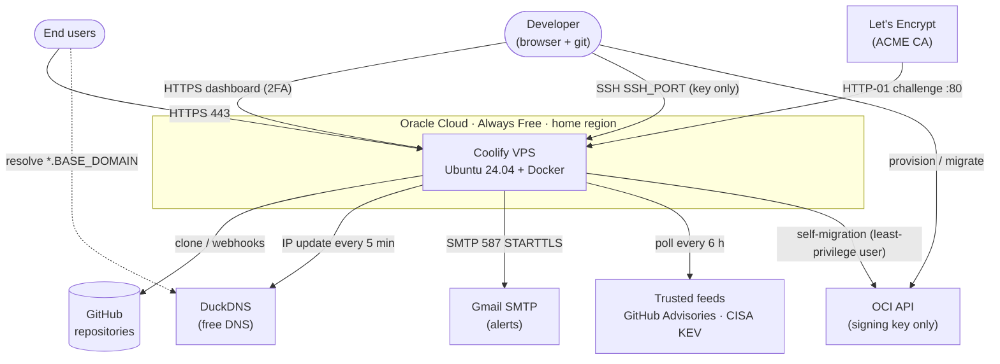

## 2. Components on the VM

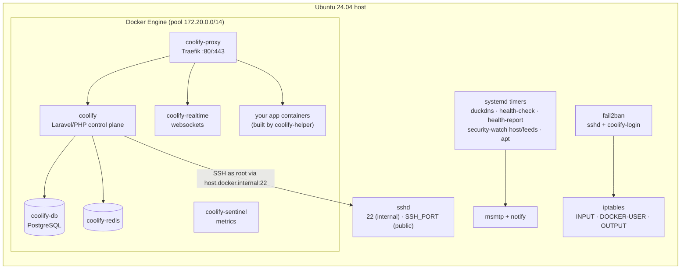

| Component | Role | Notes |
|---|---|---|
| **Traefik** (`coolify-proxy`) | Edge reverse proxy, TLS termination, ACME client | Only container reachable from the internet (80/443) |
| **Coolify** | Control plane: builds, deploys, domains, notifications | PHP/Laravel; dashboard served via Traefik at `https://<BASE_DOMAIN>` |
| **coolify-db / redis** | Coolify state & queues | Never exposed; Postgres dumped during migration |
| **coolify-helper** | Ephemeral build containers | Has the Docker socket → why Coolify RCEs are host-root RCEs |
| **sshd** | Operator access (public `<SSH_PORT>`) + Coolify host management (internal 22) | Root allowed only from local/docker/VCN ranges |
| **fail2ban** | Bans brute force on SSH and the dashboard | Dashboard bans go into `DOCKER-USER` |
| **systemd timers** | DuckDNS, health checks, daily report, security watch, unattended upgrades | All idempotent oneshots |
| **msmtp + notify** | Email delivery via Gmail with per-issue cooldown | Credentials root-only (`/etc/msmtprc`, 0600) |

## 3. Network topology

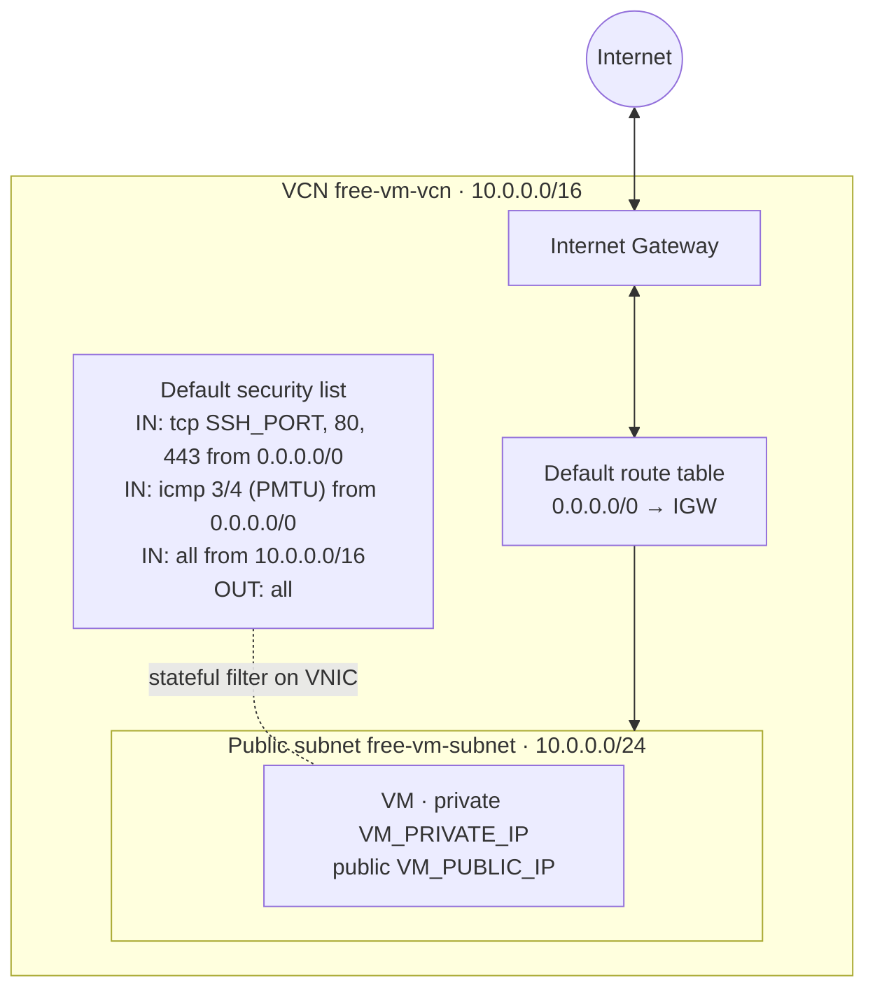

| Layer | Inbound allowed | Purpose |
|---|---|---|
| OCI security list | `<SSH_PORT>`, 80, 443 (+ ICMP type 3 code 4, + all from VCN) | Cloud perimeter |
| Host `INPUT` (iptables) | 22, `<SSH_PORT>`, 80, 443, then `REJECT` | Oracle image ships a default REJECT |
| `DOCKER-USER` | DROP original ports 8000, 6001, 6002, 8080 from the public NIC; fail2ban dashboard bans | Docker-published ports bypass `INPUT` |
| `OUTPUT` / `DOCKER-USER` | REJECT common mining-pool ports | Egress guard |

### Ports

| Port | Listener | Public? | Why |
|---|---|---|---|
| `<SSH_PORT>` | sshd | Yes | Operator SSH, key only |
| 22 | sshd | No (VCN/Docker only) | Coolify → host management; migration inside the VCN |
| 80 | Traefik | Yes | ACME HTTP-01 + redirect to HTTPS |
| 443 | Traefik | Yes | Dashboard + all apps |
| 8000 → 8080 | Coolify UI (direct) | No | Served through Traefik instead |
| 6001 / 6002 | realtime / terminal | No | Proxied by Traefik at `/app` and `/terminal/ws` |
| 8080 | Traefik dashboard | No | Never public |
| 5432 / 6379 | Postgres / Redis | No | Not published at all |

## 4. Trust boundaries

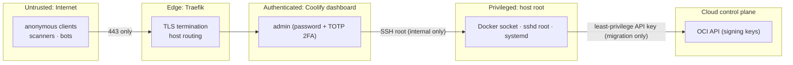

Crossing **T2 → T3** is the critical boundary: Coolify legitimately holds root on the host. That is
why the design adds 2FA, dashboard brute-force bans, same-day patching of Coolify advisories, and
a **lockdown** that stops the control plane if compromise indicators appear
([10 · Security automation](10-security-automation.md)).

## 5. Data flows

### 5.1 Request flow

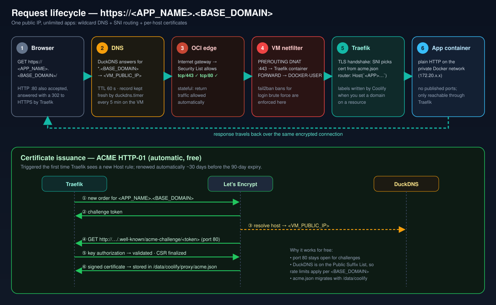

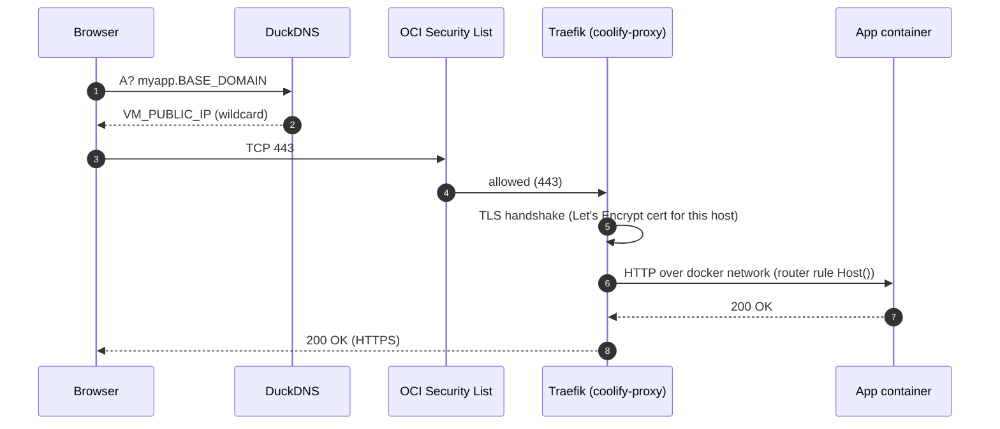

### 5.2 Deploy flow

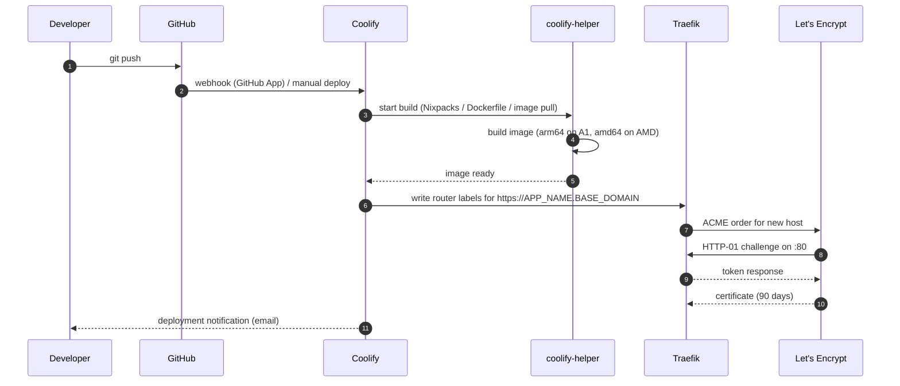

### 5.3 ACME HTTP-01

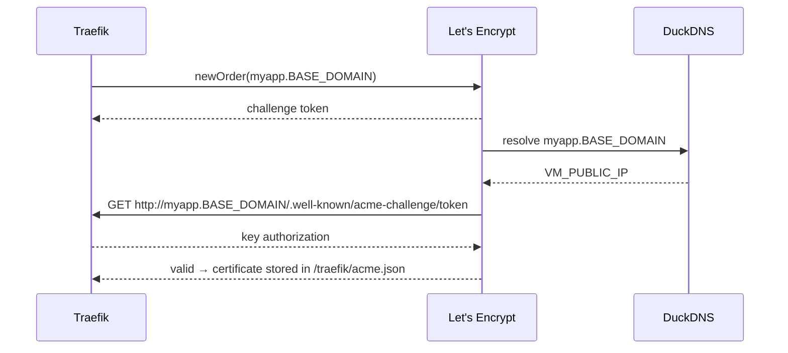

### 5.4 Alerting flow

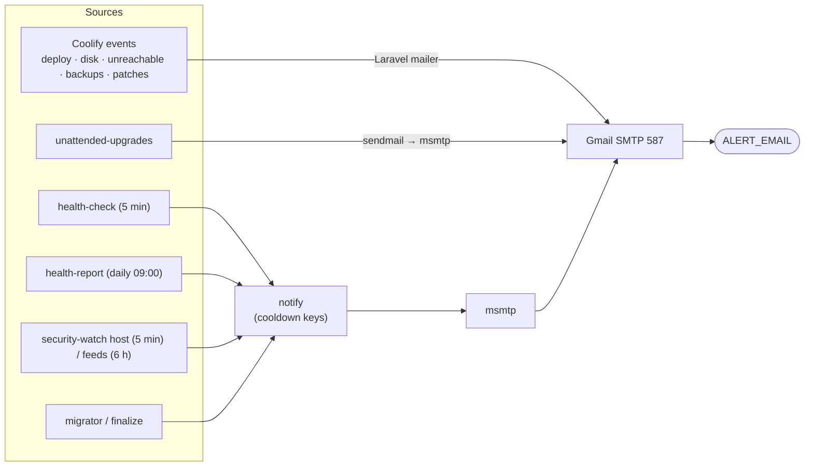

## 6. State & persistence

| Data | Location | Backed up / migrated | Notes |
|---|---|---|---|
| Coolify config & secrets (`APP_KEY`, DB/Redis passwords) | `/data/coolify/source/.env` | Yes, migrated; **back up offline** | Losing `APP_KEY` makes encrypted DB fields unreadable |
| Coolify database | Docker volume `coolify-db` | Yes, `pg_dump -Fc` → `pg_restore` | Projects, servers, env vars, notification settings |
| Coolify SSH keys | `/data/coolify/ssh/keys` | Yes, restored after reinstall | Used for root SSH to the host |
| TLS certificates | `/data/coolify/proxy/acme.json` | Yes | Avoids re-issuance after migration |
| App/service compose files | `/data/coolify/applications`, `/services`, `/databases` | Yes | |
| App data | Named Docker volumes | Yes, tarred per volume | Anonymous (hash-named) volumes skipped |
| Coolify logs (audit) | `/data/coolify/logs` (host mount) | - | Feeds fail2ban `coolify-login` |
| Host security state | `/var/lib/security-watch/state.json` | - | Baselines, seen advisories, lockdown flag |

## 7. Lifecycle of the platform

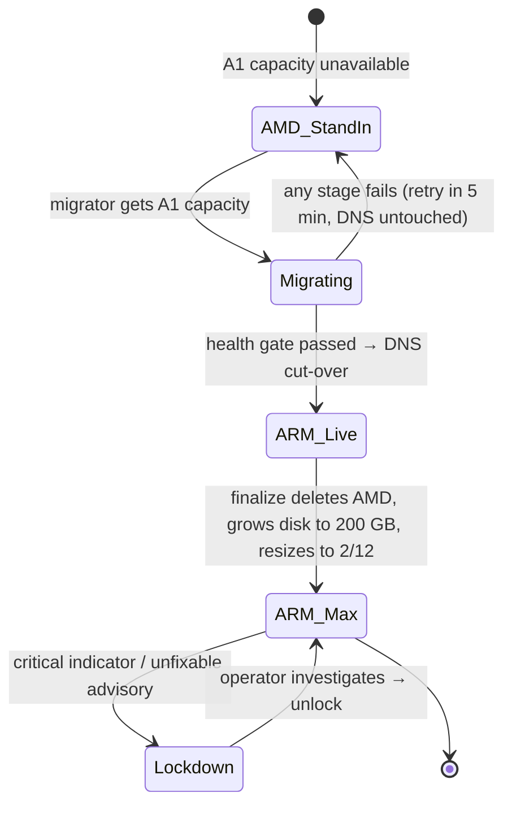

[Next: Placeholders →](03-placeholders.md)
