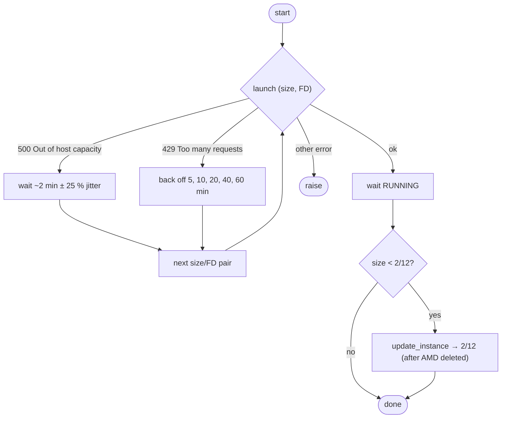

# 05 · Provisioning: Network, VM, First Boot

[← OCI API setup](04-oci-api-setup.md) · [Index](README.md) · [Next: DNS & TLS →](06-dns-and-tls.md)

> **TL;DR**: [`provision.py`](../scripts/provision.py) creates a VCN, internet gateway, route,
> security list and public subnet, then launches Ubuntu 24.04 with a cloud-init that installs Docker,
> swap, fail2ban and a firewall helper. Every call is idempotent (resources are found by display
> name). A1 launches retry across fault domains and fall back to a smaller shape that is grown later.

```bash
$ python scripts/provision.py network   # VCN, IGW, route table, security list, subnet
$ python scripts/provision.py micro     # AMD E2.1.Micro stand-in (50 GB boot)
# The A1 (ARM) VM is launched by migrate.py: see chapter 11.
```

## 1. Network


| Resource | Name | Setting |
|---|---|---|
| VCN | `free-vm-vcn` | `10.0.0.0/16`, DNS label `freevcn` |
| Internet gateway | `free-vm-igw` | enabled |
| Route table | VCN default | `0.0.0.0/0 → free-vm-igw` |
| Subnet | `free-vm-subnet` | `10.0.0.0/24`, public IPs allowed, DNS label `public` |
| Security list | VCN default | see below, **replaced wholesale** on every run |

### Security list (exact rules)

| Direction | Protocol | Source / Dest | Ports | Why |
|---|---|---|---|---|
| Ingress | TCP | `0.0.0.0/0` | `<SSH_PORT>` | Operator SSH |
| Ingress | TCP | `0.0.0.0/0` | 80 | ACME HTTP-01, redirect to HTTPS |
| Ingress | TCP | `0.0.0.0/0` | 443 | Dashboard + apps |
| Ingress | ICMP | `0.0.0.0/0` | type 3 code 4 | Path-MTU discovery ("fragmentation needed") |
| Ingress | all | `10.0.0.0/16` | all | VM ↔ VM inside the VCN (migration uses port 22 here) |
| Egress | all | `0.0.0.0/0` | all | Updates, image pulls, DuckDNS, SMTP, feeds |

Port 22 is **not** in the list: it was used only during bootstrap, then closed after verifying login
on `<SSH_PORT>` (see [08 · Hardening](08-security-hardening.md)). The list is generated from
`OPEN_PORTS` in `provision.py`, so opening a port is a one-line change plus
`python scripts/provision.py network`.

## 2. Image selection

```python
imgs = comp.list_images(T, operating_system="Canonical Ubuntu", operating_system_version="24.04",
                        shape=shape, sort_by="TIMECREATED", sort_order="DESC").data
img = next((i for i in imgs if "Minimal" not in i.display_name), imgs[0])
```

Filtering **by shape** returns the right architecture automatically: `…-aarch64-…` for
`VM.Standard.A1.Flex`, x86-64 for `VM.Standard.E2.1.Micro`. The non-Minimal image is used because
it includes the tooling cloud-init and the hardening scripts rely on.

## 3. Launch details

```python
oci.core.models.LaunchInstanceDetails(
    compartment_id=T, availability_domain=AD, fault_domain=fd, display_name=name, shape=shape,
    shape_config=LaunchInstanceShapeConfigDetails(ocpus=2, memory_in_gbs=12),   # A1 only
    source_details=InstanceSourceViaImageDetails(image_id=img.id, boot_volume_size_in_gbs=boot_gb),
    create_vnic_details=CreateVnicDetails(subnet_id=sub.id, assign_public_ip=True, hostname_label=name),
    metadata={"ssh_authorized_keys": "<your ed25519 public key>",
              "user_data": base64.b64encode(cloud_init_bytes).decode()},
    freeform_tags={"purpose": "always-free"})
```

| Field | AMD stand-in | ARM target |
|---|---|---|
| Shape | `VM.Standard.E2.1.Micro` (1/8 OCPU burstable, 1 GB) | `VM.Standard.A1.Flex` |
| Shape config | fixed | 2 OCPU / 12 GB (fallback 1/6) |
| Boot volume | 50 GB | 200 − (other volumes) → 150 GB while the AMD exists, grown to 200 GB later |
| SSH key | ed25519 generated locally (`keys/oci_vm`) | same + migrator key |

The 200 GB free storage is **shared**: boot volumes count. That is why the ARM starts at 150 GB and
is grown once the AMD (50 GB) is deleted ([11 · Migration](11-amd-to-arm-migration.md)).

## 4. Capacity retry

Ampere A1 capacity in popular home regions is often exhausted. The launcher treats two errors as
transient and rotates through every **(size, fault domain)** pair:

```python
def is_capacity_error(e):
    return e.status == 429 or (e.status == 500 and "capacity" in (e.message or "").lower())

tries = [(s, fd) for s in [(2, 12), (1, 6)] for fd in FAULT_DOMAINS]
```



A smaller request (1 OCPU / 6 GB) fits into fragmented hosts more often; `update_instance` resizes
it in place later (one reboot).

## 5. Cloud-init, line by line

[`cloud-init.yaml`](../scripts/cloud-init.yaml):

| Section | What it does | Why |
|---|---|---|
| `package_update/upgrade` | Full upgrade on first boot | Start from a patched base |
| `packages` | `curl git htop jq unzip fail2ban unattended-upgrades netfilter-persistent iptables-persistent python3-venv` | Tooling, brute-force protection, persistent firewall, venv for the finalizer |
| `write_files: /etc/docker/daemon.json` | json-file logs, 10 MB × 3 | Prevent logs filling the disk |
| `write_files: /usr/local/sbin/open-ports` | Inserts ACCEPT rules **above** the image's REJECT rule | See gotcha below |
| `runcmd: open-ports 80 443` | Opens web ports on the host | |
| `runcmd: fallocate 4G swap` | 4 GB swapfile + fstab entry | Survive builds on small VMs |
| `runcmd: Docker CE repo + install` | Docker Engine, buildx, compose plugin (official repo, `$(dpkg --print-architecture)`) | Works on amd64 and arm64 |
| `runcmd: usermod -aG docker ubuntu` | Docker without sudo for the operator | |
| `runcmd: timedatectl set-timezone` | Local timezone for logs/reports | |
| `runcmd: harden` (if injected) | Runs [`harden.sh`](../scripts/harden.sh) | ARM VM is hardened before any service starts |
| `runcmd: touch /var/log/setup-done` | Completion marker | Polled by the migrator |

### Gotcha: Oracle's iptables REJECT position

Oracle's Ubuntu images ship `/etc/iptables/rules.v4` that ends `INPUT` with
`REJECT --reject-with icmp-host-prohibited`. On this image the REJECT was **rule 5**, not 6 -
inserting at a fixed position put ports 80/443 *after* the REJECT. The helper finds the line number:

```sh
n=$(iptables -L INPUT --line-numbers -n | awk '/REJECT/ {print $1; exit}')
iptables -I INPUT "${n:-1}" -p tcp -m state --state NEW --dport "$p" -j ACCEPT
netfilter-persistent save
```

```text
vm$ sudo iptables -L INPUT -n --line-numbers
1 ACCEPT all  state RELATED,ESTABLISHED
2 ACCEPT icmp
3 ACCEPT all  (lo)
4 ACCEPT tcp  dpt:22
5 ACCEPT tcp  dpt:80
6 ACCEPT tcp  dpt:443
7 ACCEPT tcp  dpt:<SSH_PORT>
8 REJECT all  reject-with icmp-host-prohibited
```

> Docker-published ports never traverse `INPUT` (they are DNAT'd to containers), which is why a test
> nginx container answered even while 80 was "blocked". Host services do need these rules.

## 6. Verify the VM

```bash
$ ssh -i keys/oci_vm ubuntu@<VM_PUBLIC_IP> 'lsb_release -ds; uname -m; free -h; docker --version; docker compose version; swapon --show'
```

Expected: Ubuntu 24.04 LTS, `x86_64` or `aarch64`, Docker + Compose, 4 GB swap.

[Next: DNS & TLS →](06-dns-and-tls.md)
