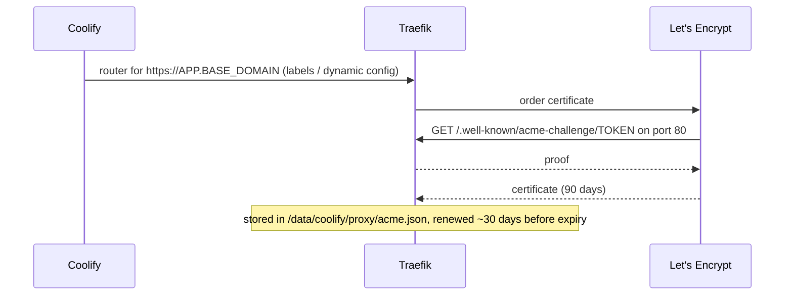

# 06 · DNS & TLS — Free Domain, Free Certificates

[← Provisioning](05-provisioning.md) · [Index](README.md) · [Next: Coolify →](07-coolify.md)

> **TL;DR** — DuckDNS gives a free `<DUCKDNS_SUBDOMAIN>.duckdns.org` and **every sub-name
> `*.<BASE_DOMAIN>` resolves to the same IP**, so each app gets a domain with zero DNS work. A
> systemd timer keeps the record pointed at the VM. Traefik obtains a Let's Encrypt certificate per
> hostname via HTTP-01 and renews it automatically. Cloudflare can't front a DuckDNS name; that is a
> documented upgrade path.

## 1. DuckDNS

1. Sign in at duckdns.org (GitHub/Google), create `<DUCKDNS_SUBDOMAIN>`, copy `<DUCKDNS_TOKEN>`.
2. Point it at the VM (the API is a single HTTPS GET):

```bash
$ curl "https://www.duckdns.org/update?domains=<DUCKDNS_SUBDOMAIN>&token=<DUCKDNS_TOKEN>&ip=<VM_PUBLIC_IP>"
OK
```

3. Verify both the apex and an arbitrary sub-name:

```bash
$ dig +short <BASE_DOMAIN> @1.1.1.1
<VM_PUBLIC_IP>
$ dig +short anything.<BASE_DOMAIN> @8.8.8.8
<VM_PUBLIC_IP>
```

The second result is the key feature: **wildcard resolution is built in**. Coolify can hand out
`https://<random>.<BASE_DOMAIN>` or `https://<APP_NAME>.<BASE_DOMAIN>` and it just works.

### Keeping it updated (on the VM)

[`harden.sh`](../scripts/harden.sh) installs `/etc/duckdns/env` (root, 0600) and:

```ini
# /etc/systemd/system/duckdns.service
[Service]
Type=oneshot
EnvironmentFile=/etc/duckdns/env
ExecStart=/bin/sh -c 'curl -fsS --max-time 20 "https://www.duckdns.org/update?domains=$DUCKDNS_DOMAIN&token=$DUCKDNS_TOKEN&ip=" | grep -q OK'

# /etc/systemd/system/duckdns.timer
[Timer]
OnBootSec=1min
OnUnitActiveSec=5min
```

`ip=` (empty) makes DuckDNS use the request's source address — the VM's public IP via the IGW.
During migration the **old VM's timer is disabled** and the new VM's enabled, so the record cannot
flip back ([11 · Migration](11-amd-to-arm-migration.md)).

> **The DuckDNS token is a secret**: anyone holding it can repoint your domain to their server and
> obtain valid certificates for it. It lives only in `keys/` and `/etc/duckdns/env`.

## 2. TLS with Let's Encrypt (Traefik HTTP-01)

Coolify runs Traefik (`coolify-proxy`) with an ACME resolver using the **HTTP-01** challenge:



| Property | Value |
|---|---|
| Challenge | HTTP-01 on port 80 (why port 80 stays open) |
| Scope | One certificate **per hostname** (no wildcard cert — that would need DNS-01) |
| Validity | 90 days, auto-renewed by Traefik |
| Storage | `/data/coolify/proxy/acme.json` (migrated with the platform) |
| Time to first cert | ~2 minutes after deploy in testing |
| Rate limits | `duckdns.org` is on the Public Suffix List, so `<BASE_DOMAIN>` is its own registered domain for LE limits (50 certs/week) |

Verification:

```bash
$ echo | openssl s_client -connect <BASE_DOMAIN>:443 -servername <BASE_DOMAIN> 2>/dev/null | openssl x509 -noout -issuer -subject -dates
issuer=C=US, O=Let's Encrypt, CN=…
subject=CN=<BASE_DOMAIN>
$ curl -sI http://<BASE_DOMAIN>/ | head -2
HTTP/1.1 302 Found
Location: https://<BASE_DOMAIN>/
```

While a certificate is being issued, clients briefly see Traefik's default self-signed certificate;
this is expected for the first ~1–2 minutes of a new hostname.

The health checker emails if the dashboard certificate is < 14 days from expiry (renewal failed) —
see [09 · Monitoring](09-monitoring-and-alerts.md).

## 3. Why not Cloudflare?

Cloudflare's proxy (WAF, DDoS absorption, caching, hiding the origin IP) requires the **zone's
nameservers** to be Cloudflare's. DuckDNS owns `duckdns.org`; you only get a record inside it, so a
DuckDNS name **cannot** be onboarded. Cloudflare Tunnel has the same requirement (except temporary
random `trycloudflare.com` hostnames).

| Option | Cost | Cloudflare? | Notes |
|---|---|---|---|
| DuckDNS (current) | $0 | ❌ | Instant, wildcard, API updates |
| `eu.org` free domain | $0 | ✅ | Manual approval, can take weeks |
| `is-a.dev` / similar | $0 | ⚠️ | Via GitHub PR, policy restrictions |
| Own domain | ~$1–10/yr | ✅ | Breaks the strict $0 constraint |

Upgrade path when a Cloudflare-capable domain exists: move DNS to Cloudflare, set records to
**proxied**, switch Traefik to DNS-01 (wildcard cert) or Cloudflare origin certs, and restrict
ports 80/443 in the security list to Cloudflare's IP ranges ([ADR 0008](adr/0008-no-cloudflare-with-duckdns.md)).

[Next: Coolify →](07-coolify.md)
