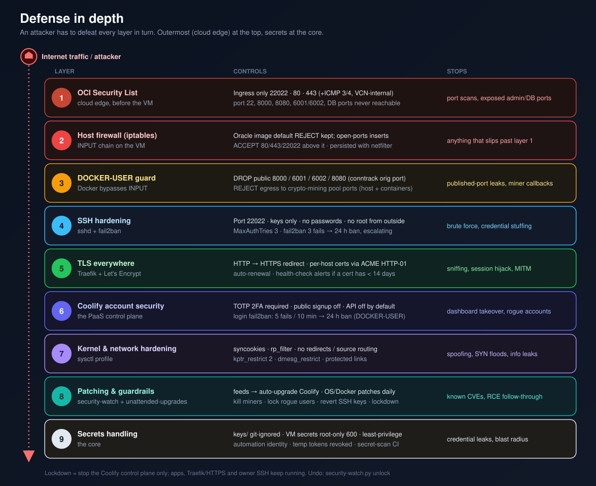
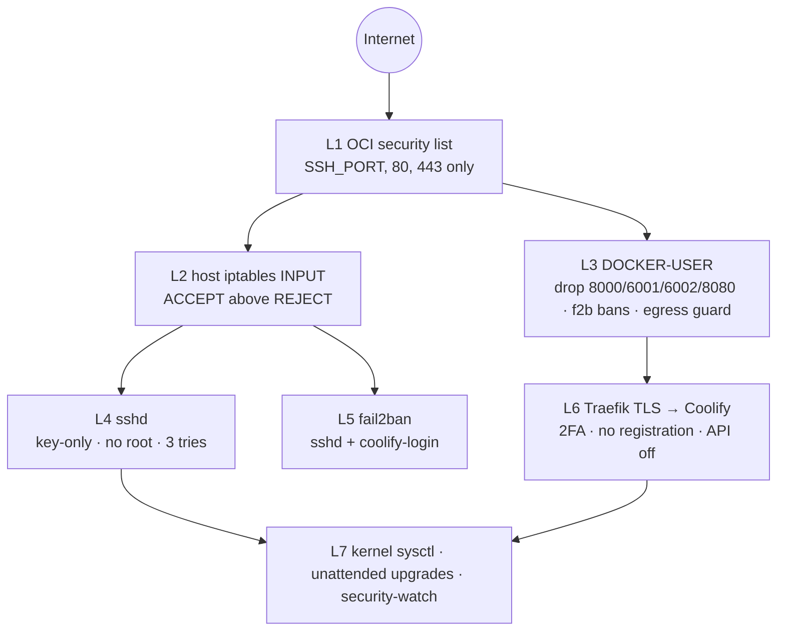

# 08 · Security Hardening — Defense in Depth

[← Coolify](07-coolify.md) · [Index](README.md) · [Next: Monitoring & alerts →](09-monitoring-and-alerts.md)

> **TL;DR** — Seven independent layers: cloud security list → host iptables → Docker-aware
> `DOCKER-USER` rules → SSH lockdown → fail2ban (SSH **and** dashboard) → kernel/sysctl hardening
> → application controls (2FA, registration off, API off). Only `<SSH_PORT>`, 80 and 443 answer
> from the internet — verified with an external port scan. All of it is in the idempotent
> [`harden.sh`](../scripts/harden.sh), which also runs on first boot of the ARM VM.





## L1 — Cloud perimeter (OCI security list)

Ingress only `<SSH_PORT>`, 80, 443 from the internet (+ ICMP 3/4 and intra-VCN). Stateful, enforced
**outside** the VM, so it holds even if the host firewall were flushed. See
[05 · Provisioning](05-provisioning.md#security-list-exact-rules).

## L2 — Host firewall (iptables INPUT)

The Oracle image's default policy rejects everything not explicitly accepted. `open-ports` inserts
ACCEPT rules above the REJECT and persists them with `netfilter-persistent`:

```bash
vm$ sudo open-ports 80 443 <SSH_PORT>
```

## L3 — Docker-aware filtering (DOCKER-USER)

Published container ports are DNAT'd in `PREROUTING` and go through `FORWARD`, **never `INPUT`**.
Coolify publishes 8000 (UI), 6001/6002 (realtime/terminal) and Traefik 8080 on `0.0.0.0`. Even
though L1 blocks them, a second, host-local guard drops them by **original** destination port:

```sh
# /usr/local/sbin/docker-port-guard  (systemd: After/PartOf docker.service)
IF=$(ip route show default | awk '{print $5; exit}')
for p in 8000 6001 6002 8080; do
  iptables -C DOCKER-USER -i "$IF" -p tcp -m conntrack --ctorigdstport "$p" -j DROP 2>/dev/null ||
    iptables -I DOCKER-USER -i "$IF" -p tcp -m conntrack --ctorigdstport "$p" -j DROP
done
```

`--ctorigdstport` matters: after DNAT the packet's destination port is the *container* port
(8000 → 8080), so matching on `--dport` would be wrong.

The same chain hosts the fail2ban dashboard bans and the **egress guard** (REJECT to common
crypto-mining pool ports `3333,5555,14433,14444,45560,45700`, also in `OUTPUT`).

## L4 — SSH

`/etc/ssh/sshd_config.d/00-hardening.conf` (first match wins, so `00-` beats cloud-init's `50-`):

```text
Port 22                      # internal: Coolify + VCN only (not in the security list)
Port <SSH_PORT>              # public
PermitRootLogin no
PasswordAuthentication no
KbdInteractiveAuthentication no
PermitEmptyPasswords no
PubkeyAuthentication yes
AuthenticationMethods publickey
MaxAuthTries 3
MaxSessions 10
LoginGraceTime 20
X11Forwarding no
AllowAgentForwarding no
ClientAliveInterval 300
ClientAliveCountMax 2
AllowUsers ubuntu root
```

`Match` blocks must be at the **end of the main** `sshd_config` (a Match inside an included file
would swallow following directives), so `harden.sh` appends a marked block there:

```text
# coolify-root-begin
Match Address 127.0.0.1,::1,172.16.0.0/12,10.0.0.0/16
    PermitRootLogin prohibit-password
# coolify-root-end
```

Verification with `sshd -T` (effective config per connection):

```bash
vm$ sudo sshd -T -C addr=1.2.3.4,user=root,host=x   | grep -i permitrootlogin   # no
vm$ sudo sshd -T -C addr=172.20.1.5,user=root,host=x | grep -i permitrootlogin  # without-password
```

Ubuntu 24.04 uses **socket activation**: after changing `Port`, run `systemctl daemon-reload` and
restart `ssh.socket`. `sshd -t` fails on a fresh boot unless `/run/sshd` exists — `harden.sh` creates
it first (this bug was caught by the migration dry run).

Cut-over procedure for the port change (no lockout risk):

1. add `<SSH_PORT>` in sshd and host firewall (22 still open),
2. open `<SSH_PORT>` in the security list, **test a login**,
3. remove 22 from the security list, re-scan.

## L5 — fail2ban

```ini
# /etc/fail2ban/jail.d/sshd.local
[DEFAULT]
backend = systemd
bantime = 24h
bantime.increment = true          # repeat offenders get longer bans
findtime = 10m
maxretry = 3
ignoreip = 127.0.0.1/8 ::1 10.0.0.0/16 172.16.0.0/12
[sshd]
enabled = true
port = 22,<SSH_PORT>
```

Dashboard brute force — Coolify's audit log line contains the real client IP (Traefik forwards it):

```ini
# /etc/fail2ban/filter.d/coolify-login.conf
[Definition]
failregex = "event":"auth\.user\.login_failed","ip":"<HOST>"
datepattern = ^\[%%Y-%%m-%%d %%H:%%M:%%S\]

# /etc/fail2ban/jail.d/coolify-login.local
[coolify-login]
enabled = true
filter = coolify-login
backend = polling
logpath = /data/coolify/logs/audit-*.log
logtimezone = UTC                 # Laravel logs in UTC
maxretry = 5
findtime = 10m
bantime = 24h
action = iptables-multiport[name=coolify-login, port="http,https", chain="DOCKER-USER"]
```

The ban goes into **`DOCKER-USER`** because HTTPS traffic is forwarded to the Traefik container.
Audit logs rotate daily at 00:00 UTC, so a cron entry reloads the jail to pick up the new file.

```bash
vm$ sudo fail2ban-regex /tmp/sample.log /etc/fail2ban/filter.d/coolify-login.conf   # 1 matched
vm$ sudo fail2ban-client status coolify-login
```

## L6 — Application controls

| Control | State |
|---|---|
| Dashboard only via HTTPS on `<BASE_DOMAIN>` | ✅ (8000 closed) |
| Admin pre-created, **registration disabled** | ✅ |
| **TOTP 2FA** required on every login | ✅ |
| Coolify API | disabled (enabled only temporarily by automation, tokens revoked) |
| Coolify login throttling (Fortify) + fail2ban | ✅ |
| `ROOT_*` credentials removed from `.env` | ✅ |

## L7 — Kernel, OS, patches

```ini
# /etc/sysctl.d/99-hardening.conf
net.ipv4.tcp_syncookies = 1
net.ipv4.conf.all.rp_filter = 1
net.ipv4.conf.default.rp_filter = 1
net.ipv4.conf.all.accept_redirects = 0
net.ipv4.conf.default.accept_redirects = 0
net.ipv4.conf.all.send_redirects = 0
net.ipv4.conf.all.accept_source_route = 0
net.ipv6.conf.all.accept_redirects = 0
net.ipv4.icmp_echo_ignore_broadcasts = 1
net.ipv4.conf.all.log_martians = 1
kernel.kptr_restrict = 2
kernel.dmesg_restrict = 1
fs.protected_hardlinks = 1
fs.protected_symlinks = 1
```

Unattended upgrades: Ubuntu security + **Docker CE** origins daily, unused kernels removed, email
report on change, **automatic reboot at 04:00** when required ([ADR 0018](adr/0018-unattended-upgrades-and-auto-reboot.md)).

## Verification — external port scan

From a workstation on the internet:

```bash
for p in 22 <SSH_PORT> 80 443 8000 8080 6001 6002 5432; do
  timeout 6 bash -c "</dev/tcp/<VM_PUBLIC_IP>/$p" 2>/dev/null && echo "$p OPEN" || echo "$p closed"; done
```

| Port | Result |
|---|---|
| 22 | closed |
| `<SSH_PORT>` | **OPEN** |
| 80 | **OPEN** |
| 443 | **OPEN** |
| 8000 · 8080 · 6001 · 6002 · 5432 | closed |

## Threat model

| # | Threat (STRIDE) | Vector | Mitigations | Residual risk |
|---|---|---|---|---|
| T1 | Spoofing — SSH credential guessing | Internet → SSH | Key-only, non-standard port, 3 tries, fail2ban 24 h escalating | Stolen private key (keep `keys/` safe) |
| T2 | Spoofing — dashboard password guessing | Internet → 443 | 2FA, Fortify throttle, fail2ban 5/10 min → 24 h | Phished TOTP (low) |
| T3 | Elevation — Coolify RCE (helper has Docker socket = host root) | Authenticated or unauthenticated app bug | Same-day auto-upgrade on advisories, lockdown if unfixed, single admin, 2FA | 0-day before advisory publication |
| T4 | Elevation — exposed internal ports | 8000/6001/6002/8080 | L1 + DOCKER-USER drop | None known |
| T5 | Tampering — DNS hijack | Leaked DuckDNS token | Token root-only, never in git; certificate expiry alerts | DuckDNS account compromise |
| T6 | Tampering — persistence (cron, systemd, keys, ld.so.preload) | Post-exploitation | security-watch integrity checks, key revert, account lock, lockdown | Kernel-level rootkit |
| T7 | Denial of service | L7 floods | Single node; Traefik; OCI network | **No CDN/WAF** (DuckDNS) — roadmap |
| T8 | Resource abuse — crypto-mining | Compromised app/container | Miner kill + quarantine, egress guard, memory/CPU alerts | Novel miners on non-standard ports |
| T9 | Information disclosure — secrets in repo | Git push | `.gitignore`, placeholders, secret scan in CI | Human error |
| T10 | Repudiation | Unknown actions | Coolify audit log, journald, email trail | Logs are local only (roadmap: shipping) |
| T11 | Cloud account takeover → billing | OCI API key leak | Free-only account (no billing possible), least-privilege automation key | Resource deletion |

[Next: Monitoring & alerts →](09-monitoring-and-alerts.md)
