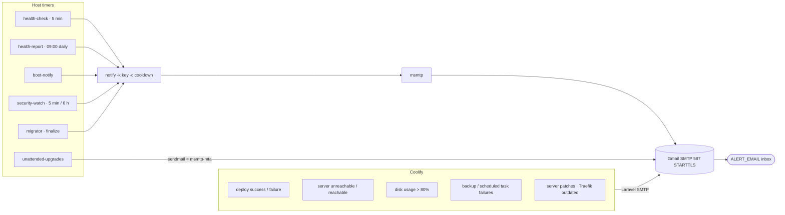

# 09 · Monitoring & Alerts (Email)

[← Security hardening](08-security-hardening.md) · [Index](README.md) · [Next: Security automation →](10-security-automation.md)

> **TL;DR**: All alerts go to `<ALERT_EMAIL>` through Gmail SMTP with an **App Password**
> (free, reliable, no extra service). Two producers: **Coolify** (deploys, server reachability, disk,
> backups, patches) and the **host** (`health-check` every 5 min, `health-report` daily, boot notice,
> unattended-upgrades reports, security-watch, migrator). A `notify` helper adds per-issue cooldowns
> so a persistent problem emails at most once every 6 hours.



## 1. Gmail App Password

1. Enable **2-Step Verification** on the Google account.
2. https://myaccount.google.com/apppasswords → name it e.g. `Coolify VPS` → copy the 16 characters
   → this is `<GMAIL_APP_PASSWORD>`. Revoking it there disables every sender at once.

OCI blocks outbound port 25 but **587 (submission, STARTTLS)** works.

## 2. Coolify email settings (team level)

Configured headlessly via tinker (equivalent to *Notifications → Email*):

```php
\App\Models\Team::find(0)->emailNotificationSettings->update([
  'smtp_enabled' => true, 'smtp_host' => 'smtp.gmail.com', 'smtp_port' => 587,
  'smtp_encryption' => 'starttls', 'smtp_username' => '<ALERT_EMAIL>',
  'smtp_password' => '<GMAIL_APP_PASSWORD>', 'smtp_from_address' => '<ALERT_EMAIL>',
  'smtp_from_name' => 'Coolify VPS', 'smtp_recipients' => '<ALERT_EMAIL>',
  'deployment_success_email_notifications' => true, 'deployment_failure_email_notifications' => true,
  'status_change_email_notifications' => true, 'restart_limit_reached_email_notifications' => true,
  'backup_failure_email_notifications' => true, 'scheduled_task_failure_email_notifications' => true,
  'docker_cleanup_failure_email_notifications' => true, 'server_disk_usage_email_notifications' => true,
  'server_reachable_email_notifications' => true, 'server_unreachable_email_notifications' => true,
  'server_patch_email_notifications' => true, 'traefik_outdated_email_notifications' => true,
]);
$ss = \App\Models\Server::find(0)->settings; $ss->server_disk_usage_notification_threshold = 80; $ss->save();
\App\Models\Team::find(0)->notify(new \App\Notifications\Test(null, 'email'));   // test mail
```

The same SMTP values are set on `InstanceSettings` so transactional mail (password reset) works.
Success notifications for backups/tasks/cleanup are off to keep the inbox meaningful.

## 3. Host mailer: msmtp + `notify`

[`monitoring.sh`](../scripts/monitoring.sh) writes `/etc/msmtprc` (root, 0600):

```ini
defaults
auth on
tls on
tls_trust_file /etc/ssl/certs/ca-certificates.crt
logfile /var/log/msmtp.log
account gmail
host smtp.gmail.com
port 587
from <ALERT_EMAIL>
user <ALERT_EMAIL>
password <GMAIL_APP_PASSWORD>
account default : gmail
```

`/usr/local/sbin/notify`:

```bash
echo "body" | notify [-k <key> -c <cooldown_seconds>] "subject"
```

* `-k` names the issue; a stamp file in `/var/lib/health-alerts/<key>` suppresses repeats within the
  cooldown. When the condition clears, `health-check` deletes the stamp so the next occurrence alerts
  immediately.
* Subject is prefixed with `[hostname]`; the footer carries hostname, dashboard URL and timestamp.
* Delivery is confirmed in `/var/log/msmtp.log` (`smtpstatus=250`).

## 4. `health-check` (every 5 minutes)

| Check | Threshold | Alert subject |
|---|---|---|
| Memory | RAM available < 10 % **and** swap used > 75 % | `LOW MEMORY` + `free -h` + top RSS processes |
| Disk `/` | ≥ 85 % (Coolify alerts at 80 %) | `DISK nn% FULL` + `docker system df` |
| Coolify containers | any `coolify*` not `Up`/unhealthy | `COOLIFY CONTAINER DOWN` |
| Dashboard | `https://<BASE_DOMAIN>/login` ≠ 200 (resolved to 127.0.0.1) | `DASHBOARD DOWN (HTTP nnn)` |
| Certificate | expires in < 14 days | `TLS CERTIFICATE EXPIRES IN n DAYS` |
| Reboot | `/var/run/reboot-required` | `REBOOT REQUIRED` (auto-reboot at 04:00 handles it) |
| Dashboard brute force | IPs in `coolify-login` jail | `DASHBOARD LOGIN BRUTE-FORCE BLOCKED` |

Each check uses its own cooldown key (6 h) and clears it on recovery.

## 5. Daily report (09:00 local)

`health-report` emails: uptime/load, `free -h`, disk, `docker system df`, container table, TLS
subject/expiry, SSH bans (current/total), dashboard bans, failed dashboard logins (24 h), failed SSH
attempts (24 h), pending upgrades, reboot status, and migrator status/last log lines.

## 6. Timers

```bash
vm$ systemctl list-timers --no-pager | grep -E 'health|security|duckdns|apt-daily'
```

| Timer | Schedule |
|---|---|
| `health-check.timer` | boot + 3 min, then every 5 min |
| `health-report.timer` | `*-*-* 09:00:00` local, persistent |
| `security-watch-host.timer` | every 5 min |
| `security-watch-feeds.timer` | every 6 h (± 10 min), persistent |
| `duckdns.timer` | every 5 min |
| `apt-daily-upgrade.timer` | daily (unattended-upgrades) |
| `boot-notify.service` | once per boot (+60 s) |

## 7. Sample emails

```text
Subject: [free-arm] DISK 87% FULL
/dev/sda1  194G  168G  26G  87% /
Docker usage: Images 41.2GB (reclaimable 30.1GB) …
Free space with: sudo docker system prune -af  (or Coolify > Server > Docker cleanup)
--
free-arm | https://<BASE_DOMAIN> | 2026-01-01 10:05:00 UTC
```

```text
Subject: [free-arm] [SECURITY] Coolify auto-upgraded to 4.5.2
Reason: high advisory GHSA-xxxx-xxxx-xxxx: Authenticated RCE … → host root
Running version now: 4.5.2
```

```text
Subject: [free-arm] Daily health report
== System  10:00:01 up 12 days, load average: 0.21, 0.30, 0.28
== Disk    /dev/sda1 194G 23G 171G 12% /
== Security (last 24h)
SSH bans now: 2   total since restart: 37
Dashboard login bans now: 0
Failed dashboard logins: 0
…
```

[Next: Security automation →](10-security-automation.md)
