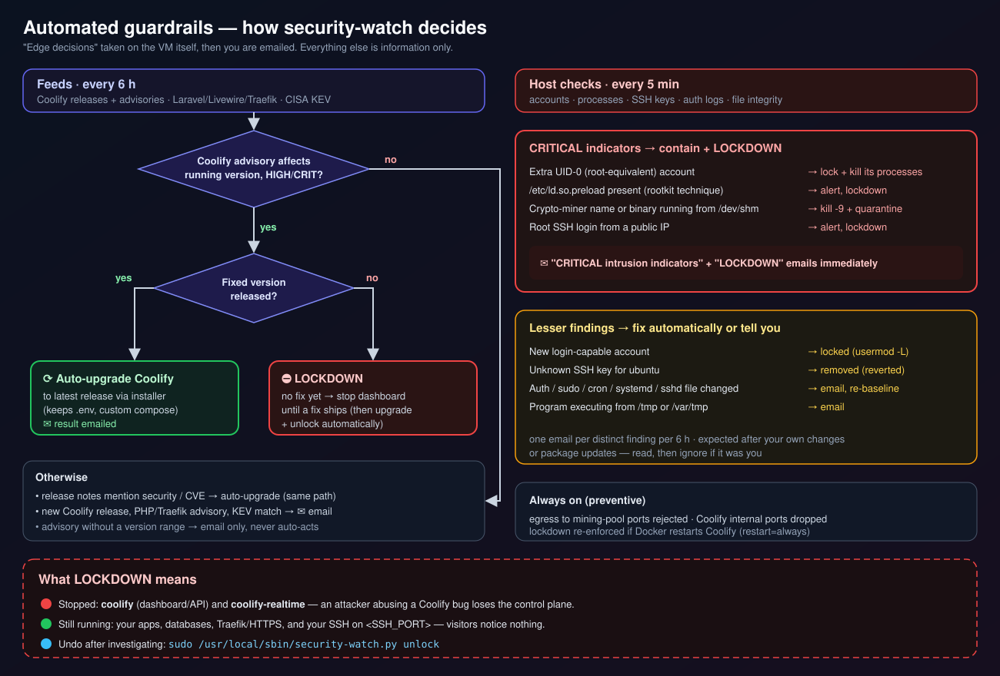
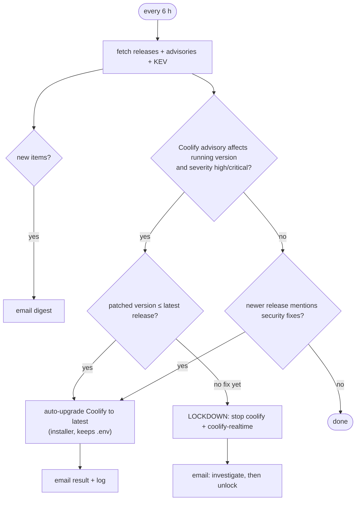
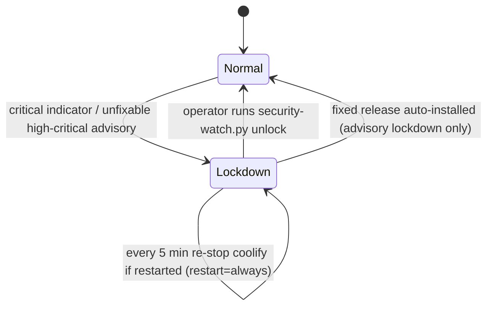

# 10 · Security Automation: Feeds, Auto-Patching, Guardrails

[← Monitoring & alerts](09-monitoring-and-alerts.md) · [Index](README.md) · [Next: AMD → ARM migration →](11-amd-to-arm-migration.md)

> **TL;DR**: [`security-watch.py`](../scripts/security-watch.py) (Python stdlib only, runs as root
> from systemd timers) does two jobs. **Feeds (every 6 h):** read trusted sources, email anything new,
> and **act**: upgrade Coolify at once for security releases / high-critical advisories, or **lock
> down** the control plane if no fix exists. **Host (every 5 min):** look for intrusion indicators and
> respond automatically, lock rogue accounts, kill and quarantine miners, revert unknown SSH keys,
> lock down on critical signs. On its very first run it found an authenticated-RCE advisory affecting
> the running Coolify 4.5.0 and upgraded to 4.5.2 unattended.



## 1. Why automate the response?

Coolify is PHP/Laravel and its build helper mounts the Docker socket, so **an RCE in Coolify is root
on the host**. Real advisories exist (e.g. command injection through custom build commands → host
root). For a solo operator, the gap between "advisory published" and "human reads email" is the
dangerous window, so the safe actions are automated and the operator is informed.

## 2. Trusted sources

| Source | Endpoint | Used for |
|---|---|---|
| Coolify releases | `api.github.com/repos/coollabsio/coolify/releases` | New versions; security keywords in notes |
| Coolify security advisories | `api.github.com/repos/coollabsio/coolify/security-advisories` | Severity, vulnerable range, patched versions → **actions** |
| GitHub Advisory DB | `api.github.com/advisories?ecosystem=composer&affects=laravel/framework` · `livewire/livewire` · `go: github.com/traefik/traefik/v3` | PHP framework & proxy CVEs (informational; fixes ship in Coolify releases) |
| CISA KEV | `cisa.gov/…/known_exploited_vulnerabilities.json` | **Actively exploited** CVEs filtered to: coolify, laravel, livewire, php, traefik, docker, containerd, runc, openssh, linux kernel, ubuntu, postgresql, redis, sudo, glibc, polkit, openssl |

Unauthenticated GitHub API calls (60/h) are plenty for a 6-hour cadence.

## 3. Feeds decision logic



### Version range evaluation

GitHub advisories express ranges like `>= 4.0.0, < 4.5.1` or `<= 4.0.0-beta.434`. The script parses
each comparator and compares with a pre-release-aware key:

```python
def vkey(v):                       # 4.0.0-beta.420 < 4.0.0 < 4.5.2
    base, _, pre = v.lstrip("v").partition("-")
    nums = lambda s: [int(x) for x in re.findall(r"\d+", s)]
    return (nums(base), 0 if pre else 1, nums(pre))
```

An advisory counts as **affecting** the host only if it publishes a `vulnerable_version_range`
that includes the running version **and** the running version is not ≥ any `patched_versions`.

### Safeguards against false positives

| Risk | Safeguard |
|---|---|
| Advisory without version data triggers a lockdown | No range → report only, never act |
| First run floods the inbox with history | First run records ~1,800 existing items as a **baseline**; only affecting advisories are reported |
| Upgrade loop | Upgrade only when `latest > running`; result verified from the running image tag |
| Lockdown left on after a fix ships | When an advisory-triggered lockdown is active and a fixed release is installed, the script unlocks automatically |
| Repeated alerts | Cooldown keys in `notify` |

### The real first run

```text
[SECURITY] Security watch enabled, Coolify running 4.5.0, latest release 4.5.2
  Coolify advisory GHSA-…  [HIGH]  Authenticated RCE via SHELL_SAFE_COMMAND_PATTERN regression → host root
  affects running 4.5.0: YES   patched in …
[SECURITY] Coolify auto-upgraded to 4.5.2
```

The upgrade re-ran the official installer with the pinned version and the same Docker pool;
`/data/coolify/source/.env` (APP_KEY) and the `docker-compose.custom.yml` log mount were preserved;
the dashboard returned 200 afterwards.

## 4. Host intrusion checks (every 5 min)

| Indicator | Automated response | Severity |
|---|---|---|
| Extra **UID 0** account | `usermod -L -e 1` + kill its processes | **Critical → lockdown** |
| `/etc/ld.so.preload` non-empty (classic rootkit) | email contents | **Critical → lockdown** |
| Process named like a known miner (xmrig, kinsing, kdevtmpfsi, …) or executing from `/dev/shm` | `kill -9`, copy binary to `/var/lib/security-watch/quarantine` (mode 000) | **Critical → lockdown** |
| **Root SSH login from a public IP** | email | **Critical → lockdown** |
| New login-capable account | lock it | Alert |
| Unknown key in `/home/ubuntu/.ssh/authorized_keys` | revert file to baseline | Alert |
| Program executing from `/tmp` or `/var/tmp` | email (deduplicated by path) | Alert |
| Change to passwd/shadow/group/sudoers, sshd config, root keys, cron, systemd units | email list of files (once per change, then re-baselined) | Alert |

### Lockdown



*Lockdown* stops `coolify` and `coolify-realtime`: the **control plane** an attacker would use.
**Apps, Traefik/HTTPS and operator SSH keep running.** Coolify containers use `restart: always`, so
the host check re-stops them if Docker or the VM restarts. Undo after investigating:

```bash
vm$ sudo /usr/local/sbin/security-watch.py status
vm$ sudo /usr/local/sbin/security-watch.py unlock
```

## 5. Egress guard

```sh
PORTS=3333,5555,14433,14444,45560,45700        # common stratum/mining pool ports
iptables -I OUTPUT      -p tcp -m multiport --dports $PORTS -j REJECT
iptables -I DOCKER-USER -p tcp -m multiport --dports $PORTS -j REJECT
```

Installed as `egress-guard.service` (re-applied whenever Docker restarts). Ports used by common dev
tools (4444, 7777, 9999) were deliberately left out to avoid breaking legitimate apps.

## 6. OS & Docker patching

[`security.sh`](../scripts/security.sh) extends unattended-upgrades:

```text
Unattended-Upgrade::Origins-Pattern { "origin=Docker,label=Docker CE"; };
Unattended-Upgrade::Mail "<ALERT_EMAIL>";
Unattended-Upgrade::MailReport "on-change";
Unattended-Upgrade::Remove-Unused-Kernel-Packages "true";
Unattended-Upgrade::Automatic-Reboot "true";
Unattended-Upgrade::Automatic-Reboot-Time "04:00";
```

`msmtp-mta` provides `sendmail`, so apt's reports go through the same Gmail relay.

## 7. Limits (be honest)

* Indicator-based detection catches commodity attacks (miners, crude persistence), not a careful
  attacker with kernel-level tooling.
* Advisory-driven response cannot cover **0-days** before publication; 2FA, minimal ports and the
  single-admin model reduce that exposure.
* File-integrity alerts fire after legitimate package updates (expected noise, one email per change).

See [ADR 0014](adr/0014-automated-security-guardrails-and-lockdown.md) for the trade-offs.

[Next: AMD → ARM migration →](11-amd-to-arm-migration.md)
