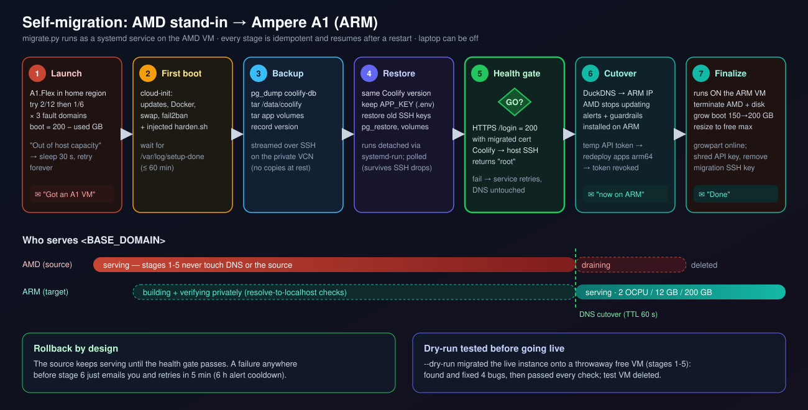
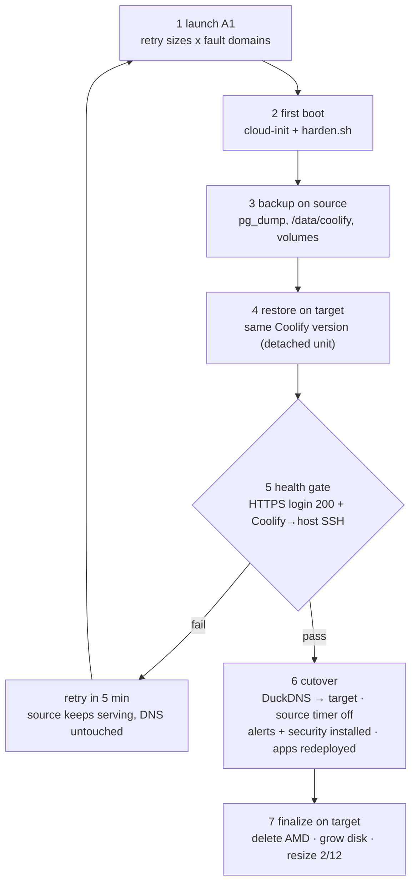
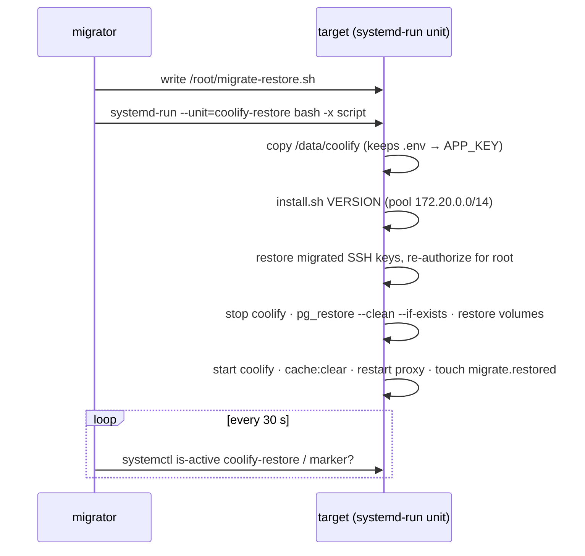
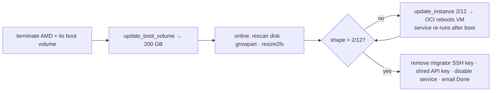

# 11 · Self-Migration: AMD Stand-in → Ampere A1

[← Security automation](10-security-automation.md) · [Index](README.md) · [Next: Cost guardrails →](12-cost-guardrails.md)

> **TL;DR**: The free A1 VM (2 OCPU / 12 GB) was unavailable ("Out of host capacity"), so the
> platform went live on a 1 GB AMD Micro. [`migrate.py`](../scripts/migrate.py) runs **as a service on
> the AMD VM** (no laptop needed): it waits for A1 capacity, builds and hardens the new VM, copies
> Coolify (DB, config, certificates, SSH keys, volumes), proves the copy is healthy, and only then
> switches DNS. [`finalize.py`](../scripts/finalize.py) on the new VM deletes the old one, grows the
> disk to 200 GB and resizes to the free maximum. A full dry run on a throwaway VM caught four bugs
> before production.



## 1. Stages



| # | Stage | Resumability marker / idempotency |
|---|---|---|
| 1 | Launch target | Found by display name `free-arm`; boot size = 200 − other volumes (150 GB) |
| 2 | First boot | `/var/log/setup-done` on target |
| 3 | Backup + stream | Skipped if `/root/migrate.restored` exists on target |
| 4 | Install + restore | `/root/migrate.restored`; each attempt removes half-made Coolify containers first |
| 5 | Health gate | Pure check, always re-run |
| 6 | Cutover | `/root/migrate.cutover` |
| 7 | Finalize | Each step checks current state (AMD gone? disk 200? shape 2/12?) |

`oci-migrator.service` uses `Restart=always, RestartSec=300`: any failure retries the whole pipeline,
and completed stages are skipped.

## 2. Backup & transfer

```bash
docker inspect coolify --format '{{.Config.Image}}' | sed 's/.*://' > version     # pin same version
docker volume ls -q | grep -vE '^coolify-(db|redis)$' | grep -vE '^[0-9a-f]{64}$' > volumes
docker exec coolify-db pg_dump -U coolify -d coolify -Fc > coolify.dump
# stream, no temp files on the small source disk:
tar czf - -C / data/coolify root/migrate | ssh target 'sudo tar xzf - -C /root/migrate-in'
```

App containers (`label=coolify.managed=true`) are stopped during the volume copy for consistency and
**restarted in a `finally` block** even if the transfer fails.

## 3. Restore: the subtle parts



| Problem | Solution |
|---|---|
| `APP_KEY` must match or encrypted DB fields are garbage | Copy `/data/coolify` **before** installing; the installer only fills empty `.env` keys |
| Installer **regenerates** the localhost SSH key on a fresh server (no `coolify-db` volume yet) | Restore migrated `ssh/keys`, derive public keys with `ssh-keygen -y`, re-add to root's `authorized_keys` |
| Permissions | Match the installer: `chown -R 9999:root` + `chmod -R 700` on `source`, `ssh`, `images` only |
| Long step on a weak VM drops SSH | Run detached with `systemd-run`, poll state |
| Certificates | `proxy/acme.json` travels with `/data/coolify`: no re-issuance burst |

## 4. Health gate

```bash
curl -s -o /dev/null -w '%{http_code}' --resolve <BASE_DOMAIN>:443:127.0.0.1 https://<BASE_DOMAIN>/login   # 200
tinker: instant_remote_process(["whoami"], Server::find(0))                                              # root
```

This proves Traefik routing, the migrated certificate, the Laravel app + DB, and Coolify's ability to
manage its host, before any user traffic moves.

## 5. Cutover

1. write `/etc/duckdns/env` on the target, re-run `harden.sh` (installs the timer), update now;
2. **disable the source's DuckDNS timer** so it cannot flip the record back;
3. copy `/etc/msmtprc`, run `monitoring.sh` + `security.sh` on the target;
4. temporary API token → redeploy every application (force rebuild for arm64), restart services and
   databases → revoke token, restore API setting;
5. email "Coolify now runs on the ARM VM".

## 6. Finalize (runs on the target)



The 200 GB free storage is shared, so the disk can only grow **after** the AMD's 50 GB is released.

## 7. Least-privilege identity

The service on the VM uses `<OCI_AUTOMATION_USER>` (API key only, no console) with
`manage instance-family`, `manage volume-family`, `use virtual-network-family`,
`inspect compartments`. Paid shapes are impossible anyway (limit 0). The key is shredded from the ARM
VM by `finalize.py` ([ADR 0016](adr/0016-least-privilege-automation-identity.md)).

Install the service on the AMD VM:

```bash
$ bash scripts/deploy-migrator.sh     # needs keys/vps-automation.config + keys/vps-automation_api_key.pem
vm$ journalctl -fu oci-migrator
```

## 8. Dry-run methodology

The same code ran from the workstation with `--dry-run` against a **second free AMD Micro** named
`migrate-test` (50 + 50 GB ≤ 200 GB): stages 1-5 for real, against the live source, with DNS and the
source VM untouched. Then the redeploy step and migrated data were verified, and the test VM deleted.

| Run | Result | Bug found | Fix |
|---|---|---|---|
| 1 | Hung at first boot | `sshd -t` failed: **`/run/sshd` missing** on a fresh socket-activated boot → harden aborted → port `<SSH_PORT>` never opened | `mkdir -p /run/sshd` before `sshd -t` |
| 2 | Restore failed (exit 255) | **SSH session dropped** while the 1/8-OCPU VM pulled images (load ≈ 4) | Restore runs as a detached `systemd-run` unit; `ServerAliveCountMax=10` |
| 3 | Restore unit exited 255 | `ssh-keygen -y` on a **`.lock` file** + `set -o pipefail` aborted the script | Skip `*.lock`/`*.pub`, tolerate errors inside the loop |
| 3b | Health gate "cannot SSH" | Tinker received an **empty script**: `mktemp` file is 0600, PHP runs non-root | `chmod 644` before `docker cp` |
| 4 | Yes, all green | - | - |

Verified on the copy: admin user present, `fqdn` and `wildcard_domain` kept, registration disabled,
all Coolify containers healthy (incl. proxy), Coolify's key authorized for root, redeploy step OK,
temporary token revoked.

Measured timings (1 GB Micro target): launch ~1 min · first boot ~10 min · backup + transfer ~15 s
(fresh install) · install + restore ~4-5 min · health gate ~2 min.

## 9. Notifications

| Event | Email |
|---|---|
| A1 capacity obtained | `[MIGRATION] Got an Ampere A1 VM (2 OCPU / 12 GB)` |
| Any stage fails | `[MIGRATION] Migration step failed (will retry in 5 min)` + traceback (max once / 6 h) |
| DNS switched | `[MIGRATION] Coolify now runs on the ARM VM` |
| Finalized | `[MIGRATION] Done: ARM VM at free-tier max` |

[Next: Cost guardrails →](12-cost-guardrails.md)
