# 12 · Cost Guardrails: Why This Stays at $0

[← AMD → ARM migration](11-amd-to-arm-migration.md) · [Index](README.md) · [Next: Operations runbook →](13-operations-runbook.md)

> **TL;DR**: The account is **free-only** (trial ended, never upgraded), so Oracle *cannot* bill
> it: non-free shapes have a limit of **0** and simply fail to create. Every component, DNS,
> certificates, SMTP, feeds, Coolify, is free. A $1 budget alert exists as a tripwire anyway. The
> only cost-adjacent risk is **idle reclamation** of Always Free VMs, which is mitigated, not ignored.

## 1. Free-only vs Pay-As-You-Go

| | Free-only (chosen) | Pay-As-You-Go |
|---|---|---|
| Can be charged | **No** | Yes, for anything beyond Always Free |
| Spending cap | Structural (paid limits = 0) | **None**: budgets alert *after* spend |
| A1 limit observed | 2 OCPU / 12 GB | typically 4 / 24 |
| A1 capacity priority | Low (frequent "Out of host capacity") | Higher |
| Idle reclamation | Applies | Does not apply |
| Fits "no charge without confirmation" | Yes | No |

Decision: [ADR 0003](adr/0003-stay-free-only-no-payg.md).

## 2. What is used vs the allowance

| Always Free resource | Allowance | Used |
|---|---|---|
| Ampere A1 compute | per-tenancy limit (here 2 OCPU / 12 GB) | 2 / 12 (target) |
| AMD E2.1.Micro | 2 VMs | 1 (temporary stand-in) |
| Block storage (boot + block) | 200 GB total | 50 (AMD) → 150 + 50 → 200 (ARM) |
| Outbound data | 10 TB / month | well below |
| VCN | 2 | 1 |
| Public IPv4 (ephemeral) | per VNIC | 1 |
| Budgets, IAM, limits API | free services | used |
| Object Storage | 20 GB | 0 (roadmap: offsite backups) |

| External service | Cost |
|---|---|
| DuckDNS | $0 |
| Let's Encrypt | $0 |
| Gmail SMTP (App Password) | $0 |
| GitHub API (unauthenticated) / CISA KEV | $0 |
| Coolify (Apache-2.0, self-hosted) | $0 |

## 3. What could cost money: and why it can't

| Potential cost | Prevention |
|---|---|
| Launching a paid shape by mistake | Limits for E3/E4/E5/Standard2… are **0** → API rejects |
| Coolify "Provision a server" (Hetzner, Vultr, DigitalOcean, Hostinger) | Never connect cloud-provider tokens; documented in the onboarding guide |
| Exceeding 200 GB storage | Migrator computes boot size from remaining allowance; finalize grows only after the AMD volume is deleted |
| Boot-volume backups beyond the 5 free | Not configured |
| Upgrading to PAYG | Explicitly rejected; would need the account owner's action |
| Unexpected spend after a future policy change | `$1` budget with ACTUAL and FORECAST alerts at 1% → `<ALERT_EMAIL>` |

## 4. Idle reclamation

Oracle may **stop** (not delete) Always Free instances on free-only tenancies when, over 7 days, the
95th percentile of CPU **and** network **and** (for A1) memory utilisation are all below ~20%.

| Mitigation | Effect |
|---|---|
| Running Coolify + apps | Memory on A1 typically above the threshold with a few apps |
| `boot-notify` + `health-check` emails | You learn quickly if the VM restarts or the dashboard goes down |
| Restart is non-destructive | Start the instance again via API (`instance_action(id, "START")`); data intact |

Deliberately **not** done: synthetic CPU burners to game the policy.

[Next: Operations runbook →](13-operations-runbook.md)
