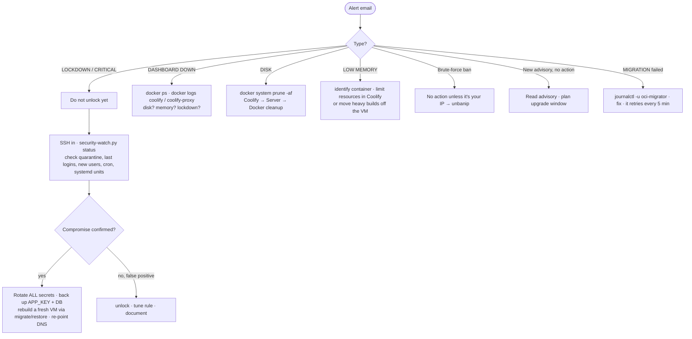

# 13 · Operations Runbook

[← Cost guardrails](12-cost-guardrails.md) · [Index](README.md) · [Next: Troubleshooting →](14-troubleshooting.md)

> **TL;DR**: Copy-paste procedures for day-2 work: access, deploys, ports, **secret rotation**,
> bans, lockdown, upgrades, **backups** (the `APP_KEY` above all), restore, reboots, and an incident
> response playbook.

## Access

```bash
$ ssh -i keys/oci_vm -p <SSH_PORT> ubuntu@<BASE_DOMAIN>
```

Dashboard: `https://<BASE_DOMAIN>` (email + password + TOTP).

## Deploy an app

Coolify → Projects → + Add → Production → + New Resource → (Public repo | GitHub App | Docker image)
→ Domains: `https://<APP_NAME>.<BASE_DOMAIN>` → Deploy. Certificate in ~1-2 minutes.

## Open an additional public port (rare: apps should use 443)

```bash
# 1) cloud: add to OPEN_PORTS in scripts/provision.py, then
$ python scripts/provision.py network
# 2) host (for non-Docker services)
vm$ sudo open-ports <PORT>
```

## Secret rotation

| Secret | Rotate | Then |
|---|---|---|
| `<DUCKDNS_TOKEN>` | duckdns.org → regenerate token | `vm$ sudoedit /etc/duckdns/env` → `sudo systemctl start duckdns.service`; update `keys/` |
| `<GMAIL_APP_PASSWORD>` | Revoke + create at myaccount.google.com/apppasswords | `vm$ sudoedit /etc/msmtprc`; Coolify → Notifications → Email → password; send test |
| OCI API key | OCI user → add new key (via API/console), delete old | update `~/.oci/config` fingerprint + `key_file` |
| Automation API key | delete key on `<OCI_AUTOMATION_USER>` | re-run `deploy-migrator.sh` with a new key (only while migrating) |
| SSH key | `ssh-keygen -t ed25519 -f keys/oci_vm_new` | add the new key with the procedure below → test → remove the old line (removals are accepted automatically) |
| Coolify admin password | Profile → Change Password | update password manager |
| Coolify 2FA | Profile → regenerate recovery codes | store offline |

Adding an SSH key for `ubuntu` is **reverted** by security-watch unless you re-baseline:

```bash
vm$ sudo systemctl stop security-watch-host.timer
vm$ cat oci_vm_new.pub >> ~/.ssh/authorized_keys
vm$ sudo python3 -c "import json;p='/var/lib/security-watch/state.json';s=json.load(open(p));s.pop('ubuntu_keys',None);json.dump(s,open(p,'w'))"
vm$ sudo systemctl start security-watch-host.timer      # next run records the new baseline
```

## Unban an IP

```bash
vm$ sudo fail2ban-client status sshd
vm$ sudo fail2ban-client set sshd unbanip <IP>
vm$ sudo fail2ban-client set coolify-login unbanip <IP>
```

## Keepalive (Always Free idle guard)

```bash
vm$ sudo keepalive status          # service state, target, current whole-machine CPU
vm$ sudo keepalive off             # heavy job coming: give it every spare cycle
vm$ sudo keepalive on              # back to holding ~25 % when idle
vm$ sudo keepalive target 30       # change the target (21..60 %)
```

Details and safety properties: [12 · Cost guardrails](12-cost-guardrails.md#keepalive-optional-installed-by-default-by-the-migrator).

## Lockdown

```bash
vm$ sudo /usr/local/sbin/security-watch.py status
vm$ sudo journalctl -u security-watch-host -u security-watch-feeds --since -24h
vm$ sudo ls -l /var/lib/security-watch/quarantine
vm$ sudo /usr/local/sbin/security-watch.py unlock      # after investigation
```

## Upgrade Coolify manually

```bash
vm$ curl -fsSL https://cdn.coollabs.io/coolify/install.sh -o /root/coolify-install.sh
vm$ sudo DOCKER_ADDRESS_POOL_BASE=172.20.0.0/14 DOCKER_ADDRESS_POOL_SIZE=24 bash /root/coolify-install.sh <VERSION>
```

## Backups

| What | Why | How |
|---|---|---|
| **`/data/coolify/source/.env`** | Contains **`APP_KEY`**: without it encrypted DB fields (env vars, keys) are unrecoverable | copy to a password manager / offline |
| Coolify DB | Projects, settings | `docker exec coolify-db pg_dump -U coolify -d coolify -Fc > coolify.dump` |
| `/data/coolify` | Proxy certs, SSH keys, compose files | `tar czf coolify-data.tgz -C / data/coolify` |
| App volumes | Your data | Coolify → Database → Backups (S3-compatible target), or `tar` per volume |

```bash
# pull a backup to the workstation
$ ssh -i keys/oci_vm -p <SSH_PORT> ubuntu@<BASE_DOMAIN> \
   'sudo docker exec coolify-db pg_dump -U coolify -d coolify -Fc' > backups/coolify-$(date +%F).dump
```

Roadmap: nightly encrypted backups to OCI Object Storage (20 GB free).

## Restore on a fresh VM

Same procedure the migrator automates ([11 · Migration](11-amd-to-arm-migration.md#3-restore-the-subtle-parts)):
copy `/data/coolify` → run installer with the same version → restore SSH keys → `pg_restore --clean`
→ restore volumes → start → redeploy apps.

## Reboot

Automatic at 04:00 when updates require it. Manual: `vm$ sudo reboot`: Coolify, Traefik and apps
come back via restart policies; you receive a "Server booted" email.

## Check that automation is alive

```bash
vm$ systemctl list-timers --no-pager | grep -E 'health|security|duckdns|apt'
vm$ systemctl is-active docker-port-guard egress-guard fail2ban
vm$ sudo tail -3 /var/log/msmtp.log
vm$ sudo fail2ban-client status
```

## Incident response playbook



[Next: Troubleshooting →](14-troubleshooting.md)
