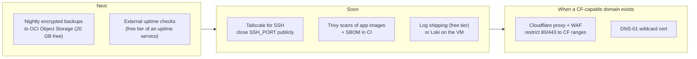

# 15 · Production Readiness: Scorecard, Gaps, Roadmap

[← Troubleshooting](14-troubleshooting.md) · [Index](README.md) · [New machine setup →](16-new-machine-setup.md)

> **TL;DR**: Strong on perimeter security, patching, automation and cost control; honest gaps in
> **offsite backups**, **edge protection (CDN/WAF)**, **external uptime monitoring** and
> **single-node availability**. Every gap has a $0 path on the roadmap.

## 1. Scorecard

| Area | Status | Notes |
|---|---|---|
| Infrastructure as code (API-only) | Done | Idempotent scripts; no console clicks |
| Cost control | Done | Free-only account, paid limits 0, budget tripwire |
| Network exposure | Done | 3 ports; verified by external scan |
| SSH | Done | Key-only, non-standard port, no public root, fail2ban |
| Dashboard auth | Done | Single admin, registration off, TOTP 2FA, brute-force bans |
| TLS | Done | Let's Encrypt per host, auto-renew, expiry alert |
| Patching | Done | Unattended OS + Docker, auto-reboot, same-day Coolify security upgrades |
| Vulnerability intelligence | Done | GitHub advisories + CISA KEV, filtered |
| Intrusion response | Done | Indicator checks + lockdown (commodity threats) |
| Alerting | Done | Email with cooldowns, daily report |
| Secrets handling | Done | Root-only files, git-ignored `keys/`, placeholders in docs |
| Migration / DR procedure | Done | Automated, dry-run tested |
| Backups (offsite) | Partial | Manual procedure only |
| External uptime monitoring | Partial | Internal checks only, a dead VM can't email |
| Edge protection (CDN/WAF/DDoS) | Gap | Impossible with DuckDNS |
| High availability | Gap | Single VM by design (free tier) |
| Centralised logs / SIEM | Partial | Local journald + audit log |
| Image/dependency scanning | Partial | Not yet |
| CIS benchmark compliance | Partial | Partially (sysctl, SSH); not audited |

## 2. Roadmap ($0 options)

| Item | Why | How |
|---|---|---|
| Offsite backups | Disk/VM loss is the biggest unmitigated risk | `pg_dump` + `/data/coolify` + volumes → `age`-encrypted → OCI Object Storage via SDK, nightly timer, alert on failure |
| External uptime monitor | Detect total VM loss (no self-alert possible) | Free HTTP check on `https://<BASE_DOMAIN>/login` and one app |
| Tailscale SSH | Zero public SSH | Join tailnet, then drop `<SSH_PORT>` from the security list |
| Cloudflare | WAF, DDoS, caching, hidden origin | Requires own/free domain with NS control ([ADR 0008](adr/0008-no-cloudflare-with-duckdns.md)) |
| Trivy / SBOM | Know vulnerable packages in app images | Scan in GitHub Actions before deploy |
| CIS hardening audit | Systematic baseline | `lynis audit system`, fix high-value items |
| auditd | Better forensics | Rules for exec of setuid, writes to `/etc` |
| A1 at 4/24 | More capacity | Only if the tenancy limit is raised; resize is in-place |

## 3. Suggested SLOs

| SLI | SLO | Measured by |
|---|---|---|
| Dashboard availability | 99.0 % monthly | external uptime check |
| App HTTPS availability | 99.0 % monthly (single node) | external uptime check |
| Time to patch a high/critical Coolify advisory | ≤ 6 h after publication (feed cadence) | security-watch emails |
| Time to detect VM loss | ≤ 5 min | external check (roadmap) |
| Certificate validity | never < 14 days | health-check alert |
| Backup RPO / RTO | 24 h / 2 h | roadmap backups + restore drill |

## 4. What "production grade" means here

Production grade for a **single-operator, zero-budget** platform means: minimal attack surface,
authenticated and audited control plane, timely patching without human latency, alerting on every
failure mode the host can observe, documented recovery, and a tested path to bigger hardware. It
does **not** mean multi-region HA or a managed WAF, those are explicit, documented trade-offs of the
$0 constraint.

[Next: New machine & from-scratch setup →](16-new-machine-setup.md)
