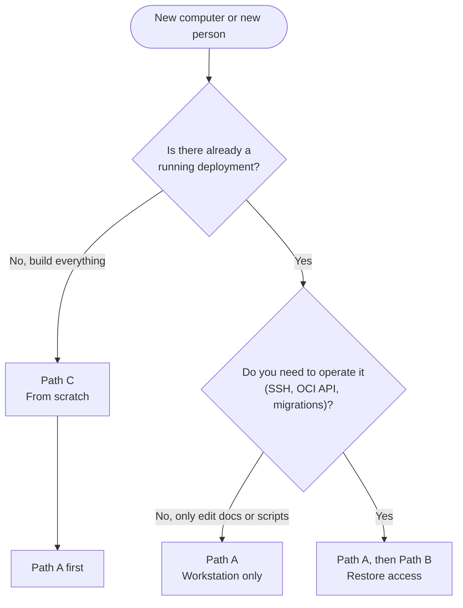

# 16 · New Machine & From-Scratch Setup

[← Production readiness](15-production-readiness.md) · [Index](README.md) · [Other clouds →](17-other-clouds-gcp-aws.md)

> **TL;DR**: Three situations, three paths. **A)** You (or a contributor) work on this repo from a
> new computer: clone, enable the git hooks, create the Python environment. **B)** You need to
> operate an *existing* deployment from a new computer: also restore the secrets in `keys/` safely.
> **C)** You build the whole platform from nothing on a new Oracle account: follow the ordered
> checklist below. Every step ends with a verification command.

> [!IMPORTANT]
> **Do this once on every new clone, on every computer:**
>
> ```bash
> git config core.hooksPath .githooks
> ```
>
> It activates the local branch protection in [`.githooks/pre-push`](../.githooks/pre-push), which
> refuses any push that deletes `main` or rewrites its history. Git does not copy hook settings when
> you clone, so a new computer starts **without** this protection until you run the command.
> Check it with `git config --get core.hooksPath` (expected output: `.githooks`).

---

## Which path do I need?



| Path | For | Needs secrets? | Time |
|---|---|---|---|
| [A · Workstation](#path-a-workstation-setup) | Editing docs and scripts, running CI checks locally | No | 10 min |
| [B · Restore access](#path-b-restore-access-to-an-existing-deployment) | Operating the live VM from a new device | Yes, from your secure backup | 15 min |
| [C · From scratch](#path-c-build-the-whole-platform-from-scratch) | A new Oracle account, a fresh deployment | You create them | 1 to 2 h plus waiting for capacity |
| [D · Handover](#path-d-handing-the-setup-to-someone-else) | Sharing the setup with another person | They create their own | Path C |

---

## Path A: Workstation setup

### A1. Install the tools

| Tool | Why | Check |
|---|---|---|
| Git 2.40+ | Clone, hooks, commits | `git --version` |
| Python 3.12 or newer | OCI Python SDK, provisioning and migration scripts | `python --version` |
| OpenSSH client | Log in to the VM, copy files | `ssh -V` |
| Bash | Runs the `.sh` scripts (on Windows: Git Bash, installed with Git) | `bash --version` |
| GitHub CLI (optional) | Clone private repos, manage PRs | `gh --version` |

> Use the **OCI Python SDK**, not `oci-cli`. On Python 3.14 the CLI fails to install (an old PyYAML
> pin needs a C compiler). See [ADR 0002](adr/0002-headless-api-only-provisioning.md).

### A2. Clone and enable the hooks

```bash
git clone https://github.com/<GITHUB_USER>/zero-cost-paas.git    # or: gh repo clone <GITHUB_USER>/zero-cost-paas
cd zero-cost-paas
git config core.hooksPath .githooks                               # local branch protection, see the note above
git config --get core.hooksPath                                   # must print: .githooks
```

Optional, on Linux/macOS: make sure the hook is executable (the repo stores it with the executable
bit, but some copy tools drop it):

```bash
chmod +x .githooks/pre-push
```

### A3. Commit identity without exposing your email

Use your GitHub **no-reply** address (GitHub, **Settings > Emails**), set for this repo only:

```bash
git config user.name  "<GITHUB_USER>"
git config user.email "<GITHUB_ID>+<GITHUB_USER>@users.noreply.github.com"
```

### A4. Python environment

Linux / macOS:

```bash
python3 -m venv .venv
. .venv/bin/activate
pip install -r scripts/requirements.txt
```

Windows (PowerShell):

```powershell
python -m venv .venv
.\.venv\Scripts\Activate.ps1
pip install -r scripts/requirements.txt
```

`.venv/` is git-ignored.

### A5. Verify the workstation

These are the same checks CI runs, minus the network-only ones:

```bash
python -m py_compile scripts/*.py && echo "python OK"
for f in scripts/*.sh; do bash -n "$f" || echo "syntax error: $f"; done
git status --short          # must not list anything under keys/ or any *.pem / *.env file
```

Line endings are handled by [`.gitattributes`](../.gitattributes) (`eol=lf`), so scripts edited on
Windows still run on the Linux VM.

---

## Path B: Restore access to an existing deployment

Do Path A first. Then bring back the secrets. **Secrets are never in git**: they come from your own
secure backup.

### B1. What to carry over

| File (in `keys/` unless noted) | What it unlocks | Needed for |
|---|---|---|
| `oci_vm` (+ `oci_vm.pub`) | SSH to the VM on `<SSH_PORT>` | Every server task |
| `~/.oci/config` + `~/.oci/oci_api_key.pem` | OCI API as your admin user | `check-account.py`, `provision.py`, IAM changes |
| `config.env` | All non-secret settings + your secrets as variables | Every script |
| `duckdns-token.txt` | Repointing `<BASE_DOMAIN>` | Re-running `harden.sh`, migrator |
| `gmail-app-password.txt` | Sending alert email | Re-running `monitoring.sh` |
| `vps-automation.config` + `vps-automation_api_key.pem` | Least-privilege migrator identity | `deploy-migrator.sh` (until the ARM move is done) |
| Coolify `.env` backup (from `/data/coolify/source/.env`) | Decrypting everything Coolify stores (`APP_KEY`) | Disaster recovery only |
| Authenticator app + 2FA recovery codes | Coolify dashboard login | Every dashboard login |

### B2. Move them safely

Pick **one** of these. Never email them, paste them into chat or tickets, or put them in cloud
storage unencrypted.

- **Password manager** (recommended): store each file as a secure note or attachment.
- **Encrypted archive**, then copy it over USB or any channel:

  ```bash
  # on the old computer, from the repo root (7-Zip: AES-256, file names encrypted too)
  7z a -p -mhe=on keys-backup.7z keys/ ~/.oci/config ~/.oci/oci_api_key.pem
  # on the new computer
  7z x keys-backup.7z
  ```

  Delete the archive after extracting it.

### B3. Put them in place and lock them down

```bash
mkdir -p keys ~/.oci
# copy the files into keys/ and ~/.oci/ as listed in B1, then:
chmod 700 keys ~/.oci
chmod 600 keys/* ~/.oci/*
```

On Windows, OpenSSH refuses keys other users can read. Restrict them (PowerShell):

```powershell
icacls keys\oci_vm /inheritance:r /grant:r "$($env:USERNAME):F"
icacls $env:USERPROFILE\.oci\oci_api_key.pem /inheritance:r /grant:r "$($env:USERNAME):F"
```

Fix the key path inside `~/.oci/config` for the new computer:

```ini
key_file=~/.oci/oci_api_key.pem
```

### B4. Verify access

```bash
set -a; . keys/config.env; set +a                 # load VPS_DOMAIN, SSH_PORT, ...
python scripts/check-account.py                   # OCI API: auth OK, limits, instances
ssh -i keys/oci_vm -p "$SSH_PORT" ubuntu@"$VPS_DOMAIN" 'hostname; systemctl --failed --no-pager'
```

Then open `https://<BASE_DOMAIN>` and log in with your password **and** the 6-digit code.

### B5. If a secret is lost

| Lost | Recovery |
|---|---|
| SSH key, but you still have another way in | Add a new public key to `/home/ubuntu/.ssh/authorized_keys`, test it, remove the old one. Tip: keep a **second** key from a different device there in advance. |
| SSH key, no other way in | Break-glass: OCI instance console connection (needs the web console once), or move to a new VM with [Path C](#path-c-build-the-whole-platform-from-scratch) and restore Coolify from your `.env` + DB backup ([runbook](13-operations-runbook.md)). |
| OCI API key | Upload a new API key for your user (the console is the only way in without a working key), update `~/.oci/config`. |
| DuckDNS token | Regenerate it on duckdns.org, then on the VM: `sudo DUCKDNS_TOKEN=<new> DUCKDNS_DOMAIN=<DUCKDNS_SUBDOMAIN> bash harden.sh`. |
| Gmail App Password | Revoke the old one at myaccount.google.com/apppasswords, create a new one, re-run `monitoring.sh` with `GMAIL_APP_PASSWORD`, and update Coolify **Notifications > Email**. |
| Phone with the authenticator | Use a recovery code. Without codes, reset 2FA from the server (below), then enable it again immediately. |
| Coolify admin password | Use **Forgot password** (email works once SMTP is configured), or reset it from the server. |

Reset Coolify 2FA from the server (only for the account owner, over SSH):

```bash
sudo docker exec coolify php artisan tinker --execute='$u = \App\Models\User::find(0);
$u->two_factor_secret = null; $u->two_factor_recovery_codes = null; $u->two_factor_confirmed_at = null;
$u->save(); echo "2FA reset";'
```

---

## Path C: Build the whole platform from scratch

Ordered checklist. Each step links to the chapter with the full explanation. Do not skip the
verification column: every later step depends on the earlier ones.


### Step 0. Create the accounts (all free)

| Account | What to do | Watch out |
|---|---|---|
| Oracle Cloud | Sign up for the Free Tier | The **home region is permanent** and Always Free compute only exists there. Pick one close to your users. |
| DuckDNS | Sign in, create `<DUCKDNS_SUBDOMAIN>`, copy the token | The token can repoint your domain: treat it as a secret. |
| Gmail | Turn on **2-Step Verification**, then create an **App Password** | App passwords only appear once 2-Step Verification is on. |
| GitHub (optional) | For Git-push deploys from Coolify | |

### Step by step

| # | Do | Command | Verify | Details |
|---|---|---|---|---|
| 1 | Create the OCI API signing key (the only console action) and write `~/.oci/config` | see chapter | `python scripts/check-account.py` prints `auth OK` | [04](04-oci-api-setup.md) |
| 2 | Workstation | [Path A](#path-a-workstation-setup) | `git config --get core.hooksPath` prints `.githooks` | above |
| 3 | Settings + SSH key | `mkdir -p keys && cp scripts/config.example.env keys/config.env` then fill it in; `ssh-keygen -t ed25519 -f keys/oci_vm -N ""` | `git status` shows nothing under `keys/` | [03](03-placeholders.md) |
| 4 | Pre-flight: what does this tenancy allow? | `python scripts/check-account.py` | Note the A1 OCPU/memory limit and the account type | [04](04-oci-api-setup.md) |
| 5 | Network + VM (hardened from first boot) | `set -a; . keys/config.env; set +a` <br/> `VM_SSH_PUB=keys/oci_vm.pub python scripts/provision.py network` <br/> `VM_SSH_PUB=keys/oci_vm.pub python scripts/provision.py micro` | `ssh -i keys/oci_vm -p $SSH_PORT ubuntu@<VM_PUBLIC_IP> 'cat /var/log/setup-done && echo ready'` (allow ~10 min for first boot) | [05](05-provisioning.md) |
| 6 | DNS updater | copy `scripts/*.sh` and `scripts/security-watch.py` to `/tmp` on the VM, then `sudo DUCKDNS_TOKEN=$DUCKDNS_TOKEN DUCKDNS_DOMAIN=$DUCKDNS_DOMAIN bash /tmp/harden.sh` | `nslookup test.$VPS_DOMAIN` returns `<VM_PUBLIC_IP>` | [06](06-dns-and-tls.md) |
| 7 | Coolify (headless) | `sudo ADMIN_USERNAME=... ADMIN_EMAIL=... ADMIN_PASSWORD='...' VPS_DOMAIN=$VPS_DOMAIN bash /tmp/coolify-setup.sh` | `curl -sI https://$VPS_DOMAIN/login` returns `200` with a Let's Encrypt certificate | [07](07-coolify.md) |
| 8 | First login | Change the password, **enable 2FA**, save the recovery codes, choose **This machine** | Log out and in again: the 6-digit code is required | [07](07-coolify.md) |
| 9 | Alerts + security automation | `sudo ALERT_EMAIL=... VPS_DOMAIN=... GMAIL_APP_PASSWORD=... bash /tmp/monitoring.sh && sudo ALERT_EMAIL=... bash /tmp/security.sh`, then set Coolify **Notifications > Email** | `echo ok \| sudo notify "Test"` arrives in your inbox; `systemctl list-timers` shows health, security and duckdns timers | [09](09-monitoring-and-alerts.md), [10](10-security-automation.md) |
| 10 | Back up what cannot be regenerated | Copy `/data/coolify/source/.env` into your password manager; keep `keys/` backed up (Path B2) | You can answer "where is my APP_KEY?" | [13](13-operations-runbook.md) |
| 11 | Optional: automatic move to Ampere A1 | `python scripts/create-automation-user.py` then `bash scripts/deploy-migrator.sh` | `journalctl -u oci-migrator` on the VM shows capacity retries | [11](11-amd-to-arm-migration.md) |

### Final acceptance check

| Check | Command or action | Expected |
|---|---|---|
| Only 3 ports public | `for p in 22 $SSH_PORT 80 443 8000 8080; do timeout 5 bash -c "</dev/tcp/<VM_PUBLIC_IP>/$p" && echo "$p open" \|\| echo "$p closed"; done` | `$SSH_PORT`, 80, 443 open; the rest closed |
| HTTPS + certificate | `curl -sI https://<BASE_DOMAIN>/login` | `HTTP/2 200` |
| App HTTPS | Deploy any app at `https://<APP_NAME>.<BASE_DOMAIN>` | Certificate issued within about 2 minutes |
| Dashboard 2FA | Log in | Password **and** code required |
| Alerts | Wait for the 09:00 report, or run `sudo health-report` | Email arrives |
| Security watch | `sudo security-watch.py status` | `last_feeds` and `last_host` are recent |
| Cost | OCI budget alert at $1 exists; tenancy is free-only | [12](12-cost-guardrails.md) |

---

## Path D: Handing the setup to someone else

Sharing this repository shares **knowledge, not access**. The other person:

1. Uses their **own** Oracle, DuckDNS, Gmail and GitHub accounts and follows [Path C](#path-c-build-the-whole-platform-from-scratch).
2. Never receives your `keys/` folder, your `.env`, your tokens or your recovery codes.
3. Replaces every `<PLACEHOLDER>` using [03 · Placeholders](03-placeholders.md).
4. Runs `git config core.hooksPath .githooks` in their clone.

If someone must operate **your** deployment (for example a co-maintainer), give them their own SSH
key (add their public key to `authorized_keys`) and their own Coolify account, never your
credentials. Remove both when they no longer need access.

---

## Gotchas on a new machine

| Symptom | Cause | Fix |
|---|---|---|
| A force push to `main` was not blocked | Hooks are not active in this clone | `git config core.hooksPath .githooks` |
| `Permissions for 'keys/oci_vm' are too open` | Key file readable by others | `chmod 600 keys/oci_vm` (Windows: the `icacls` command in B3) |
| `bash\r: No such file or directory` on the VM | Script saved with Windows line endings outside git | Re-checkout through git (`.gitattributes` forces LF) or `sed -i 's/\r$//' file.sh` |
| `ssh: connect to host ... port 22: Connection timed out` | Public SSH is on `<SSH_PORT>`, not 22 | `ssh -p <SSH_PORT> ...` |
| `Host key verification failed` after rebuilding the VM | New VM, same name or IP | `ssh-keygen -R "[<BASE_DOMAIN>]:<SSH_PORT>"` |
| `pip install oci-cli` fails on Python 3.14 | CLI pins an old PyYAML | Use the SDK from `scripts/requirements.txt` |
| `Out of host capacity` | No free A1 capacity in the home region right now | Expected; the scripts retry, see [11](11-amd-to-arm-migration.md) |

[Next: Same stack on Google Cloud or AWS →](17-other-clouds-gcp-aws.md)
