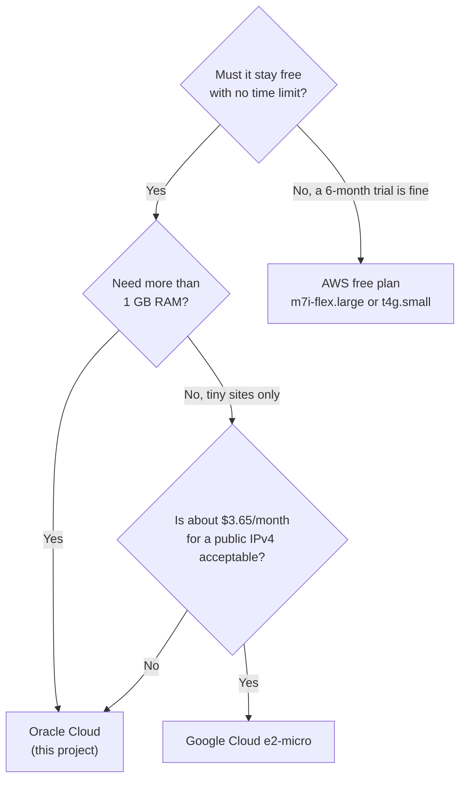

# 17 · Same Stack on Google Cloud or AWS

[← New machine setup](16-new-machine-setup.md) · [Index](README.md) · [Hosting options compared →](18-hosting-options-compared.md)

> **TL;DR**: Everything above the VM in this project (DuckDNS, Coolify, Traefik, hardening, alerts,
> security automation) is cloud-agnostic. Only the provisioning layer changes. But the free tiers are
> **not** equal: **Oracle** is free indefinitely with up to 4 OCPU / 24 GB on ARM (some free-only
> accounts get 2 / 12); **Google Cloud** is free indefinitely but tiny (1 GB RAM), and its public IPv4 is
> billed (about $3.65/month); **AWS** is free only for the first **6 months** on credits, then the free
> account closes. This chapter gives a clean, headless path for both, with honest cost notes.

> [!NOTE]
> Free-tier terms below were checked against the providers' own pages on **2026-10-28** (sources at
> the end). Providers change these terms; re-check before you build. The live deployment in this
> project runs on Oracle Cloud; the GCP and AWS commands are standard CLI usage that applies the
> same design, not a second production deployment.

---

## Which cloud fits?

| | Oracle Cloud (this project) | Google Cloud | AWS |
|---|---|---|---|
| Free for how long | **No end date** (Always Free) | **No end date** (Free Tier) | **6 months**, then the free account closes unless upgraded |
| Free VM | Ampere A1 ARM, up to 4 OCPU / 24 GB documented (account limits vary), plus 2 AMD micro VMs | 1 × **e2-micro** (2 shared vCPU, 1 GB RAM) | t3.micro, t3.small, t4g.micro, t4g.small, c7i-flex.large, m7i-flex.large (accounts created on or after 2025-07-15) |
| Free disk | 200 GB block storage | 30 GB standard persistent disk | Covered by credits during the free plan |
| Free egress | 10 TB / month | **1 GB / month** (North America, excluding China and Australia) | Covered by credits |
| Public IPv4 | Included | **Billed**: about $0.005/hour (~$3.65/month) after a 1-hour monthly allowance | **Billed** $0.005/hour, paid from credits during the free plan |
| Regions | Your home region | us-west1, us-central1, us-east1 only | Most regions |
| Billing safety | Free-only tenancy cannot be billed | Billing account required; budget alerts only alert | Free plan does not charge you; upgrading to paid removes that |
| Coolify experience | Good on A1 (12 to 24 GB) | Slow (1 GB + swap, like this project's AMD stand-in) | Good on m7i-flex.large (8 GB) while credits last |



**Recommendation:** for a strictly $0, permanent setup, Oracle Cloud remains the only one of the
three that fits. Use GCP for a tiny always-on box if a few dollars a month for IPv4 is acceptable;
use AWS to learn or to run a bigger box for six months.

---

## What carries over unchanged

| Layer | Oracle (this repo) | On GCP / AWS |
|---|---|---|
| Provisioning | [`provision.py`](../scripts/provision.py) (OCI SDK) | **Replace** with the `gcloud` / `aws` commands below |
| Cloud firewall | OCI security list | **Replace**: GCP VPC firewall rule / AWS security group, same 3 ports |
| First boot | [`cloud-init.yaml`](../scripts/cloud-init.yaml) + embedded [`harden.sh`](../scripts/harden.sh) | **Same**: render with [`render-cloud-init.py`](../scripts/render-cloud-init.py), pass as user data |
| Host firewall helper | `open-ports` inserts above Oracle's REJECT rule | **Same**: with no REJECT rule it inserts at the top (harmless) |
| DOCKER-USER guard, fail2ban, sysctl, SSH | `harden.sh` | **Same** (the guard detects the interface name itself) |
| DNS + TLS | DuckDNS + Let's Encrypt via Traefik | **Same** |
| Coolify | [`coolify-setup.sh`](../scripts/coolify-setup.sh) | **Same** (Coolify supports amd64 and arm64) |
| Alerts | [`monitoring.sh`](../scripts/monitoring.sh), Gmail on port 587 | **Same** (both clouds block port 25, not 587) |
| Security automation | [`security.sh`](../scripts/security.sh), [`security-watch.py`](../scripts/security-watch.py) | **Same** |
| AMD → ARM migration | [`migrate.py`](../scripts/migrate.py), [`finalize.py`](../scripts/finalize.py) | **Not applicable** (Oracle-specific capacity workaround) |
| Cost guardrail | Free-only tenancy + $1 budget | **Replace**: provider budget alerts below |

---

## Common preparation (both clouds)

Do [Path A of chapter 16](16-new-machine-setup.md#path-a-workstation-setup), then:

```bash
mkdir -p keys
cp scripts/config.example.env keys/config.env          # fill in DuckDNS, Gmail, admin values
ssh-keygen -t ed25519 -f keys/oci_vm -N "" -C paas-vm   # the file name is reused; any name works
python scripts/render-cloud-init.py > keys/cloud-init.rendered.yaml
set -a; . keys/config.env; set +a
```

The rendered cloud-init has **no secrets**: instance metadata and user data are readable from
inside the VM, so tokens and passwords are only ever passed later over SSH ([ADR 0017](adr/0017-secrets-handling.md)).

---

## Google Cloud (e2-micro, free indefinitely)

### GCP 1. Account and CLI

| Step | How |
|---|---|
| Account + billing account | Sign up at cloud.google.com (a billing account is required even for the free tier) |
| Install CLI | Google Cloud CLI (`gcloud`) |
| Log in headlessly | `gcloud auth login --no-launch-browser` |
| Project | `gcloud projects create <GCP_PROJECT_ID>` then `gcloud config set project <GCP_PROJECT_ID>` |
| Link billing | `gcloud billing projects link <GCP_PROJECT_ID> --billing-account=<GCP_BILLING_ACCOUNT_ID>` |
| Enable Compute | `gcloud services enable compute.googleapis.com` |

### GCP 2. Budget alert first

```bash
gcloud services enable billingbudgets.googleapis.com
gcloud billing budgets create --billing-account=<GCP_BILLING_ACCOUNT_ID> \
  --display-name="free-tier-guard" --budget-amount=5USD \
  --threshold-rule=percent=0.5 --threshold-rule=percent=1.0
```

Budgets only **alert**; they do not stop spending. Expect the IPv4 line item (about $3.65/month).

### GCP 3. Firewall: only the three ports

The default network allows SSH on 22 from anywhere. Remove that and allow only `SSH_PORT`, 80, 443:

```bash
gcloud compute firewall-rules delete default-allow-ssh default-allow-rdp --quiet
gcloud compute firewall-rules create paas-public \
  --network=default --direction=INGRESS --action=ALLOW \
  --rules=tcp:${SSH_PORT:-22022},tcp:80,tcp:443 --source-ranges=0.0.0.0/0 --target-tags=paas
```

### GCP 4. The VM (must match the free tier exactly)

```bash
printf 'ubuntu:%s\n' "$(cat keys/oci_vm.pub)" > keys/gcp-ssh-keys.txt

gcloud compute instances create paas-vm \
  --zone=us-central1-a --machine-type=e2-micro \
  --image-family=ubuntu-2404-lts-amd64 --image-project=ubuntu-os-cloud \
  --boot-disk-size=30GB --boot-disk-type=pd-standard \
  --tags=paas \
  --metadata-from-file=user-data=keys/cloud-init.rendered.yaml,ssh-keys=keys/gcp-ssh-keys.txt
```

| Setting | Why it matters for $0 |
|---|---|
| `e2-micro` | Only this machine type is free |
| `us-west1`, `us-central1` or `us-east1` | Free only in these regions |
| `pd-standard`, 30 GB | Balanced or SSD disks are not part of the free tier |
| One VM | The allowance is "hours in the month" in total, so two VMs run out halfway |

Get the IP and verify the first boot (about 10 minutes on 1 GB):

```bash
IP=$(gcloud compute instances describe paas-vm --zone=us-central1-a \
     --format='get(networkInterfaces[0].accessConfigs[0].natIP)')
ssh -i keys/oci_vm -p ${SSH_PORT:-22022} ubuntu@$IP 'cat /var/log/setup-done && echo ready'
```

### GCP 5. Continue with the common steps

Go to [After the VM exists](#after-the-vm-exists-identical-on-every-cloud).

**GCP-specific notes**
- 1 GB RAM: keep the 4 GB swap from cloud-init; build images elsewhere and deploy prebuilt images.
- 1 GB/month egress is small: a busy site or large downloads will be billed.
- Use the `ubuntu` user; `harden.sh` only allows `ubuntu` (and `root` from Docker/VCN ranges) to log in.

---

## AWS (free plan, 6 months)

### AWS 1. Account and CLI

| Step | How |
|---|---|
| Account | Sign up for the **Free plan** (credits; you are not charged unless you upgrade) |
| Install CLI | AWS CLI v2 |
| Credentials | Prefer IAM Identity Center: `aws configure sso`; avoid long-lived root access keys |
| Region | `aws configure set region <AWS_REGION>` |

List the instance types that are free-plan eligible **in your region and account**:

```bash
aws ec2 describe-instance-types --filters Name=free-tier-eligible,Values=true \
  --query 'InstanceTypes[].[InstanceType,VCpuInfo.DefaultVCpus,MemoryInfo.SizeInMiB]' --output table
```

### AWS 2. Budget alert first

```bash
aws budgets create-budget --account-id <AWS_ACCOUNT_ID> \
  --budget '{"BudgetName":"free-tier-guard","BudgetLimit":{"Amount":"1","Unit":"USD"},"TimeUnit":"MONTHLY","BudgetType":"COST"}' \
  --notifications-with-subscribers '[{"Notification":{"NotificationType":"ACTUAL","ComparisonOperator":"GREATER_THAN","Threshold":50},"Subscribers":[{"SubscriptionType":"EMAIL","Address":"<ALERT_EMAIL>"}]}]'
```

### AWS 3. Security group: only the three ports

```bash
SG=$(aws ec2 create-security-group --group-name paas --description "Zero-Cost PaaS" --query GroupId --output text)
for p in ${SSH_PORT:-22022} 80 443; do
  aws ec2 authorize-security-group-ingress --group-id $SG --protocol tcp --port $p --cidr 0.0.0.0/0
done
aws ec2 import-key-pair --key-name paas --public-key-material fileb://keys/oci_vm.pub
```

### AWS 4. The VM

`t4g.small` (ARM, 2 vCPU, 2 GB) is a good default; `m7i-flex.large` (x86, 2 vCPU, 8 GB) runs
Coolify builds comfortably while credits last. For x86 types use the `amd64` image path.

```bash
AMI=$(aws ssm get-parameter --query Parameter.Value --output text \
      --name /aws/service/canonical/ubuntu/server/24.04/stable/current/arm64/hvm/ebs-gp3/ami-id)

aws ec2 run-instances --image-id $AMI --instance-type t4g.small \
  --key-name paas --security-group-ids $SG \
  --block-device-mappings '[{"DeviceName":"/dev/sda1","Ebs":{"VolumeSize":30,"VolumeType":"gp3"}}]' \
  --user-data file://keys/cloud-init.rendered.yaml \
  --metadata-options HttpTokens=required \
  --tag-specifications 'ResourceType=instance,Tags=[{Key=Name,Value=paas-vm}]'
```

`HttpTokens=required` enforces IMDSv2, which blocks a common way for a compromised app to steal
instance credentials. Get the IP and verify:

```bash
IP=$(aws ec2 describe-instances --filters Name=tag:Name,Values=paas-vm Name=instance-state-name,Values=running \
     --query 'Reservations[0].Instances[0].PublicIpAddress' --output text)
ssh -i keys/oci_vm -p ${SSH_PORT:-22022} ubuntu@$IP 'cat /var/log/setup-done && echo ready'
```

**AWS-specific notes**
- Do not allocate an Elastic IP unless you need a fixed address; idle Elastic IPs are billed.
- The public IPv4 address costs $0.005/hour; during the free plan it comes out of your credits.
- Plan for month 6: export `/data/coolify` and your app data, or upgrade knowingly. When the free
  plan ends the account closes.

---

## After the VM exists (identical on every cloud)

These are steps 6 to 10 of [chapter 16, Path C](16-new-machine-setup.md#path-c-build-the-whole-platform-from-scratch),
with `<VM_PUBLIC_IP>` set to the `IP` from above:

```bash
scp -i keys/oci_vm -P ${SSH_PORT:-22022} scripts/*.sh scripts/security-watch.py ubuntu@$IP:/tmp/
VM="ssh -i keys/oci_vm -p ${SSH_PORT:-22022} ubuntu@$IP"
$VM "sudo DUCKDNS_TOKEN=$DUCKDNS_TOKEN DUCKDNS_DOMAIN=$DUCKDNS_DOMAIN bash /tmp/harden.sh"          # DNS updater
$VM "sudo ADMIN_USERNAME=$ADMIN_USERNAME ADMIN_EMAIL=$ALERT_EMAIL ADMIN_PASSWORD='$ADMIN_PASSWORD' \
     VPS_DOMAIN=$VPS_DOMAIN bash /tmp/coolify-setup.sh"                                             # Coolify
$VM "cd /tmp && sudo ALERT_EMAIL=$ALERT_EMAIL VPS_DOMAIN=$VPS_DOMAIN GMAIL_APP_PASSWORD=$GMAIL_APP_PASSWORD \
     bash monitoring.sh && sudo ALERT_EMAIL=$ALERT_EMAIL bash security.sh && rm -f /tmp/*.sh /tmp/security-watch.py"
```

Then: log in at `https://<BASE_DOMAIN>`, change the password, **enable 2FA**, choose **This machine**,
and run the [final acceptance check](16-new-machine-setup.md#final-acceptance-check).

---

## Cloud-specific gotchas

| Symptom | Cloud | Cause | Fix |
|---|---|---|---|
| Unexpected few-dollar bill | GCP, AWS | Public IPv4 is billed hourly | Expected; budget for it, or stay on Oracle |
| e2-micro billed | GCP | Wrong region, disk type or a second VM | Use us-west1/us-central1/us-east1, `pd-standard`, one VM |
| Cannot SSH right after launch | All | First boot still running (`harden.sh` moves SSH to `SSH_PORT`) | Wait for `/var/log/setup-done`; connect on `SSH_PORT` |
| Port 22 still open | GCP | `default-allow-ssh` rule still exists | Delete it (GCP 3) |
| Instance type not eligible | AWS | Eligibility differs by account age and region | Use the `free-tier-eligible` query (AWS 1) |
| Coolify very slow | GCP | 1 GB RAM | Deploy prebuilt images; keep swap; or move to Oracle A1 |
| Outbound email fails on port 25 | GCP, AWS | Providers block 25 | This stack uses 587 (STARTTLS) |

---

## Placeholders added by this chapter

| Placeholder | Meaning | Example (fake) |
|---|---|---|
| `<GCP_PROJECT_ID>` | Google Cloud project ID | `paas-demo-123456` |
| `<GCP_BILLING_ACCOUNT_ID>` | Billing account ID | `000000-000000-000000` |
| `<AWS_REGION>` | AWS region | `eu-central-1` |
| `<AWS_ACCOUNT_ID>` | 12-digit AWS account ID | `123456789012` |

All other placeholders are in [03 · Placeholders](03-placeholders.md).

## Sources (checked 2026-10-28)

- Google Cloud Free Program, Compute Engine free tier: <https://docs.cloud.google.com/free/docs/free-cloud-features>
- Google Cloud VPC pricing, external IPv4 addresses: <https://cloud.google.com/vpc/pricing>
- AWS Free Tier overview (free plan, credits, 6 months): <https://aws.amazon.com/free/>
- AWS EC2 free tier usage and eligible types: <https://docs.aws.amazon.com/AWSEC2/latest/UserGuide/ec2-free-tier-usage.html>
- Oracle Cloud Always Free resources: <https://docs.oracle.com/en-us/iaas/Content/FreeTier/freetier_topic-Always_Free_Resources.htm>

[Next: Hosting options compared →](18-hosting-options-compared.md)
