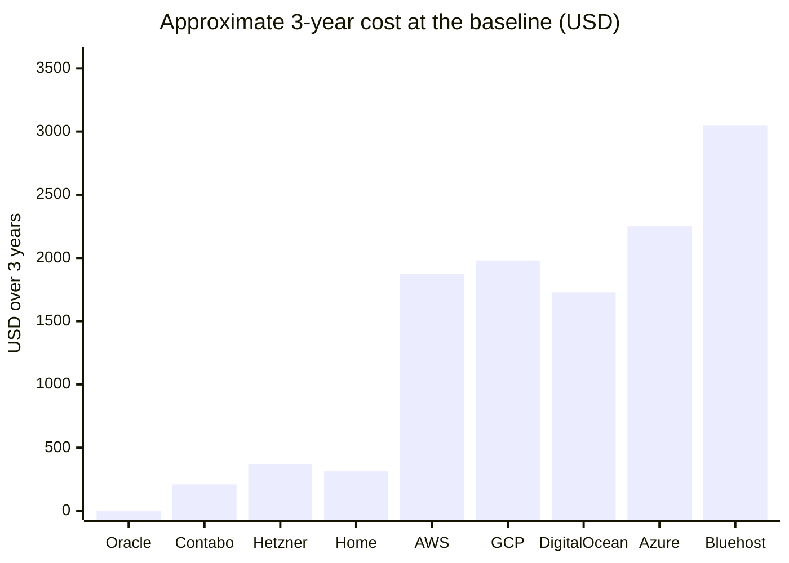
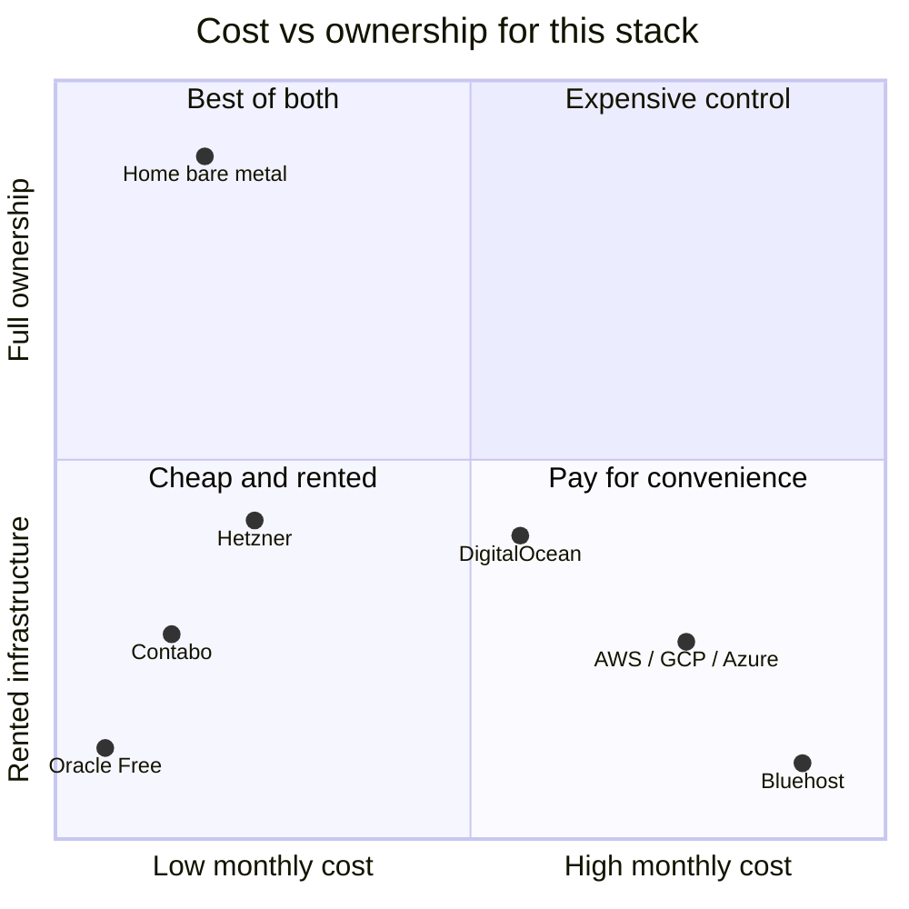
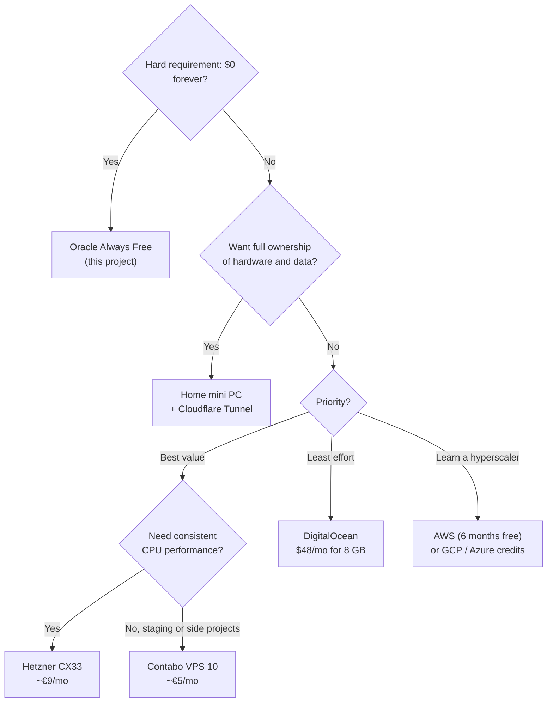

# 18 · Hosting Options Compared: Clouds, VPS and Home Bare Metal

[← Other clouds](17-other-clouds-gcp-aws.md) · [Index](README.md) · [ADRs →](adr/README.md)

> **TL;DR**: For the **same production setup** (this stack: Coolify, Traefik, HTTPS, alerts and
> security automation on one always-on Linux box with about 2 to 4 vCPU and 8 GB RAM):
> **Oracle Always Free is the only $0 option that fits permanently.** If you pay, a **budget VPS**
> (Hetzner, Contabo) gives the best value at roughly €5 to €11 a month. **Home bare metal** gives full
> ownership for about $8 to $10 a month all-in over 3 years (hardware included). **Hyperscalers** (AWS, GCP, Azure) cost about 5 to 10
> times more once credits end. **Managed shared-hosting VPS** (Bluehost) is the poorest fit for a
> Docker PaaS.

> [!NOTE]
> **How to read the prices.** Checked on **2026-10-28**. Each figure is tagged:
> **(V)** verified on the provider's own page, **(A)** from independent aggregators or benchmarks,
> **(≈)** an approximate list price that varies by region, so confirm it with the provider's
> calculator. EUR prices exclude VAT. Approximate conversion: €1 ≈ $1.15. Promotions and taxes are
> ignored. Prices change, so re-check before you decide.

---

## 1. The baseline we compare

Every option is costed for the **same job**, so the numbers are comparable:

| Requirement | Value |
|---|---|
| Workload | Coolify + Traefik + PostgreSQL + Redis + your apps (this repository's stack) |
| Compute | About 2 to 4 vCPU, **8 GB RAM** (comfortable for builds), 80+ GB disk |
| Availability | Always on, single node |
| Reachability | Public HTTPS for `<BASE_DOMAIN>` and `*.<BASE_DOMAIN>` |
| Security | Same hardening (works on any Ubuntu host, see [chapter 17](17-other-clouds-gcp-aws.md)) |

---

## 2. Unified comparison

| Option | Example at the baseline | Monthly cost | Free period | Public IPv4 | Traffic included | You own | Setup | Ops effort |
|---|---|---|---|---|---|---|---|---|
| **Oracle Cloud Always Free** (this project) | A1 Ampere 2 to 4 OCPU / 12 to 24 GB, 200 GB | **$0** (V) | No end date | Included | 10 TB | Config + data | Medium | Low (automated here) |
| **Google Cloud** | Free: e2-micro 1 GB. Baseline: e2-standard-2 (2 vCPU / 8 GB) | Free tier + ~$3.65 IPv4 (V); baseline ≈ $50 to $60 (≈) | No end date (tiny VM only) | ~$3.65/mo (V) | Free tier 1 GB/mo (V), then billed | Config + data | Medium | Medium |
| **AWS** | Free plan: m7i-flex.large (2 vCPU / 8 GB) on credits. After: similar on-demand | $0 for **6 months** on credits (V); then ≈ $55 to $70 (≈) | 6 months (V) | ~$3.65/mo (V) | Billed after free allowances | Config + data | Medium-High | Medium |
| **Azure** | Free: B2pts v2 / B2ats v2 (2 vCPU / 1 GB), 750 h/mo for 12 months (V). Baseline: B2as v2 (2 vCPU / 8 GB) | $0 for **12 months** on the small VM (V); baseline ≈ $55 to $70 (≈) | 12 months (V) | Billed (≈ $3 to $4) | Billed after free allowances | Config + data | Medium-High | Medium |
| **Hetzner Cloud** | CX33: 4 vCPU / 8 GB / 80 GB NVMe | **€8.99 ≈ $10.30** (V) | None | Included (V) | 20 TB in EU (V) | Config + data | Low | Medium |
| **Contabo** | Cloud VPS 10: 4 vCPU / 8 GB / 75 GB NVMe | **≈ €4.50 to €5.50** (A) | None | Included | Unlimited at 200 Mbit/s (A) | Config + data | Low | Medium |
| **DigitalOcean** | Basic Droplet 4 vCPU / 8 GB / 160 GB | **$48** (V) | Trial credit only | Included (V) | 5 TB (V) | Config + data | Very low | Medium |
| **Bluehost managed VPS** | NVMe 8: 4 cores / 8 GB / 200 GB, cPanel | **≈ $69 intro to $99+ renewal** (A) | None | Included | Generous | Config + data (cPanel-centric) | Low for websites, awkward for Docker | Low-Medium |
| **Home bare metal** | Mini PC Intel N100, 16 GB / 512 GB | **≈ $2 to $3 running + hardware** (≈) | n/a | Not needed with a tunnel; static IPv4 from ISP varies | Your home line | **Everything, incl. hardware** | High | High |

> Legend for "You own": every option gives you your config and data. Only bare metal gives you the
> hardware, the network path and physical control.

---

## 3. Total cost of ownership at the baseline

Same 8 GB-class box, always on. Domain: $0 with DuckDNS, or about **$10.46/year** for a `.com` at
cost through Cloudflare Registrar (A).

| Option | Year 1 | Year 3 (cumulative) | Notes |
|---|---|---|---|
| Oracle Always Free | **$0** | **$0** | Within Always Free limits; idle reclaim risk on free-only tenancies |
| Contabo Cloud VPS 10 | ≈ $60 to $75 | ≈ $190 to $230 | (A) price, monthly billing |
| Hetzner CX33 | ≈ $124 | ≈ $372 | (V) price, EU traffic 20 TB |
| Home mini PC + Cloudflare Tunnel | ≈ $230 to $285 | ≈ $280 to $355 | Hardware ≈ $210 to $250 once, power ≈ $1 to $2/mo, domain ≈ $10.5/yr (UPS extra) |
| DigitalOcean 8 GB | $576 | $1,728 | (V) |
| AWS (6-month free plan, then on-demand) | ≈ $330 to $420 | ≈ $1,650 to $2,100 | First 6 months on credits |
| Azure (baseline size, small VM free 12 months) | ≈ $660 to $840 | ≈ $1,980 to $2,520 | The free size has only 1 GB RAM |
| Google Cloud (baseline size) | ≈ $600 to $720 | ≈ $1,800 to $2,160 | The free e2-micro alone is ≈ $44/yr for IPv4 |
| Bluehost managed VPS | ≈ $830 to $1,190 | ≈ $2,500 to $3,600 | Intro then renewal pricing (A) |

### Home bare metal, itemized

| Item | One-time | Monthly | Notes |
|---|---|---|---|
| Mini PC (Intel N100, 16 GB, 512 GB NVMe) | ≈ $210 to $250 (A) | | 5 to 12 W typical draw (A) |
| Electricity | | ≈ $1 to $2 | 8 to 12 W × 730 h ≈ 6 to 9 kWh; at $0.15 to $0.25/kWh |
| UPS (optional, recommended) | ≈ $50 to $80 | | Rides through short outages |
| Internet | | $0 extra | Your existing line; check its terms for hosting |
| **Reachability, option A: Cloudflare Tunnel** | | $0 tunnel + ≈ $0.90 domain | Outbound-only, works behind CGNAT, no open ports, no static IP |
| **Reachability, option B: static IPv4 from ISP** | | Varies widely by ISP and country | Needs port forwarding 80/443, exposes your home IP |
| **Reachability, option C: dynamic IP + DuckDNS** | | $0 | Only if your ISP gives a public IPv4 (not CGNAT); exposes your home IP |
| Spare disk for offsite backup | ≈ $50 | | Or a free cloud object storage tier |

**Recommended home pattern:** Cloudflare Tunnel with your own domain on Cloudflare. It removes the
static IP, port forwarding and CGNAT problems, adds Cloudflare's free DDoS protection and WAF, and
never reveals your home IP. Put the server on its own VLAN or guest network.

---

## 4. Static IPv4 and DNS, side by side

| | Public IPv4 | Static / stable? | Free DNS option | Paid DNS option | Cloudflare proxy (WAF/DDoS) |
|---|---|---|---|---|---|
| Oracle | Included | Ephemeral IP kept for the VM's life | DuckDNS | Own domain ≈ $10.5/yr | Only with own domain |
| GCP | ~$3.65/mo | Ephemeral or reserved (reserved costs more when unused) | DuckDNS | Own domain | Only with own domain |
| AWS | ~$3.65/mo | Auto-assigned changes on stop/start; Elastic IP for fixed | DuckDNS | Own domain / Route 53 | Only with own domain |
| Azure | Billed (≈) | Static option available | DuckDNS | Own domain / Azure DNS | Only with own domain |
| Hetzner / Contabo / DigitalOcean | Included | Static for the server's life | DuckDNS | Own domain | Only with own domain |
| Bluehost VPS | Included | Static | Bundled domain offers | Bundled | Only with own domain |
| Home | ISP-dependent | Usually dynamic; static costs extra or needs a business plan | DuckDNS (if not CGNAT) | Own domain + Cloudflare Tunnel | **Yes with Tunnel** (needs own domain) |

---

## 5. Scoring for this use case

Scores 1 (poor) to 5 (excellent) for running **this** stack. Weights reflect the original goal:
value first, then simplicity and ownership. Oracle's hard advantage, costing $0 with no end date, is a
constraint rather than a score: if $0 is mandatory it wins outright; if paying is acceptable, Hetzner
scores highest.

| Option | Value for money (×3) | Simplicity (×2) | Ownership & control (×2) | Reliability (×1) | Scale headroom (×1) | **Weighted /45** |
|---|---|---|---|---|---|---|
| **Hetzner Cloud** | 4 | 5 | 3 | 4 | 4 | **36** |
| **Contabo** | 5 | 4 | 3 | 3 | 3 | **35** |
| **Oracle Always Free** | 5 | 3 | 3 | 3 | 3 | **33** |
| **Home bare metal + Tunnel** | 4 | 2 | 5 | 2 | 2 | **30** |
| **DigitalOcean** | 2 | 5 | 3 | 4 | 4 | **30** |
| **AWS** | 2 | 2 | 3 | 5 | 5 | **26** |
| **Google Cloud** | 2 | 2 | 3 | 5 | 5 | **26** |
| **Azure** | 2 | 2 | 3 | 5 | 5 | **26** |
| **Bluehost managed VPS** | 1 | 3 | 2 | 4 | 3 | **20** |

---

## 6. SWOT per option

### Oracle Cloud Always Free (this project)

| Strengths | Weaknesses |
|---|---|
| $0 with no end date; up to 4 OCPU / 24 GB ARM (account limits vary), 200 GB, 10 TB egress; a free-only tenancy cannot be billed | Ampere capacity is often unavailable; idle VMs can be reclaimed on free-only accounts; console and docs are less friendly |
| **Opportunities** | **Threats** |
| Grow to PAYG for capacity priority (still $0 within limits); Object Storage and Autonomous DB also free | Oracle can change Always Free terms; account limits can be lower than documented; single region |

### Google Cloud

| Strengths | Weaknesses |
|---|---|
| Free tier with no end date; excellent network and tooling; $300 / 90-day trial | Free VM is 1 GB RAM in 3 US regions; IPv4 billed; 1 GB/month free egress |
| **Opportunities** | **Threats** |
| Managed services (Cloud Run, Cloud SQL) when you outgrow one VM | Small surprise bills (IP, egress, disk type); costs scale fast beyond free |

### AWS

| Strengths | Weaknesses |
|---|---|
| Widest service catalogue; 8 GB-class instance free for 6 months on credits; IMDSv2, IAM, mature security | Free plan ends after 6 months; IPv4 billed; complex pricing |
| **Opportunities** | **Threats** |
| Learn the market-leading cloud; move to ECS/EKS/Lambda later | Bill shock after credits; many billable side-resources (EBS, snapshots, Elastic IPs, NAT) |

### Azure

| Strengths | Weaknesses |
|---|---|
| 12 months of small free VMs (B1s, B2pts v2, B2ats v2); strong identity integration; student credit available | Free VMs have 1 GB RAM; free-account quota limits are commonly reported; complex pricing |
| **Opportunities** | **Threats** |
| Fits Microsoft-centric organisations; Azure for Students | Paid baseline is expensive for a single box; public IP and disk charges |

### Hetzner Cloud

| Strengths | Weaknesses |
|---|---|
| Best paid price/performance: 4 vCPU / 8 GB for €8.99 with IPv4 and 20 TB traffic included; simple API and CLI | Fewer regions (mostly EU, some US/Asia); occasional stock limits; fewer managed services |
| **Opportunities** | **Threats** |
| Scale vertically in minutes; cheap Arm (CAX) plans; snapshots and backups for a small fee | Price increases (already happened); strict abuse handling |

### Contabo

| Strengths | Weaknesses |
|---|---|
| Most RAM and CPU per euro (≈ 4 vCPU / 8 GB for ≈ €4.50); unlimited traffic at 200 Mbit/s | Oversubscribed CPUs and variable disk performance reported in benchmarks; slower provisioning; support is basic |
| **Opportunities** | **Threats** |
| Great for staging, CI runners, side projects | Noisy neighbours; not ideal for latency-sensitive production |

### DigitalOcean

| Strengths | Weaknesses |
|---|---|
| Simplest experience; excellent docs; IPv4 and generous transfer included; predictable pricing | About 5 times Hetzner's price at the same RAM |
| **Opportunities** | **Threats** |
| App Platform, managed DBs, and its own one-click Coolify alternatives | Cost grows linearly with RAM |

### Bluehost managed VPS

| Strengths | Weaknesses |
|---|---|
| Managed, cPanel included, support for website owners | Expensive for the resources; renewal much higher than intro; cPanel is irrelevant for a Docker PaaS; reported checkout surprises (A) |
| **Opportunities** | **Threats** |
| Fine for classic WordPress/PHP hosting | Paying for a control panel you do not need; lock-in to bundled extras |

### Home bare metal

| Strengths | Weaknesses |
|---|---|
| Full ownership of hardware, data and network; cheapest per GB of RAM over time; no provider can reclaim it | Home internet uptime, power cuts, upload speed; you are the datacenter (hardware failure, backups) |
| **Opportunities** | **Threats** |
| Cloudflare Tunnel removes static IP and CGNAT issues for $0 plus a domain; reuse old hardware; learn real ops | ISP terms may forbid hosting; exposing a home IP without a tunnel; theft, fire, single point of failure |

---

## 7. Which one is best?

| If you want... | Choose | Why |
|---|---|---|
| **Strictly $0, permanently** | **Oracle Always Free** | The only option that stays free at a useful size; this repo automates its rough edges |
| **Best paid value with good reliability** | **Hetzner CX33** | 4 vCPU / 8 GB, IPv4 and 20 TB included for ≈ €9; simple ops |
| **Lowest paid price, can tolerate variability** | **Contabo** | Most resources per euro |
| **Full ownership and learning** | **Home mini PC + Cloudflare Tunnel** | ≈ $2 to $3/month to run after ≈ $230 hardware; total control |
| **Least effort, polished UX** | **DigitalOcean** | Simplest, but you pay for it |
| **Career or ecosystem learning** | **AWS / GCP / Azure** | Use the free plan or credits, then move to one of the above |
| **This stack on classic shared hosting** | **Avoid Bluehost-style managed VPS** | Expensive, cPanel-centric, renewal jumps |

**Overall verdict for this project's goals:** Oracle Always Free first ($0, already built and
automated). Keep **Hetzner** as the paid fallback if Oracle ever changes its terms. Choose **home
bare metal** when ownership matters more than uptime.

The whole stack in this repository is portable: on any Ubuntu host, start from
[`render-cloud-init.py`](../scripts/render-cloud-init.py) or run [`harden.sh`](../scripts/harden.sh)
directly, then follow [chapter 16, Path C](16-new-machine-setup.md#path-c-build-the-whole-platform-from-scratch)
from step 6.

---

## Sources (checked 2026-10-28)

| Topic | Source |
|---|---|
| Hetzner Cloud prices (V) | <https://www.hetzner.com/cloud/cost-optimized/> |
| DigitalOcean Droplet prices (V) | <https://www.digitalocean.com/pricing/droplets> |
| Google Cloud free tier (V) | <https://docs.cloud.google.com/free/docs/free-cloud-features> |
| Google Cloud IPv4 pricing (V) | <https://cloud.google.com/vpc/pricing> |
| AWS free plan (V) | <https://aws.amazon.com/free/> |
| AWS EC2 free tier types (V) | <https://docs.aws.amazon.com/AWSEC2/latest/UserGuide/ec2-free-tier-usage.html> |
| Azure free services (V) | <https://azure.microsoft.com/en-us/pricing/free-services> |
| Azure free VM sizes (V) | <https://learn.microsoft.com/en-us/azure/cost-management-billing/manage/create-free-services> |
| Contabo Cloud VPS 10 (A) | <https://www.vpsbenchmarks.com/hosters/contabo/plans/cloud-vps-10> |
| Bluehost VPS pricing (A) | <https://hostadvice.com/hosting-company/blue-host-reviews/vps-pricing/> |
| Cloudflare Registrar .com at cost (A) | <https://costgoat.com/pricing/cloudflare-domains> |
| N100 mini PC power draw (A) | <https://dev.to/selfhostingsh/intel-n100-mini-pc-the-self-hosters-best-friend-3mcf> |
| Oracle Always Free resources (V) | <https://docs.oracle.com/en-us/iaas/Content/FreeTier/freetier_topic-Always_Free_Resources.htm> |

[ADR index →](adr/README.md)
