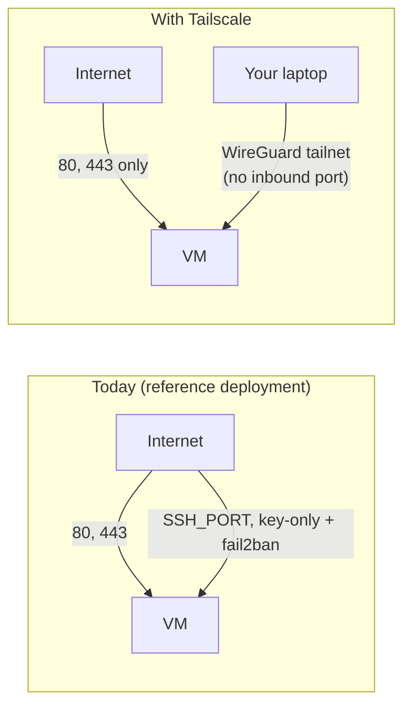

# 19 · Private Access with Tailscale (optional)

[← Hosting options compared](18-hosting-options-compared.md) · [Index](README.md) · [Next: AMD Micro limits →](20-amd-micro-limits.md)

> **TL;DR**: Tailscale puts your laptop and the VM on a private WireGuard network ("tailnet").
> Once SSH works over it, you can **close the public SSH port completely**, leaving only 80 and 443
> on the internet. It is free for personal use, needs no open inbound port, and takes about 15
> minutes. **Status in this project: documented and supported, not enabled** on the reference
> deployment (SSH is key-only on `<SSH_PORT>` there, see [ADR 0010](adr/0010-ssh-key-only-nonstandard-port.md)).

> [!NOTE]
> Tailscale's plans changed in 2026 and third-party summaries disagree on the free limits. Check
> <https://tailscale.com/pricing> for the current Personal plan limits, and its terms if you use it
> for client or commercial work.

---

## Before and after



| | Today | With Tailscale |
|---|---|---|
| Public ports | `<SSH_PORT>`, 80, 443 | **80, 443** |
| Who can even attempt SSH | Anyone on the internet (blocked by keys + fail2ban) | Only devices in your tailnet |
| SSH key still required | Yes | Yes (defense in depth) |
| Extra cost | $0 | $0 on the Personal plan |
| New dependency | None | Tailscale's coordination service (traffic itself is end-to-end encrypted) |

## New placeholders

| Placeholder | Meaning | Secret? |
|---|---|---|
| `<TAILSCALE_AUTH_KEY>` | One-off auth key that joins the VM to your tailnet | **Yes** (expires; generate a new one each time) |
| `<TAILNET_HOST>` | The VM's tailnet name, e.g. `paas-vm` (MagicDNS) | No |

---

## Step 1. Create the tailnet and an auth key

1. Sign up at tailscale.com and install Tailscale on your **laptop**; log in.
2. In the admin console, **Settings > Keys > Generate auth key**: one-off, not ephemeral, short expiry.
   Store it as `<TAILSCALE_AUTH_KEY>` in your password manager (never in git).

## Step 2. Install on the VM (over the current public SSH)

```bash
VM="ssh -i keys/oci_vm -p <SSH_PORT> ubuntu@<BASE_DOMAIN>"
$VM 'curl -fsSL https://tailscale.com/install.sh | sh'
# pass the key on stdin so it never lands in shell history or the process list
printf '%s' '<TAILSCALE_AUTH_KEY>' | $VM 'sudo tailscale up --auth-key="$(cat)" --hostname=<TAILNET_HOST>'
$VM 'sudo tailscale set --auto-update && tailscale ip -4'
```

Then, in the admin console, open the VM's machine entry and **disable key expiry**. Server node
keys expire by default (180 days), and an expired key would cut you off after you close public SSH.

## Step 3. Verify SSH over the tailnet

```bash
tailscale status                                   # on the laptop: <TAILNET_HOST> listed and online
ssh -i keys/oci_vm -p <SSH_PORT> ubuntu@<TAILNET_HOST> 'hostname && echo "over tailnet OK"'
```

**Do not continue until this works.**

Optional: stop fail2ban from ever banning tailnet addresses. On the VM, add `100.64.0.0/10` to the
`ignoreip` line in `/etc/fail2ban/jail.d/sshd.local`, then `sudo systemctl restart fail2ban`.

## Step 4. Close the public SSH port

In [`scripts/provision.py`](../scripts/provision.py), change the public ports and re-apply the
cloud firewall:

```python
OPEN_PORTS = [80, 443]   # SSH only over Tailscale
```

```bash
python scripts/provision.py network
```

On another cloud, remove the SSH rule from the GCP firewall rule or the AWS security group instead
([chapter 17](17-other-clouds-gcp-aws.md)).

## Step 5. Prove it from outside

```bash
# from a machine NOT on the tailnet (or with Tailscale paused)
for p in <SSH_PORT> 80 443; do timeout 5 bash -c "</dev/tcp/<VM_PUBLIC_IP>/$p" && echo "$p open" || echo "$p closed"; done
# expected: <SSH_PORT> closed, 80 open, 443 open

# from your laptop on the tailnet
ssh -i keys/oci_vm -p <SSH_PORT> ubuntu@<TAILNET_HOST> 'echo still reachable privately'
```

---

## Optional: reach the Coolify UI privately

Coolify's internal UI port (8000) is blocked from the internet by the DOCKER-USER guard, which only
filters the **public** network interface. Over the tailnet it is reachable directly:

```text
http://<TAILNET_HOST>:8000
```

Keep the public `https://<BASE_DOMAIN>` dashboard enabled: GitHub webhooks for push-to-deploy need
to reach it. Restricting the public dashboard to tailnet addresses (a Traefik IP allow-list that
exempts the webhook paths) is possible but advanced, and not covered here.

## How this interacts with the rest of the setup

| Component | Effect |
|---|---|
| `harden.sh` | Unchanged. SSH stays key-only on `<SSH_PORT>`; root login stays limited to Docker and VCN ranges |
| Coolify → host SSH | Unchanged (uses port 22 inside the VM) |
| AMD → ARM migrator | Unchanged on the VM (it uses private VCN addresses). Run `deploy-migrator.sh` with `HOST=<TAILNET_HOST>` |
| `security-watch.py` | Expect one "files changed" email after the install (new systemd unit, apt source). That is normal |
| Unattended upgrades | Tailscale updates itself via `tailscale set --auto-update` |
| New VM after migration | Repeat steps 2 and 3 on the new VM before closing its SSH port |

## Break-glass and rollback

| Situation | Action |
|---|---|
| Tailscale down or node key expired | Temporarily re-open SSH: set `OPEN_PORTS = [<SSH_PORT>, 80, 443]`, run `python scripts/provision.py network`, fix, close again |
| Lost laptop | Remove it in the Tailscale admin console; it loses access immediately |
| Leave Tailscale entirely | Re-open the SSH port as above, then `sudo tailscale logout && sudo apt remove tailscale` on the VM |

[ADR index →](adr/README.md)
