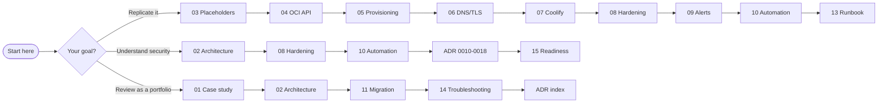

# Documentation Index

[← Repository home](../README.md)

> **TL;DR**: This folder is the full engineering record of a **zero-cost, self-hosted Vercel/Netlify
> alternative** built on Oracle Cloud *Always Free* with Coolify. Everything was provisioned
> **headlessly through the OCI API** (no web console clicks), hardened in depth, monitored by email,
> guarded by automated security responses, and designed to migrate itself from a temporary AMD VM to
> an Ampere A1 VM when capacity appears.

## Chapters

| # | Chapter | What you learn |
|---|---|---|
| 01 | [Case study](01-case-study.md) | Problem, constraints, discoveries, outcome metrics, lessons, timeline |
| 02 | [Architecture](02-architecture.md) | System context, components, network topology, trust boundaries, data flows |
| 03 | [Placeholders & configuration](03-placeholders.md) | Every `<PLACEHOLDER>` used in the docs and where secrets live |
| 04 | [OCI API setup](04-oci-api-setup.md) | API signing key, SDK, auth check, account type, limits, no console |
| 05 | [Provisioning](05-provisioning.md) | VCN, security list, image choice, launch, capacity retry, cloud-init |
| 06 | [DNS & TLS](06-dns-and-tls.md) | DuckDNS wildcard, updater timer, Let's Encrypt via Traefik, Cloudflare limits |
| 07 | [Coolify](07-coolify.md) | Headless install, configuration via tinker, deploying apps, 2FA |
| 08 | [Security hardening](08-security-hardening.md) | Defense-in-depth layers, exact configs, port scan proof, threat model |
| 09 | [Monitoring & alerts](09-monitoring-and-alerts.md) | Gmail SMTP, health checks, daily report, Coolify notifications |
| 10 | [Security automation](10-security-automation.md) | Vulnerability feeds, auto-patching, intrusion guardrails, lockdown |
| 11 | [AMD → ARM migration](11-amd-to-arm-migration.md) | Self-migrating design, stages, dry-run methodology, bugs caught |
| 12 | [Cost guardrails](12-cost-guardrails.md) | Why it stays $0, limits, budget alert, idle reclaim |
| 13 | [Operations runbook](13-operations-runbook.md) | Day-2 tasks, secret rotation, backups, incident response |
| 14 | [Troubleshooting](14-troubleshooting.md) | Every real issue hit: symptom → cause → fix |
| 15 | [Production readiness](15-production-readiness.md) | Scorecard, gaps, roadmap, SLO suggestions |
| 16 | [New machine & from-scratch setup](16-new-machine-setup.md) | Clone on a new device (enable git hooks), restore access safely, rebuild everything, hand over |
| 17 | [Same stack on Google Cloud or AWS](17-other-clouds-gcp-aws.md) | Free-tier comparison, headless gcloud / aws CLI setup, what carries over, cost caveats |
| 18 | [Hosting options compared](18-hosting-options-compared.md) | Oracle, GCP, AWS, Azure, Hetzner, Contabo, DigitalOcean, Bluehost and home bare metal: cost, 3-year TCO, IPv4/DNS, scoring, SWOT, verdict |
| 19 | [Private access with Tailscale (optional)](19-private-access-with-tailscale.md) | Close the public SSH port: tailnet setup, verification, private Coolify UI, break-glass and rollback |
| 20 | [AMD Micro limits](20-amd-micro-limits.md) | Why Coolify is slow on the 1 GB test box: measurements, benchmark method, tuning, what was rejected, test vs production |

**Architecture Decision Records:** [adr/README.md](adr/README.md): 19 ADRs explaining *why* each choice was made.

## Visual assets

| Asset | Shows |
|---|---|
| [architecture.svg](../assets/architecture.svg) | End-to-end production architecture |
| [request-flow.svg](../assets/request-flow.svg) | How a browser request reaches an app |
| [security-layers.svg](../assets/security-layers.svg) | Defense-in-depth layers |
| [guardrails-decision.svg](../assets/guardrails-decision.svg) | Automated security decision logic |
| [migration-flow.svg](../assets/migration-flow.svg) | AMD → ARM self-migration stages |
| [cost-breakdown.svg](../assets/cost-breakdown.svg) | What is used vs. the Always Free allowance |

## Reading paths

| I want to… | Read |
|---|---|
| **Replicate the setup** | 16 (Path C checklist) → 03 → 04 → 05 → 06 → 07 → 08 → 09 → 10 → 11 → 13 |
| **Work on this repo from a new computer** | 16 (Path A, then Path B if you operate the VM) |
| **Choose where to host it** | 18 → 17 → 12 |
| **Build it on Google Cloud or AWS instead** | 17 → 16 (Path C steps 6 to 10) → 08 → 09 → 10 |
| **Understand the security model** | 02 → 08 → 10 → 19 → ADRs 0010-0018 → 15 |
| **Review it as a portfolio piece** | 01 → 02 → 11 → 14 → ADR index → 15 |
| **Operate it day to day** | 13 → 14 → 09 |

## Conventions

- `<PLACEHOLDER>` values are defined in [03-placeholders.md](03-placeholders.md). No real secret,
  address, or identity appears anywhere in this repository.
- Commands prefixed with `$` run on your workstation; commands prefixed with `vm$` run on the VM
  (`ssh -i keys/oci_vm -p <SSH_PORT> ubuntu@<BASE_DOMAIN>`).
- Scripts live in [`../scripts`](../scripts); each one is idempotent (safe to re-run).
