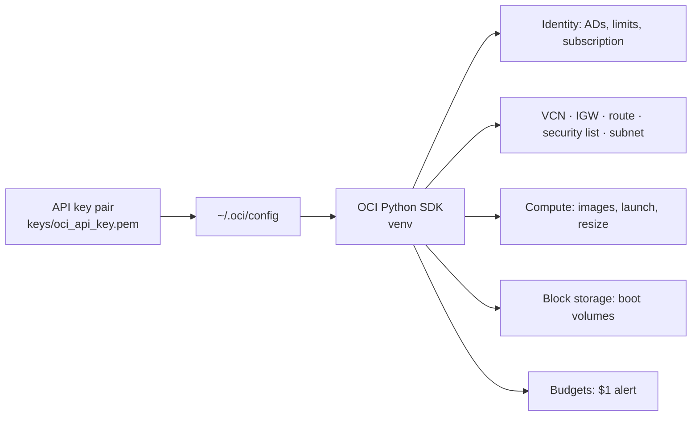

# ADR-0002: Headless, API-only provisioning

- **Status:** Accepted — 2026-10-28
- **Related:** [ADR-0016](0016-least-privilege-automation-identity.md), [OCI API setup](../04-oci-api-setup.md), [Provisioning](../05-provisioning.md), [`scripts/provision.py`](../../scripts/provision.py)

## Context

Console click-ops is not reproducible, not reviewable and not shareable. The only manual step
we accept is creating an **API signing key** for the user (Profile → API keys) once; everything
after that — network, firewall, VMs, budgets, IAM — must be code.

The obvious tool, `oci-cli`, failed to install on the workstation's **Python 3.14**: it pins an older
**PyYAML** that has no prebuilt wheel for 3.14 and needs a C compiler (*"Microsoft Visual C++ 14.0
or greater is required"*). The **OCI Python SDK** (`pip install oci`) has no such dependency.

## Decision

- Authenticate with `~/.oci/config` (user OCID, fingerprint, tenancy OCID, `<OCI_REGION>`, key file).
- Use the **OCI Python SDK** in a dedicated virtualenv for every operation.
- Keep all infrastructure logic in idempotent scripts that **find resources by display name** and
  create them only if missing, so any script can be safely re-run.

## Consequences

**Positive**
- Entire environment is reproducible from the repository plus four config values.
- Same code runs from a laptop or from the VM itself (the migrator, [ADR-0015](0015-self-migrating-amd-to-arm.md)).
- Pre-flight checks (account type, A1 limits, storage usage) are scripted, not guessed.

**Negative**
- The SDK is more verbose than the CLI; we wrote small helpers (`first()`, `wait()`, `launch_details()`).
- The initial API key is tenancy-admin; it must stay on the workstation only ([ADR-0017](0017-secrets-handling.md)).

## Alternatives considered

| Option | Why not |
|---|---|
| OCI Console | Not reproducible, no audit trail in git |
| `oci-cli` | Install failure on Python 3.14 (PyYAML build); would need build tools or another Python |
| Terraform OCI provider | Good fit for larger estates; overkill for ~10 resources and awkward for the capacity-retry loop and in-place resize/migration logic |
| OCI Resource Manager | Console-centric, still Terraform |
