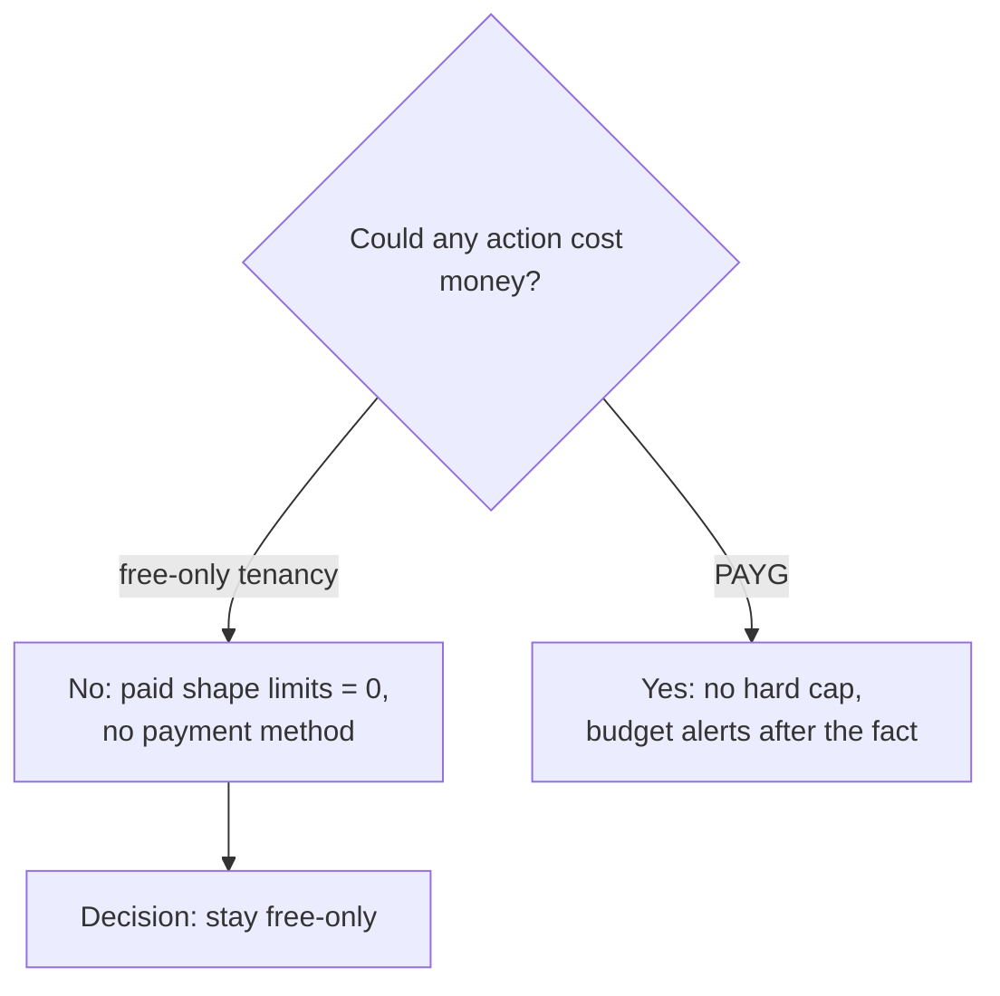

# ADR-0003: Stay on a free-only tenancy (no Pay-As-You-Go)

- **Status:** Accepted: 2026-10-28
- **Related:** [ADR-0001](0001-oracle-cloud-always-free.md), [ADR-0004](0004-ampere-a1-target-amd-micro-standin.md), [Cost guardrails](../12-cost-guardrails.md)

## Context

The hard requirement: **no money may ever be deducted without explicit confirmation.**

Facts gathered via the API (Subscriptions + Limits):

| Check | Result |
|---|---|
| Subscription `payment_model` | `FREE_TRIAL`, trial window ended → **free-only** tenancy |
| A1 core / memory limit | **2 OCPU / 12 GB** (documented maximum is 4 / 24) |
| E4/E5/Standard2 limits | **0**: paid shapes cannot be launched at all |
| Block storage | 200 GB |

Upgrading to Pay-As-You-Go (PAYG) typically raises A1 limits and capacity priority and removes
idle reclaim, but **OCI has no hard spending cap**: a budget only sends an email *after* spend
occurs.

## Decision

Remain **free-only**. Size everything to the account's real limits (2 OCPU / 12 GB / 200 GB).
Additionally create a **$1/month budget** with ACTUAL and FORECAST alert rules to `<ALERT_EMAIL>`
as defence-in-depth, even though a free-only tenancy cannot be billed.

## Consequences

**Positive**
- Billing is **structurally impossible**, not merely monitored.
- Accidental creation of a paid shape fails with `LimitExceeded`.

**Negative**
- Half the documented A1 capacity (2/12 instead of 4/24).
- Lower priority for scarce A1 capacity → long waits ([ADR-0004](0004-ampere-a1-target-amd-micro-standin.md)).
- Idle reclaim policy applies (VM may be **stopped**, not deleted, after 7 idle days).
- Upgrade path documented: if PAYG is ever chosen, the A1 VM can be resized in place to 4/24.

## Alternatives considered

| Option | Why not |
|---|---|
| PAYG + $1 budget | Alerts arrive after the charge; violates "no deduction without confirmation" |
| PAYG + quotas policy | Quotas reduce risk but are not a billing guarantee; mistakes in policy = charges |
| Support limit-increase request | Free-only tenancies are generally told to upgrade first |
