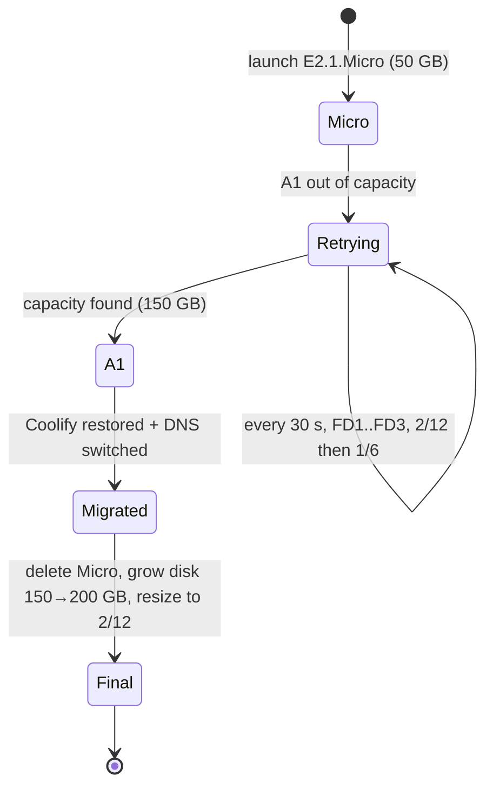

# ADR-0004: Ampere A1 as the target, AMD Micro as a stand-in

- **Status:** Accepted — 2026-10-28
- **Related:** [ADR-0015](0015-self-migrating-amd-to-arm.md), [Provisioning](../05-provisioning.md), [Migration](../11-amd-to-arm-migration.md)

## Context

The first A1 launch attempts (2 OCPU / 12 GB) returned **`Out of host capacity`** repeatedly — the
home region had no free ARM hosts. Waiting could take hours to days. Meanwhile the owner wanted a
usable server *now*.

Storage is a shared pool of **200 GB** across all boot and block volumes. A boot volume has a
minimum of ~47–50 GB.

| Shape | CPU | RAM | Availability |
|---|---|---|---|
| VM.Standard.A1.Flex | up to 2 OCPU (this account) | up to 12 GB | Scarce |
| VM.Standard.E2.1.Micro | 1/8 OCPU (burstable) | 1 GB | Usually available |

## Decision

1. Launch an **E2.1.Micro** now with a **50 GB** boot volume and run the full stack on it.
2. Retry the A1 continuously, cycling all fault domains, trying 2/12 first and **1/6 as a
   fallback** (smaller requests fit fragmented hosts more often), with a **150 GB** boot volume.
3. On success: migrate, delete the Micro (frees 50 GB), **grow the A1 boot volume to 200 GB**
   online and **resize to 2/12** in place.

## Consequences

**Positive**
- Usable immediately; no idle waiting.
- End state still uses **100 %** of the free storage (200 GB) on one strong server.

**Negative**
- 1 GB RAM is below Coolify's 2 GB minimum: works with 4 GB swap, but heavy builds (e.g. Next.js)
  are slow or fail until the move.
- x86 → ARM switch means app images must be rebuilt for arm64 (handled by redeploy in the migrator).
- Extra machinery (migrator) to maintain.

## Alternatives considered

| Option | Why not |
|---|---|
| Wait for A1 with nothing running | No usable environment for an unknown time |
| Two A1 VMs 1/6 each | Splits the small 2/12 allowance; owner chose one maximal server |
| Use the Micro forever | 1 GB RAM / 1/8 OCPU is too small for a PaaS |
| Change region | Always Free compute is home-region only; free-only tenancies cannot subscribe to other regions |
