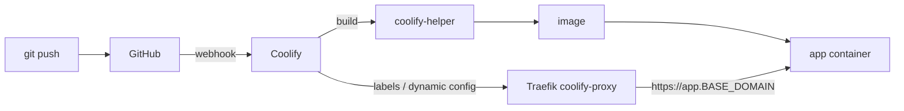

# ADR-0005: Coolify as the PaaS layer

- **Status:** Accepted: 2026-10-28
- **Related:** [ADR-0007](0007-letsencrypt-http01-via-traefik.md), [ADR-0009](0009-docker-address-pool-172-20.md), [Coolify chapter](../07-coolify.md)

## Context

We want the Vercel/Netlify developer experience, push to git, get a build, get
`https://<APP_NAME>.<BASE_DOMAIN>` with a valid certificate, on one small VM, plus databases and
long-running services that serverless platforms cannot host.

## Decision

Use **Coolify v4** (installed headlessly, pinned per migration to the running version, auto-updated
otherwise). Coolify brings: Traefik reverse proxy with automatic Let's Encrypt, git/GitHub-App
deploys, Nixpacks/Dockerfile/Compose builds, one-click databases and services, backups, notifications
and an API.

## Consequences

**Positive**
- Full PaaS on one host; UI for non-ops users; per-app HTTPS out of the box.
- Supports arm64 natively (official multi-arch images).
- Built-in email notifications for deploys, disk, server reachability, backups, patches.

**Negative**
- Coolify itself is a **high-value target**: it runs as root-equivalent (Docker socket, root SSH to
  the host). Its own advisories have included authenticated RCE → host root. Mitigated by
  [ADR-0012](0012-fail2ban-for-ssh-and-coolify-login.md) (2FA + brute-force bans) and
  [ADR-0014](0014-automated-security-guardrails-and-lockdown.md) (auto-patch, lockdown).
- ~700-900 MB RAM baseline for its own containers (heavy for the 1 GB stand-in).
- Installer quirks we had to handle: Docker pool overlap, password policy requiring a symbol,
  localhost SSH key regeneration on fresh hosts.

## Alternatives considered

| Option | Pros | Why not |
|---|---|---|
| Dokku | Tiny, Heroku-like | No UI, per-app TLS plugin, weaker multi-service story |
| CapRover | UI, one-click apps | Docker Swarm based; less active; fewer notifications |
| k3s + Argo/Flux | Industry standard | Far too heavy for 1-12 GB, steep ops burden for one node |
| Plain docker-compose + Caddy | Simple | No git-push deploys, no UI, everything manual |
| Dokploy | Similar to Coolify | Younger ecosystem at decision time |
