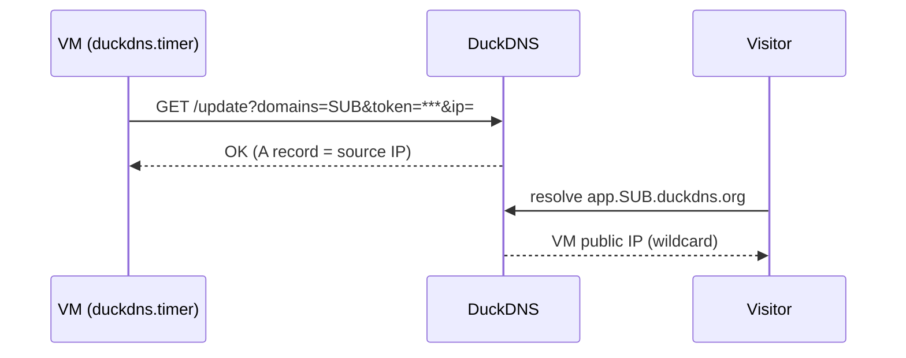

# ADR-0006: DuckDNS with wildcard sub-names

- **Status:** Accepted: 2026-10-28
- **Related:** [ADR-0007](0007-letsencrypt-http01-via-traefik.md), [ADR-0008](0008-no-cloudflare-with-duckdns.md), [DNS & TLS](../06-dns-and-tls.md)

## Context

A PaaS needs one hostname per app. Buying a domain costs money; free subdomain services vary in
reliability and features.

Verified behaviour of DuckDNS: after registering `<DUCKDNS_SUBDOMAIN>.duckdns.org`, **any** deeper
name (`anything.<DUCKDNS_SUBDOMAIN>.duckdns.org`) resolves to the same IP, effectively a free
wildcard A record. `duckdns.org` is on the **Public Suffix List**, so Let's Encrypt rate limits apply
per subdomain, not to all DuckDNS users together.

## Decision

- Register `<DUCKDNS_SUBDOMAIN>` on DuckDNS; dashboard at `https://<BASE_DOMAIN>`, apps at
  `https://<APP_NAME>.<BASE_DOMAIN>`.
- Keep the record correct from the VM itself with a **systemd timer every 5 minutes**
  (`/etc/duckdns/env`, root-only, `ip=` empty so DuckDNS uses the request's source IP).
- During migration the **source disables its timer** and the target enables its own, exactly one
  updater at any time.

## Consequences

**Positive**
- $0, wildcard, instant updates, simple HTTP API.
- Survives public-IP changes (e.g. after the AMD → ARM move) automatically.

**Negative**
- The DuckDNS token can repoint the domain → treated as a secret ([ADR-0017](0017-secrets-handling.md)).
- No DNSSEC/CAA control, no Cloudflare ([ADR-0008](0008-no-cloudflare-with-duckdns.md)).
- Third-party dependency with no SLA.

## Alternatives considered

| Option | Why not |
|---|---|
| Paid domain + Cloudflare | Costs money (~$1-12/yr), violates zero-cost |
| eu.org / is-a.dev | Free and Cloudflare-compatible, but approval takes days, weeks; good **future** upgrade |
| nip.io / sslip.io | IP-embedded names change with the IP; ugly URLs |
| Raw IP | No TLS from public CAs |
