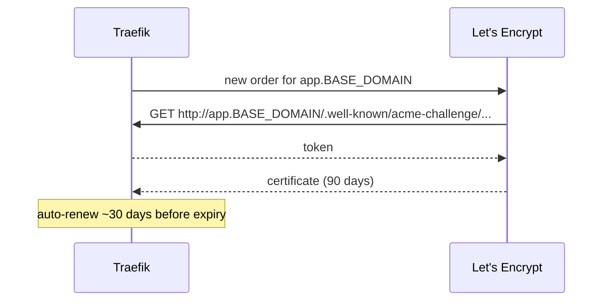

# ADR-0007: Let's Encrypt HTTP-01 via Coolify's Traefik

- **Status:** Accepted — 2026-10-28
- **Related:** [ADR-0005](0005-coolify-as-paas.md), [ADR-0006](0006-duckdns-wildcard-dns.md), [DNS & TLS](../06-dns-and-tls.md)

## Context

Every app and the dashboard need trusted HTTPS, renewed without human action. Coolify ships Traefik
(`coolify-proxy`) with an ACME resolver using the **HTTP-01** challenge and storage in
`/data/coolify/proxy/acme.json`.

## Decision

- Let Traefik issue **one certificate per hostname** via HTTP-01 on port 80; renewals happen
  automatically ~30 days before the 90-day expiry.
- Always configure app domains with the `https://` prefix in Coolify so a certificate is requested.
- Redirect HTTP → HTTPS.
- Carry `acme.json` along during migration so certificates survive a host change.
- Monitor expiry: `health-check` alerts if a certificate has < 14 days left.

Verified: the dashboard and a test app each received a Let's Encrypt certificate about two minutes
after deployment.

## Consequences

**Positive**
- Zero-touch TLS for unlimited apps; certificates are standard and trusted.
- Port 80 must stay open — it also serves the HTTP→HTTPS redirect.

**Negative**
- No wildcard certificate (DNS-01 would need a DNS-provider plugin; DuckDNS DNS-01 is possible but
  adds token exposure in Traefik). Per-host certificates are fine within Let's Encrypt limits
  (50 certificates/week per registered domain — here, per DuckDNS subdomain).
- During the first ~1–2 minutes after a deploy, visitors see Traefik's default certificate.

## Alternatives considered

| Option | Why not |
|---|---|
| DNS-01 wildcard via DuckDNS plugin | Puts the DuckDNS token inside the proxy; unnecessary for our volume |
| Caddy | Excellent auto-TLS, but Coolify is built around Traefik |
| Cloudflare origin certs | Requires Cloudflare ([ADR-0008](0008-no-cloudflare-with-duckdns.md)) |
