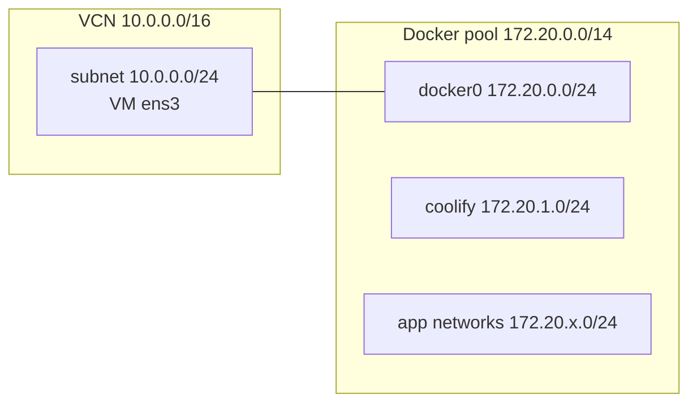

# ADR-0009: Docker address pool `172.20.0.0/14`

- **Status:** Accepted: 2026-10-28
- **Related:** [ADR-0005](0005-coolify-as-paas.md), [ADR-0010](0010-ssh-key-only-nonstandard-port.md), [Coolify chapter](../07-coolify.md), [Troubleshooting](../14-troubleshooting.md)

## Context

Reading Coolify's installer before running it showed it configures Docker's
`default-address-pools` to **`10.0.0.0/8`** (size /24). The OCI VCN is **`10.0.0.0/16`** with the
VM subnet **`10.0.0.0/24`**. A Docker bridge could be allocated `10.0.0.0/24`: the same range as
the VM's own subnet, breaking routing to the gateway, the internet, and SSH.

## Decision

Run the installer with:

```bash
DOCKER_ADDRESS_POOL_BASE=172.20.0.0/14 DOCKER_ADDRESS_POOL_SIZE=24 bash install.sh
```

The same values are used by the migrator on the target and by `security-watch` when it runs the
installer to upgrade Coolify.

Verified after install: `docker0 = 172.20.0.0/24`, `coolify` network `172.20.1.0/24`, VCN routes
untouched.



## Consequences

**Positive**
- No overlap now or later (the /14 gives 1024 /24 networks).
- `172.16.0.0/12` is a single, clean range to trust in sshd `Match Address` and fail2ban `ignoreip`.

**Negative**
- A setting to remember on every reinstall/upgrade, encoded in scripts to avoid drift.

## Alternatives considered

| Option | Why not |
|---|---|
| Keep `10.0.0.0/8` | Collides with the VCN |
| Change the VCN to `192.168.0.0/16` | Works, but fighting a default that will be re-applied by future installs is worse |
