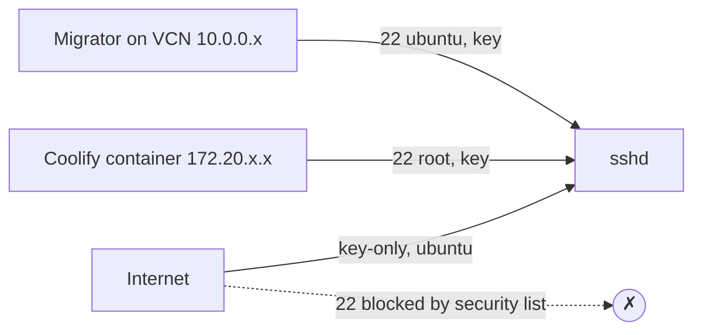

# ADR-0010: Key-only SSH on a non-standard public port

- **Status:** Accepted — 2026-10-28
- **Related:** [ADR-0011](0011-defense-in-depth-network-layers.md), [ADR-0012](0012-fail2ban-for-ssh-and-coolify-login.md), [Security hardening](../08-security-hardening.md), [`scripts/harden.sh`](../../scripts/harden.sh)

## Context

- The owner wants SSH from any device that holds the private key (so no IP allow-list), with a
  path to a VPN (Tailscale) later.
- **Coolify manages its host by SSH-ing as `root` to `host.docker.internal:22`** from its container
  network (`172.20.x.x`). Disabling root or moving port 22 entirely would break it.
- Ubuntu 24.04 uses **socket-activated** sshd: `Port` lines are turned into `ssh.socket` listeners by
  a generator, so a `daemon-reload` + socket restart is required.

## Decision

`/etc/ssh/sshd_config.d/00-hardening.conf` (first match wins):

```text
Port 22
Port <SSH_PORT>            # 22022
PermitRootLogin no
PasswordAuthentication no
KbdInteractiveAuthentication no
AuthenticationMethods publickey
MaxAuthTries 3
LoginGraceTime 20
X11Forwarding no
AllowAgentForwarding no
AllowUsers ubuntu root
```

Appended to the main `sshd_config` (Match blocks must be last):

```text
Match Address 127.0.0.1,::1,172.16.0.0/12,10.0.0.0/16
    PermitRootLogin prohibit-password
```

- The **OCI security list exposes only `<SSH_PORT>`**; port 22 is reachable only from inside the
  VM/Docker/VCN.
- Port change rollout was done safely: open `<SSH_PORT>` → test login → only then close 22.



## Consequences

**Positive**
- No password attacks possible; root never reachable from the internet.
- Non-standard port drops >95 % of automated scan noise (not a security control on its own).
- Coolify host management keeps working (verified: `instant_remote_process(["whoami"])` → `root`).

**Negative**
- A lost private key means console/serial recovery. Keep `keys/` backed up offline.
- Two listening ports to reason about.

**Lesson:** on a freshly booted 24.04 image `/run/sshd` does not exist until the first connection, so
`sshd -t` fails — the hardening script runs `mkdir -p /run/sshd` first (found by the migration dry run).

## Alternatives considered

| Option | Why not (now) |
|---|---|
| Tailscale only, no public SSH | Best posture; deferred because the owner wants key-only access from any device first — documented upgrade |
| IP allow-list | Owner's IP is dynamic |
| Keep 22 public | Needless log noise and brute-force load |
