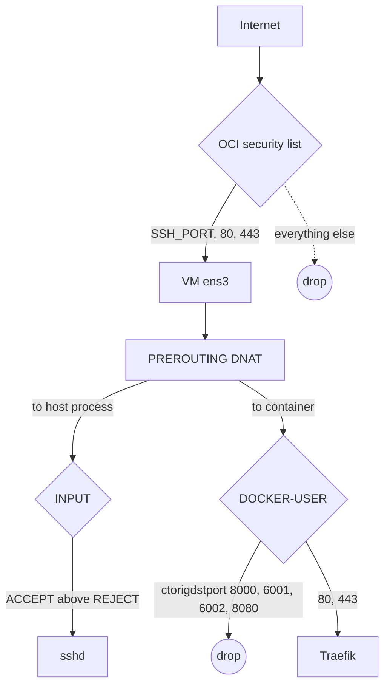

# ADR-0011: Defense-in-depth network layers

- **Status:** Accepted: 2026-10-28
- **Related:** [ADR-0010](0010-ssh-key-only-nonstandard-port.md), [ADR-0012](0012-fail2ban-for-ssh-and-coolify-login.md), [Security hardening](../08-security-hardening.md)

## Context

Three surprises shaped this decision:

1. **Oracle's Ubuntu image ships host iptables rules** that `REJECT` everything except SSH. Our first
   script inserted ACCEPT rules at line 6, but on this image the `REJECT` is at **line 5**, so 80/443
   landed *after* it and were blocked.
2. **Docker-published ports bypass the INPUT chain.** Traffic is DNAT'd in `PREROUTING` and passes
   `FORWARD → DOCKER-USER`, so host INPUT rules do not protect containers. nginx in Docker was
   reachable even when INPUT had no rule for port 80.
3. Coolify publishes **8000 (UI), 6001/6002 (realtime/terminal)** and Traefik **8080 (dashboard)** on
   `0.0.0.0`.

## Decision

| Layer | Control |
|---|---|
| 1. OCI security list (cloud edge) | Ingress only TCP `<SSH_PORT>`, 80, 443 + ICMP type 3/4 from anywhere; all from `10.0.0.0/16` |
| 2. Host `INPUT` | `open-ports` helper inserts ACCEPT **directly above the first REJECT** (found dynamically), persisted with `netfilter-persistent` |
| 3. `DOCKER-USER` | `docker-port-guard.service` drops external-interface traffic to 8000/6001/6002/8080 using `-m conntrack --ctorigdstport` (matches the **pre-DNAT** port) |
| 4. Egress | `egress-guard` rejects outbound to common crypto-mining pool ports (host + containers) |
| 5. Application | Traefik serves only configured hosts; Coolify UI only via `https://<BASE_DOMAIN>` |

Verified with an external TCP scan: open = `<SSH_PORT>`, 80, 443; closed = 22, 8000, 8080, 6001, 6002, 5432.

## Consequences

**Positive**
- A mistake in any single layer (e.g. a too-open security list) does not expose internal services.
- Works the same on the ARM target (scripts are idempotent and run at first boot).

**Negative**
- More moving parts; documented in the runbook ("opening a new port requires security list **and**
  `open-ports`"). Docker-published app ports need only the security list, which is intentional.

## Alternatives considered

| Option | Why not |
|---|---|
| UFW | Same Docker-bypass problem; conflicts with Oracle's preinstalled rules |
| Bind Coolify ports to 127.0.0.1 via compose override | Compose merges port lists (appends), fragile across Coolify upgrades |
| Security list only | Single point of failure |
