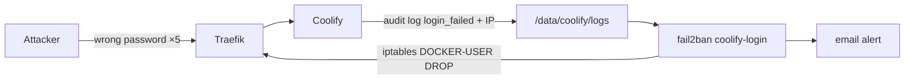

# ADR-0012: fail2ban for SSH and the Coolify login, plus 2FA

- **Status:** Accepted: 2026-10-28
- **Related:** [ADR-0010](0010-ssh-key-only-nonstandard-port.md), [ADR-0011](0011-defense-in-depth-network-layers.md), [Security hardening](../08-security-hardening.md)

## Context

The Coolify dashboard is internet-facing (no Cloudflare, [ADR-0008](0008-no-cloudflare-with-duckdns.md)).
Coolify (Laravel Fortify) throttles logins per email+IP, but does not ban attackers at the network
level. Investigation showed Coolify writes an **audit log** with the real client IP:

```json
{"event":"auth.user.login_failed","ip":"198.51.100.7", ...}
```

…but inside the container (`/var/www/html/storage/logs`), not on the host. Log timestamps are **UTC**
while the host runs in local time.

## Decision

1. Mount the logs to the host with Coolify's supported override
   `/data/coolify/source/docker-compose.custom.yml` (honoured by `upgrade.sh`, so it survives updates):
   ```yaml
   services:
     coolify:
       volumes:
         - /data/coolify/logs:/var/www/html/storage/logs
   ```
2. fail2ban jails:

| Jail | Source | Threshold | Ban | Where the ban applies |
|---|---|---|---|---|
| `sshd` | systemd journal | 3 fails / 10 min | 24 h, escalating (`bantime.increment`) | INPUT (ports 22, `<SSH_PORT>`) |
| `coolify-login` | `/data/coolify/logs/audit-*.log`, `logtimezone = UTC` | 5 fails / 10 min | 24 h | **`DOCKER-USER`** (HTTPS goes to the Traefik container) |

3. Daily cron reloads `coolify-login` after the UTC log rotation so the new file is watched.
4. **2FA (TOTP)** is enabled on the only admin account; registration is disabled, so every possible
   login requires a second factor. Verified `two_factor_confirmed_at` is set in the database.
5. Bans trigger an email via `health-check`.



## Consequences

**Positive**
- Password guessing is rate-limited (Fortify), banned (fail2ban) and ultimately useless (2FA).

**Negative**
- Users behind a shared NAT could be banned by someone else's failures (unban documented).
- Depends on Coolify's audit-log JSON key order (`"event"…,"ip"`); a format change would silently
  disable the jail → covered by testing with `fail2ban-regex` after upgrades (runbook).

## Alternatives considered

| Option | Why not |
|---|---|
| Traefik access-log based jail | Coolify does not enable access logs by default; status 422/302 is ambiguous |
| CrowdSec | Strong, but heavier; good future upgrade |
| Basic-auth in front of the dashboard | Breaks Coolify's realtime/websocket flows and webhooks |
