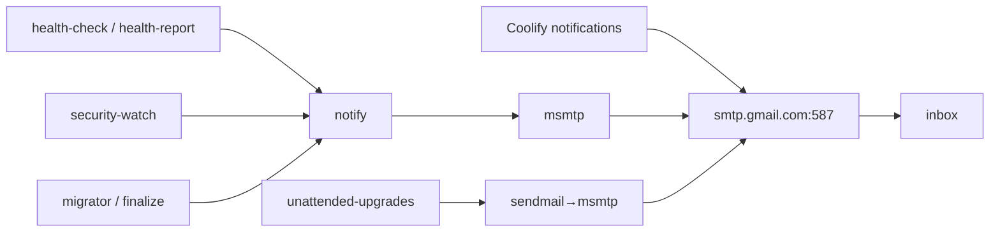

# ADR-0013: Gmail SMTP for alerts

- **Status:** Accepted — 2026-10-28
- **Related:** [ADR-0014](0014-automated-security-guardrails-and-lockdown.md), [ADR-0017](0017-secrets-handling.md), [Monitoring & alerts](../09-monitoring-and-alerts.md)

## Context

The owner must learn about problems quickly, by email, at $0. Sources of alerts:
Coolify (deploys, disk, reachability, backups, patches), host health checks, security automation,
unattended-upgrades, the migrator. OCI **blocks outbound port 25** by default; submission ports
(587/465) work.

## Decision

- Use the owner's Gmail account with a **Google App Password** (requires 2-Step Verification),
  `smtp.gmail.com:587` **STARTTLS**.
- Coolify: team email channel + instance SMTP configured with the same settings (also enables
  password-reset mails).
- Host: **msmtp** (`/etc/msmtprc`, mode 600) + `msmtp-mta` (provides `sendmail` for
  unattended-upgrades) + a small `notify` wrapper with per-key **cooldowns** to prevent alert storms.
- Delivery verified via msmtp log `smtpstatus=250`.

## Consequences

**Positive**
- Free, reliable delivery; alerts land on the phone.
- App Password is scoped and **revocable independently** of the Google account password.

**Negative**
- Gmail sending limits (~500/day) — cooldowns keep us far below.
- App Password is a long-lived secret on the VM (root-only file); rotation documented in the runbook.
- Alerts depend on a third party; the daily report doubles as a heartbeat (missing report = problem).

## Alternatives considered

| Option | Why not |
|---|---|
| Resend / SendGrid free tiers | Extra account + domain verification (no own domain) |
| Telegram/Discord | Good for chat-ops; owner preferred email |
| Local MTA on port 25 | Blocked by OCI; poor deliverability |
