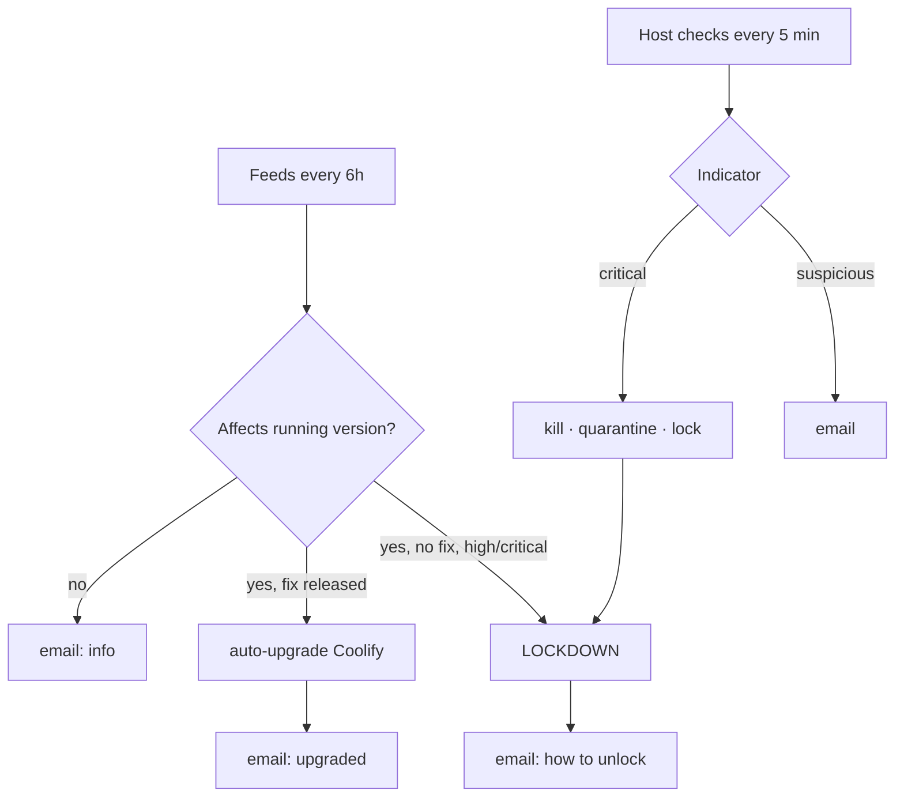

# ADR-0014: Automated security guardrails and lockdown

- **Status:** Accepted — 2026-10-28
- **Related:** [ADR-0005](0005-coolify-as-paas.md), [ADR-0013](0013-gmail-smtp-for-alerts.md), [ADR-0018](0018-unattended-upgrades-and-auto-reboot.md), [Security automation](../10-security-automation.md), [`scripts/security-watch.py`](../../scripts/security-watch.py)

## Context

Coolify (PHP/Laravel) holds the Docker socket and root SSH to the host; a Coolify RCE equals host
root. Its published advisories include an *"Authenticated RCE … → host root"*. A single owner cannot
watch advisories around the clock, so the server needs to **notice and react on its own**.

## Decision

`security-watch.py` (Python stdlib only, root, systemd timers):

**Feeds — every 6 h, trusted sources only**

| Source | Purpose |
|---|---|
| GitHub Releases `coollabsio/coolify` | New versions; release notes scanned for security keywords |
| GitHub Security Advisories `coollabsio/coolify` | Version-range check against the running version |
| GitHub Advisory DB: `laravel/framework`, `livewire/livewire`, `traefik/v3` | High/critical stack advisories (info) |
| **CISA KEV** catalog | Actively exploited CVEs filtered to stack keywords (PHP, Laravel, Docker, OpenSSH, kernel, …) |

**Host checks — every 5 min**: extra UID-0 accounts, new login accounts, `/etc/ld.so.preload`,
miner process names / binaries executing from `/dev/shm`, programs running from temp dirs, unknown
SSH keys for `ubuntu`, root SSH logins from public IPs, integrity hashes of ~40 auth/persistence files.

**Automated actions (edge decisions)**

| Signal | Action |
|---|---|
| Security release, or high/critical advisory affecting the running version **with a fix** | Upgrade Coolify immediately (installer, pinned pool settings), email result |
| High/critical advisory **without a fix** | **Lockdown** |
| Rootkit preload, miner, extra UID-0, root SSH from internet | Kill/quarantine/lock + **Lockdown** |
| New login account / unknown `ubuntu` key | Lock account / remove key, email |
| File changes | Email once, re-baseline |

**Lockdown** = stop `coolify` + `coolify-realtime` (the control plane). Apps, Traefik/HTTPS and the
owner's SSH keep working; the lockdown is re-enforced every 5 min (Coolify containers use
`restart: always`). `security-watch.py unlock` restores it after investigation.

First run on the live system: Coolify 4.5.0 was affected by a published advisory; the watcher
**auto-upgraded to 4.5.2**, verified healthy, and emailed the result.

**False-positive safeguards**: first run seeds a baseline (~1,800 known items) without alerting;
advisories without a version range are reported but never acted on; temp-dir alerts are keyed by
path (not PID) with 6 h cooldowns; only clear-cut indicators trigger lockdown.

## Consequences

**Positive**
- Patch latency for Coolify drops from "whenever noticed" to ≤ 6 h.
- Containment limits blast radius while keeping public apps online.

**Negative**
- Auto-upgrades can introduce regressions; mitigated by health checks and email.
- Heuristic host checks are not an EDR; a careful attacker can evade them.
- GitHub API unauthenticated rate limit (60/h) — we use ~6 calls per run.

## Alternatives considered

| Option | Why not |
|---|---|
| Alert only, no automation | Owner asked for automated edge decisions; human latency too high |
| Wazuh / OSSEC agent | Needs a manager server and RAM |
| CrowdSec + AppSec | Promising; heavier; future work |
| Falco | eBPF runtime security; too heavy for 1 GB stand-in |
