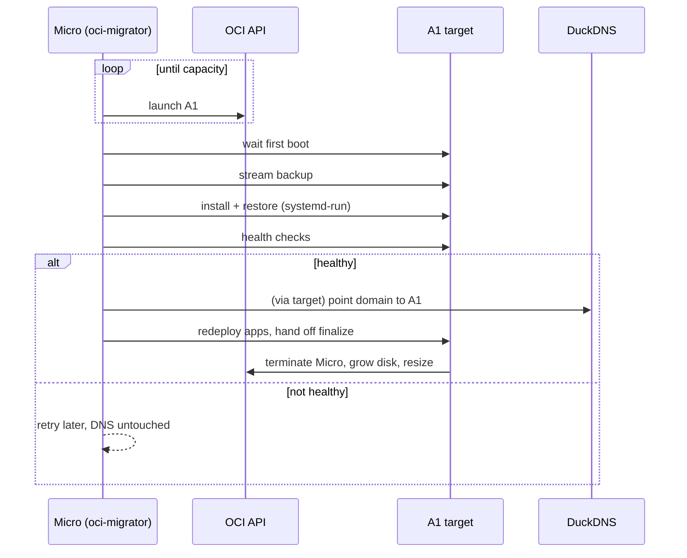

# ADR-0015: Self-migrating AMD → ARM

- **Status:** Accepted: 2026-10-28
- **Related:** [ADR-0004](0004-ampere-a1-target-amd-micro-standin.md), [ADR-0016](0016-least-privilege-automation-identity.md), [Migration chapter](../11-amd-to-arm-migration.md), [`scripts/migrate.py`](../../scripts/migrate.py), [`scripts/finalize.py`](../../scripts/finalize.py)

## Context

A1 capacity may appear at any hour, possibly days later. Retrying from a laptop ties the move to the
laptop being on. The move must also preserve Coolify's state (database, `APP_KEY`, certificates, SSH
keys, app volumes) and must never break the live site.

## Decision

Run `migrate.py` as a **systemd service on the Micro** (`Restart=always`, 5 min backoff). Stages are
idempotent and resumable via marker files on the target:

| # | Stage | Key detail |
|---|---|---|
| 1 | Launch A1 | All fault domains, 2/12 then 1/6, boot = 200 − used GB; cloud-init embeds `harden.sh` |
| 2 | First boot | Wait for `/var/log/setup-done` |
| 3 | Backup + stream | `pg_dump -Fc`, tar `/data/coolify`, app volumes; streamed over SSH (private IP) |
| 4 | Install + restore | Same Coolify version, `pg_restore --clean`, **restore old SSH keys** (installer regenerates them), volumes |
| 5 | **Health gate** | `https://<BASE_DOMAIN>/login` = 200 through Traefik with migrated cert + Coolify→host SSH = `root` |
| 6 | Cutover | Target DuckDNS on, source DuckDNS off; email + security automation installed; apps redeployed for arm64 via temporary API token (revoked after) |
| 7 | Finalize (on target) | Delete Micro, grow boot 150→200 GB online, resize to 2/12, shred API key |

**Validated by a dry run** (`--dry-run`, target = throwaway Micro) against the live instance. It
found and fixed four bugs before the real run:

| Bug | Fix |
|---|---|
| `sshd -t` fails on fresh boot (`/run/sshd` missing) | `mkdir -p /run/sshd` in `harden.sh` |
| SSH session dropped while the 1 GB target pulled images → restore killed | Restore runs **detached** via `systemd-run`, migrator polls |
| `ssh-keygen` on a `.lock` file + `pipefail` aborted restore | Skip `*.lock`/`*.pub` |
| tinker script unreadable (mktemp 600, PHP runs non-root) | `chmod 644` before `docker cp` |

## Consequences

**Positive**
- Laptop-independent; health-gated (the live site is never pointed at an unhealthy server).
- Emails at start, success and failure (6 h cooldown).

**Negative**
- Writes after the backup and before cutover are lost (app containers are stopped only during the
  backup, minutes of exposure).
- Requires an API identity on the VM ([ADR-0016](0016-least-privilege-automation-identity.md)).

## Alternatives considered

| Option | Why not |
|---|---|
| Laptop retry loop | Laptop must stay on |
| Fresh install on ARM, manual re-setup | Loses projects, secrets, certificates |
| Boot-volume clone | x86 image cannot boot on ARM |
