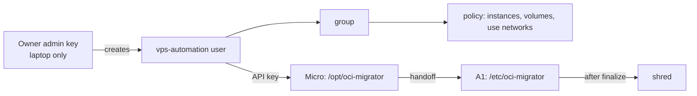

# ADR-0016: Least-privilege automation identity

- **Status:** Accepted: 2026-10-28 (creation requires explicit owner approval)
- **Related:** [ADR-0002](0002-headless-api-only-provisioning.md), [ADR-0015](0015-self-migrating-amd-to-arm.md), [ADR-0017](0017-secrets-handling.md)

## Context

The self-migration runs on an internet-facing VM. Placing the owner's **tenancy-admin** API key there
would turn any VM compromise into full account compromise (IAM, deletion of everything). Creating new
cloud credentials is itself a sensitive action; in this build, the agent's permission system
correctly blocked it until the owner explicitly approves.

## Decision

Create a dedicated identity (`<OCI_AUTOMATION_USER>`, e.g. `vps-automation`):

- **Group + policy**
  ```text
  Allow group vps-automation to manage instance-family in tenancy
  Allow group vps-automation to manage volume-family in tenancy
  Allow group vps-automation to use virtual-network-family in tenancy
  Allow group vps-automation to inspect compartments in tenancy
  ```
- **Capabilities:** API keys only: console password, auth tokens, SMTP credentials, customer secret
  keys, OAuth and DB credentials **disabled**.
- Fresh RSA-2048 API key generated locally; the private key is copied to the VM as root-only 600.
- After `finalize.py` completes, the key is **shredded** on the ARM VM and the migrator's SSH key is
  removed from `authorized_keys`. Afterwards the API key can be deleted from the user in IAM.



## Consequences

**Positive**
- A VM compromise cannot manage IAM, policies, budgets, or other services.
- On a free-only tenancy, even `manage instance-family` cannot create billable resources (limits = 0).

**Negative**
- Still powerful within compute: could delete/launch instances. Acceptable for a single-purpose
  tenancy; could be narrowed further with compartments.
- One more identity to audit and clean up.

## Alternatives considered

| Option | Why not |
|---|---|
| Admin key on the VM | Full account takeover risk |
| Instance principals (dynamic group) | Elegant (no key at all), but dynamic groups/policies must exist before launch and grant to every matching instance; good future refinement |
| Run migrator from laptop | Works with admin key locally but needs the laptop on |
