# ADR-0018: Unattended upgrades and automatic reboot

- **Status:** Accepted: 2026-10-28
- **Related:** [ADR-0014](0014-automated-security-guardrails-and-lockdown.md), [ADR-0013](0013-gmail-smtp-for-alerts.md), [Security automation](../10-security-automation.md)

## Context

Most real-world compromises exploit **known, already-patched** vulnerabilities. Right after first
boot the VM already reported `/var/run/reboot-required`. Docker Engine comes from Docker's own APT
repository, which Ubuntu's default unattended-upgrades configuration does **not** cover.

## Decision

`/etc/apt/apt.conf.d/20auto-upgrades` + `52vps-unattended`:

```text
APT::Periodic::Update-Package-Lists "1";
APT::Periodic::Unattended-Upgrade "1";
Unattended-Upgrade::Origins-Pattern { "origin=Docker,label=Docker CE"; };
Unattended-Upgrade::Mail "<ALERT_EMAIL>";
Unattended-Upgrade::MailReport "on-change";
Unattended-Upgrade::Remove-Unused-Kernel-Packages "true";
Unattended-Upgrade::Automatic-Reboot "true";
Unattended-Upgrade::Automatic-Reboot-Time "04:00";
```

- Ubuntu security + updates pockets (default) **and Docker CE** are patched daily.
- Email on every change; `health-check` also emails "reboot required"; `boot-notify` emails after
  every boot so unexpected restarts are visible.
- Coolify updates itself daily (its own auto-update), and `security-watch` force-upgrades on
  security releases ([ADR-0014](0014-automated-security-guardrails-and-lockdown.md)).

```mermaid
gantt
  dateFormat HH:mm
  axisFormat %H:%M
  title Daily maintenance window (local time)
  section OS
  apt-daily-upgrade (randomized)   :06:00, 30m
  auto-reboot if required          :04:00, 5m
  section App
  Coolify auto-update              :06:25, 15m
  section Reporting
  Daily health report              :09:00, 5m
```



## Consequences

**Positive**
- Kernel, OpenSSH, glibc, Docker fixes land within ~24 h without human action.

**Negative**
- Nightly reboot can cause a few minutes of downtime when required (all containers restart via
  restart policies).
- A bad upstream package could break the host; mitigated by email reports and daily health summary.

## Alternatives considered

| Option | Why not |
|---|---|
| Manual patching | Relies on human attention |
| Canonical Livepatch | Free for personal use but needs Ubuntu Pro enrollment; future option to reduce reboots |
| Security-only, no Docker origin | Leaves the container runtime unpatched |
