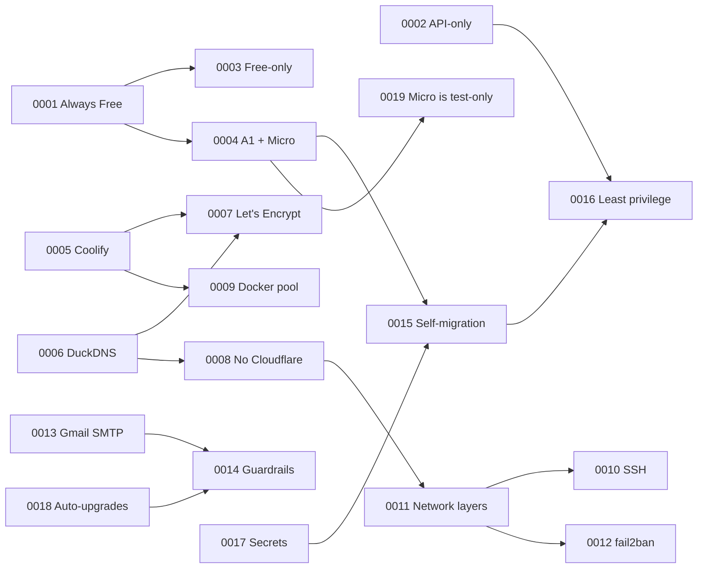

# Architecture Decision Records

Each significant choice in this build is recorded as an **ADR**: a short document that captures
*why* something was done, what else was considered, and what it costs. If you fork this setup and
change a decision, add a new ADR that **supersedes** the old one instead of editing history.

## Format (MADR-style)

| Section | Purpose |
|---|---|
| **Status** | `Proposed` → `Accepted` → (`Deprecated` \| `Superseded by ADR-NNNN`) + date |
| **Context** | The forces at play: constraints, facts, problems observed |
| **Decision** | What we do, stated plainly |
| **Consequences** | Positive and negative results we accept |
| **Alternatives considered** | Options rejected and why |
| **Related** | Links to other ADRs, docs chapters and scripts |

## Index

| # | Title | Status | Decision in one line |
|---|---|---|---|
| [0001](0001-oracle-cloud-always-free.md) | Oracle Cloud Always Free as the host | Accepted | Use OCI Always Free (Ampere A1 + E2.1.Micro, 200 GB, 10 TB egress) as a $0 production host |
| [0002](0002-headless-api-only-provisioning.md) | Headless, API-only provisioning | Accepted | Provision everything with an API key + OCI Python SDK; never click in the console |
| [0003](0003-stay-free-only-no-payg.md) | Stay on a free-only tenancy (no Pay-As-You-Go) | Accepted | Accept lower limits and reclaim risk to make billing structurally impossible |
| [0004](0004-ampere-a1-target-amd-micro-standin.md) | Ampere A1 target, AMD Micro stand-in | Accepted | Run on an E2.1.Micro now; auto-move to A1 when capacity appears, keeping the full 200 GB |
| [0005](0005-coolify-as-paas.md) | Coolify as the PaaS layer | Accepted | Coolify v4 gives Vercel/Netlify-style git deploys, per-app HTTPS and a UI on one VM |
| [0006](0006-duckdns-wildcard-dns.md) | DuckDNS with wildcard sub-names | Accepted | Free DuckDNS name; `*.<BASE_DOMAIN>` resolves automatically, one host per app |
| [0007](0007-letsencrypt-http01-via-traefik.md) | Let's Encrypt HTTP-01 via Traefik | Accepted | Coolify's Traefik issues and renews a certificate per hostname automatically |
| [0008](0008-no-cloudflare-with-duckdns.md) | No Cloudflare proxy with DuckDNS | Accepted | Cloudflare needs nameserver control; harden the origin instead, revisit with an own domain |
| [0009](0009-docker-address-pool-172-20.md) | Docker address pool `172.20.0.0/14` | Accepted | Override Coolify's default `10.0.0.0/8` pool which overlaps the VCN |
| [0010](0010-ssh-key-only-nonstandard-port.md) | Key-only SSH on a non-standard port | Accepted | Public SSH only on `<SSH_PORT>` (22022); port 22 stays internal for Coolify |
| [0011](0011-defense-in-depth-network-layers.md) | Defense-in-depth network layers | Accepted | OCI security list + host INPUT + `DOCKER-USER`, because Docker DNAT bypasses INPUT |
| [0012](0012-fail2ban-for-ssh-and-coolify-login.md) | fail2ban for SSH and the Coolify login | Accepted | Ban brute-force IPs from sshd and Coolify's audit log; 2FA on the admin |
| [0013](0013-gmail-smtp-for-alerts.md) | Gmail SMTP for alerts | Accepted | msmtp + Google App Password on 587/STARTTLS for every alert channel |
| [0014](0014-automated-security-guardrails-and-lockdown.md) | Automated security guardrails & lockdown | Accepted | Watch trusted feeds, auto-patch Coolify, contain intrusions by stopping the control plane |
| [0015](0015-self-migrating-amd-to-arm.md) | Self-migrating AMD → ARM | Accepted | A service on the Micro moves Coolify to A1 with a health-gated DNS cutover |
| [0016](0016-least-privilege-automation-identity.md) | Least-privilege automation identity | Accepted | A dedicated IAM user limited to instances/volumes/networking, key shredded after use |
| [0017](0017-secrets-handling.md) | Secrets handling | Accepted | Secrets only in git-ignored `keys/` and root-only 600 files on the VM; none in user_data |
| [0018](0018-unattended-upgrades-and-auto-reboot.md) | Unattended upgrades & auto-reboot | Accepted | Daily Ubuntu + Docker security patches, emailed, auto-reboot at 04:00 when required |
| [0019](0019-amd-micro-is-test-only.md) | AMD Micro is test-only, A1 is production | Accepted | Measured: 1 GB / 1/8 OCPU is too slow for production Coolify; tuned test box, untuned A1 |

